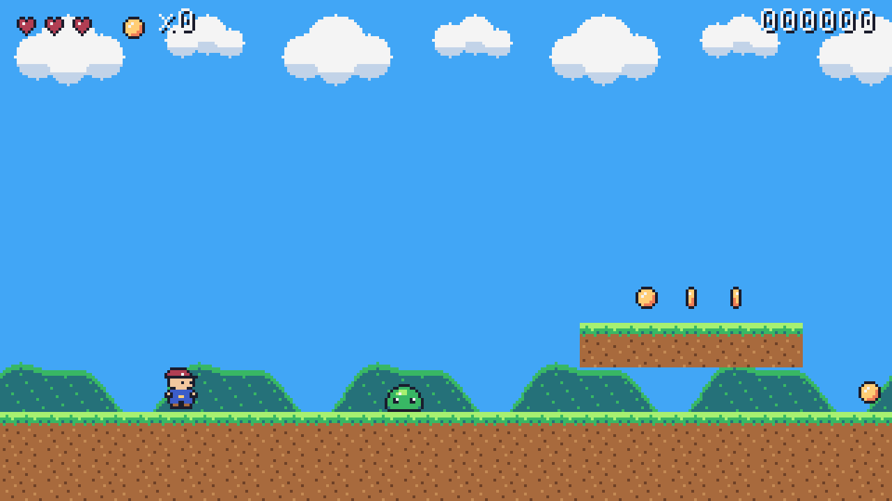
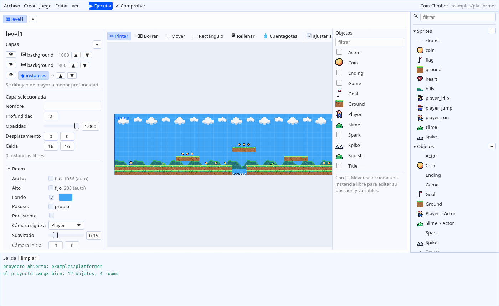

# Mod Engine

Motor de juegos 2D escrito en Rust y organizado como los motores clásicos de "objetos y eventos":
defines **objetos** con **eventos** (`create`, `step`, `draw`, `collision`...), colocas **instancias**
de esos objetos en **rooms** y escribes la lógica en **ModScript**, un lenguaje de script pequeño
pensado para eso.



## Probarlo

```bash
cargo build --release
./target/release/modeditor examples/platformer      # editor visual
./target/release/modengine run examples/platformer  # solo el juego
```



Controles del ejemplo: flechas/WASD para moverte, ESPACIO para saltar, ESC para volver al título.
En cualquier juego: **F3** muestra la capa de depuración (fps, instancias, cajas de colisión),
**F4** pantalla completa y **F12** guarda una captura.

Crear un proyecto nuevo (también desde la pantalla de inicio del editor):

```bash
./target/release/modengine new mi_juego
./target/release/modeditor mi_juego
```

## Cómo es un proyecto

```text
mi_juego/
  game.toml            nombre, resolución, orden de rooms, paleta de colores
  sprites/*.toml|png   imágenes: PNG (tiras o rejillas de frames) o pixel art escrito en el TOML
  sounds/*.toml|wav|ogg  audio, o efectos sintetizados descritos en el TOML
  fonts/*.toml|ttf     fuentes
  rooms/*.toml         niveles: tamaño, capas, instancias, mapas ASCII, cámara
  **/*.ms              ModScript: objetos, funciones y código inicial
```

Un objeto completo:

```js
object Coin {
    sprite = coin            // propiedades: se asignan a cada instancia nueva

    on step {
        y = ystart + dsin(steps() * 4) * 1.5
    }

    on collision(Player) {
        global.score += 10
        play_sound(snd_coin)
        destroy()
    }
}
```

Y una room que lo usa, dibujada con caracteres:

```toml
[[layer]]
type = "instances"
cell = [16, 16]
legend = { "#" = "Ground", "@" = "Player", "o" = "Coin" }
map = '''
.....ooo......
....#####.....
.@............
##############
'''
```

## De dónde viene cada idea

| Concepto (motores de objetos/eventos) | En Mod Engine |
|---|---|
| Objeto con eventos | `object Nombre : Padre { on step { ... } }` en ficheros `.ms` |
| Variables de instancia por defecto | líneas `nombre = valor` dentro del objeto |
| Herencia y "llamar al evento del padre" | `object Hijo : Padre` e `inherited()` |
| Room con capas | `rooms/*.toml` con capas `background`, `tiles` e `instances` |
| Colocar instancias en el editor de rooms | mapas ASCII con leyenda, o listas `instances = [...]` |
| Alarmas | `alarm[0] = 60` + `on alarm(0)` |
| `with`, `self`, `other`, `all` | mismos conceptos, sintaxis propia |
| Sprites con origen, frames y máscara | `sprites/*.toml` (PNG o pixel art en texto) |
| Variables globales | `global.nombre` |
| Instancias y rooms persistentes | `persistent = true` (objeto) / `persistent = true` (room) |
| Vista / cámara que sigue a un objeto | `[camera] follow = "Player"` + `camera_*()` |

## Documentación

- [docs/editor.md](docs/editor.md): el editor visual (rooms, objetos, sprites, sonidos, scripts).
- [docs/lenguaje.md](docs/lenguaje.md): ModScript paso a paso.
- [docs/proyecto.md](docs/proyecto.md): `game.toml`, sprites, sonidos, fuentes y rooms.
- [docs/funciones.md](docs/funciones.md): todas las funciones integradas.
- [docs/arquitectura.md](docs/arquitectura.md): cómo está hecho el motor y el orden exacto del bucle de juego.

## Línea de comandos

```text
modengine run <proyecto> [--room R] [--exec CODIGO] [--input SPEC] [--screenshot f.png] [--frames N]
modengine check <proyecto> [--room R] [--exec CODIGO] [--input SPEC] [--steps N] [--watch Objeto]
modengine new <carpeta>
modengine functions
```

`check` ejecuta el juego sin ventana y falla si hay errores de script: sirve para tests y CI.
`--input "10-200:right,30:space"` simula teclas (mantener `right` de los pasos 10 a 200, pulsar
`space` en el paso 30) y `--exec "with Player x = 800"` ejecuta código al arrancar.

## Estructura del código

| Crate | Qué contiene |
|---|---|
| `crates/modscript` | El lenguaje: lexer, parser, intérprete. No sabe nada de juegos. |
| `crates/modengine` | El motor: carga de proyectos, objetos, eventos, rooms, colisiones, cámara, funciones integradas. No depende de ninguna librería gráfica: produce una lista de órdenes de dibujo. |
| `crates/modengine-cli` | El ejecutable `modengine`: ventana, dibujo, input y audio con [macroquad](https://macroquad.rs), más el modo sin ventana. |
| `crates/modengine-editor` | El editor visual `modeditor` (con [egui](https://github.com/emilk/egui)): navegador de assets y editores de rooms, objetos, sprites, sonidos, scripts y ajustes. |

```bash
cargo test     # lenguaje, motor (juega el ejemplo sin ventana) y editor (con ratón simulado)
```

Disclaimer: Esto nace de un proyecto personal, para mi uso personal. Puedes usarlo pero no esperes que te de soporte.

## Licencia

Mod Engine se distribuye bajo la [licencia MIT](LICENSE). Puedes usarlo, modificarlo y
redistribuirlo libremente (también en proyectos comerciales), con una única condición:
**debes atribuirme**. Cualquier copia o parte sustancial del código debe conservar el aviso de
copyright y el texto de la licencia:

```text
Copyright (c) 2026 evilrender23
```

Si usas Mod Engine o parte de su código en tu proyecto, incluye un crédito visible, por ejemplo:
"Basado en Mod Engine de evilrender23 (https://github.com/evilrender23)".
