# Mod Engine

Motor de juegos 2D escrito en Rust y organizado como los motores clásicos de "objetos y eventos":
defines **objetos** con **eventos** (`create`, `step`, `draw`, `collision`...), colocas **instancias**
de esos objetos en **rooms** y escribes la lógica en **ModScript**, un lenguaje de script pequeño
pensado para eso. Exporta a Windows, Linux y Android, y trae **multijugador por red** (host y
clientes por LAN o Internet, al estilo de GameMaker; ver [docs/red.md](docs/red.md)).

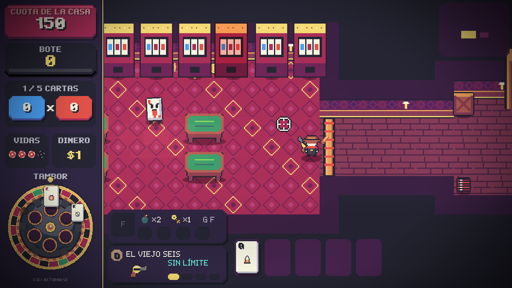

*RogueShot*, un roguelike de disparos en un casino, es la demo técnica: menús con cartas, salas
generadas, combate con ratón, efectos de shader y música con intro y bucle, todo en ModScript.

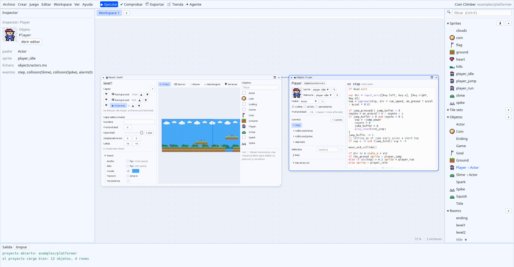

## Instalación

Un solo comando compila el motor y el editor y los instala en el sistema. Si falta algo (Rust 1.95+,
un compilador de C, Git y, en Linux, ALSA), pregunta antes de instalarlo.

**Linux y Mac:**

```bash
curl -fsSL https://raw.githubusercontent.com/evilrender23/Mod-Engine/master/instalar.sh | bash
```

**Windows** (PowerShell):

```powershell
irm https://raw.githubusercontent.com/evilrender23/Mod-Engine/master/instalar.ps1 | iex
```

También desde un clon: `bash Mod-Engine/instalar.sh` o
`powershell -ExecutionPolicy Bypass -File Mod-Engine\instalar.ps1`.

| | Código y caché | Programas | Comandos | Acceso |
|---|---|---|---|---|
| Linux | `~/.local/share/ModEngine/codigo` | `~/.local/share/ModEngine/app` | enlaces en `~/.local/bin` | menú de aplicaciones |
| Mac | `~/Library/Application Support/ModEngine/codigo` | `…/ModEngine/app` | enlaces en `~/.local/bin` | `~/Applications/Mod Engine Editor.app` |
| Windows | `%LOCALAPPDATA%\ModEngine\codigo` | `%LOCALAPPDATA%\ModEngine\app` | `app` en el PATH del usuario | menú Inicio |

Para actualizar, vuelve a ejecutar el mismo comando: trae lo último de `master` y recompila
aprovechando la caché. Opciones: `--repo`, `--rama`, `--destino` y `--bin` (en Windows `-Repo`,
`-Rama` y `-Destino`). Junto a los programas queda el ejemplo `examples/platformer`.

## Probarlo

```bash
cargo build --release
./target/release/modeditor examples/platformer      # editor visual
./target/release/modengine run examples/platformer  # solo el juego
```

Controles del ejemplo: flechas/WASD para moverte, ESPACIO para saltar, ESC para volver al título.
Dungeon crawler con cartas: `./target/release/modengine run examples/crawler` (Cripta de Naipes,
ver [docs/plantilla-crawler.md](docs/plantilla-crawler.md)).
Multijugador: abre `examples/multijugador` en el editor y usa **Juego → ▶▶ Ejecutar 2 instancias**
(H en una ventana para ser host, J en la otra para unirte).
En cualquier juego: **F3** muestra la capa de depuración (fps, instancias, cajas de colisión),
**F4** pantalla completa y **F12** guarda una captura.

Crear o abrir proyectos: `./target/release/modeditor` sin argumentos muestra la **página de
inicio** con botones grandes **＋ Nuevo proyecto** (nombre, carpeta, plantilla *Vacío*, *Básico*,
*Plataformas*, *Top-down*, *Crawler de cartas* o *Showcase*, tamaño de pantalla y paleta), **📂 Abrir proyecto…** (un
explorador que marca con 🎮 las carpetas que son proyectos, o el diálogo del sistema) y **Abrir
ejemplo**, más tus proyectos recientes como tarjetas. También puedes arrastrar a la ventana la
carpeta de un proyecto o su `game.toml`. Desde la terminal:

```bash
./target/release/modengine new --template platformer --name "Mi juego" mi_juego
./target/release/modeditor mi_juego          # o mi_juego/game.toml
./target/release/modengine store search coin --licencia cc0   # assets gratis de OpenGameArt (store get los importa con sus créditos)
```

## Capturas

| | |
|---|---|
| 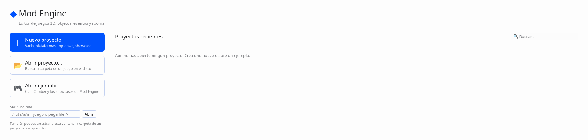 **Página de inicio:** nuevo proyecto con plantillas, abrir, ejemplos y recientes. |  **Rooms:** capas, pincel de objetos, rejilla y cámara. |
| 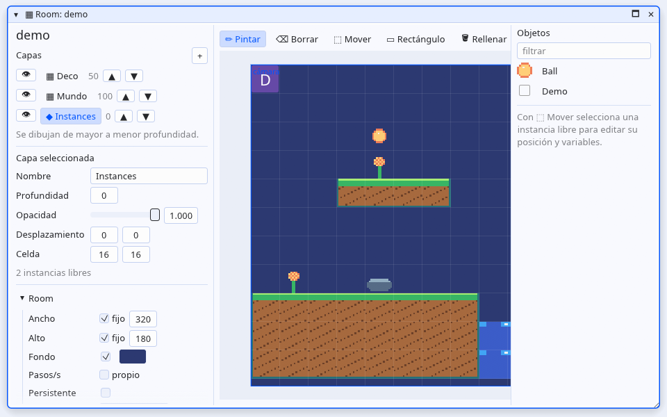 **Tile sets:** pinta tiles en las capas, con auto tile y tiles animados. | 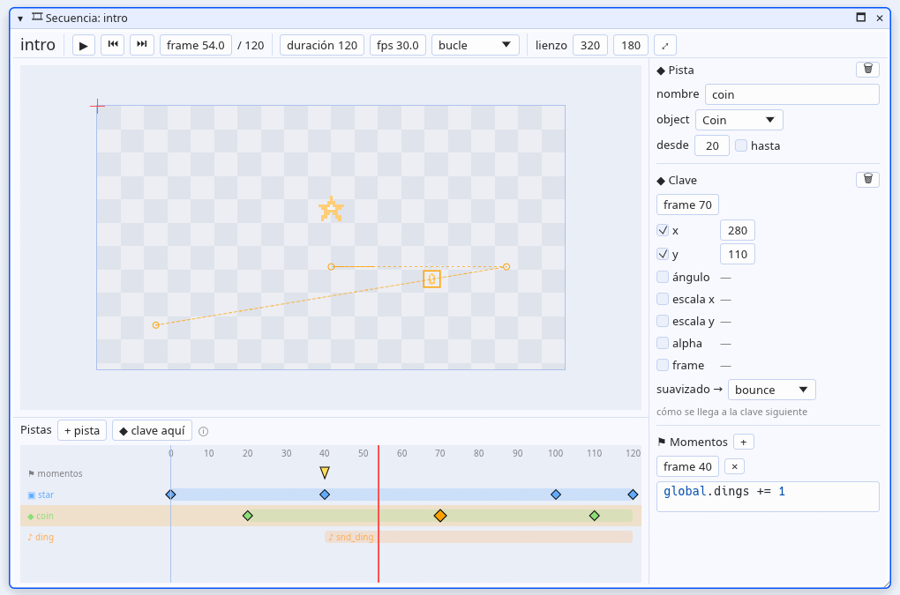 **Secuencias:** pistas, claves y suavizado con vista previa. |
| 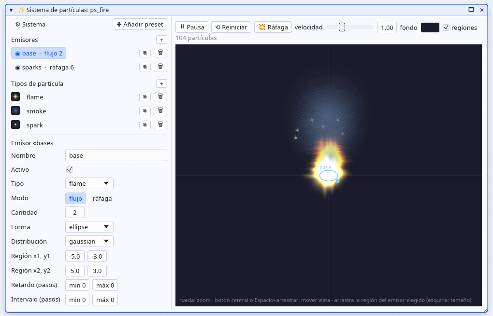 **Partículas:** emisores y tipos con vista previa animada. | 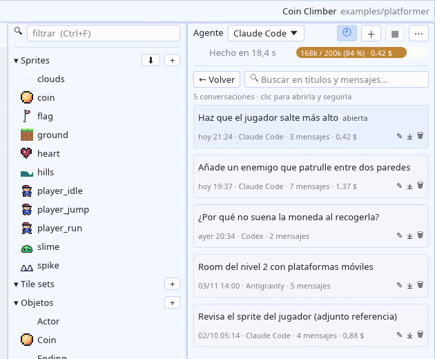 **Agente:** Claude Code, Codex o Antigravity trabajando en el proyecto, con historial. |
| 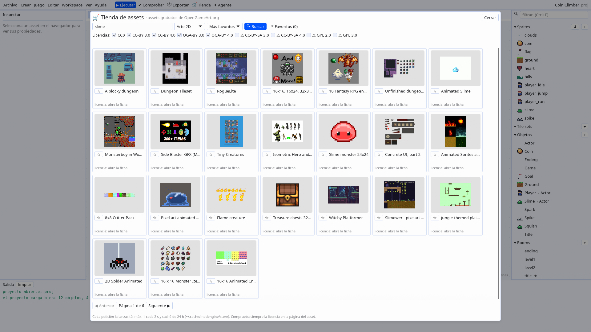 **Tienda:** assets gratuitos de OpenGameArt con sus licencias y créditos. | 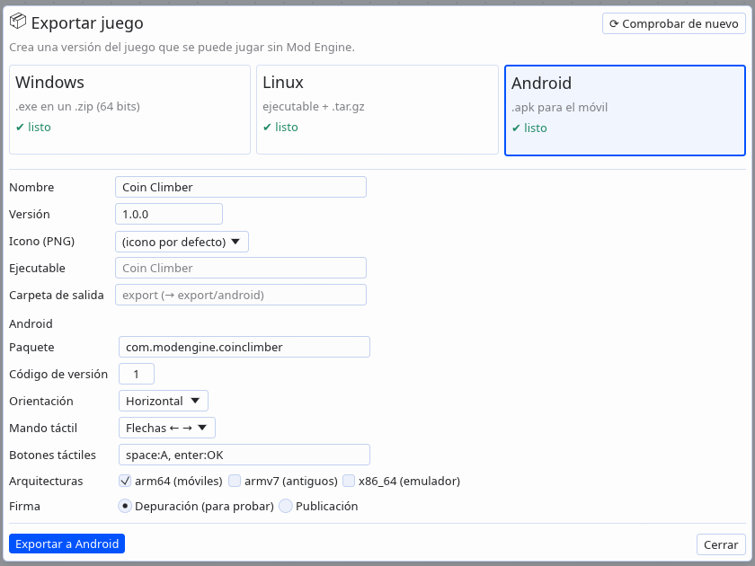 **Exportar:** Windows, Linux y Android. |
| 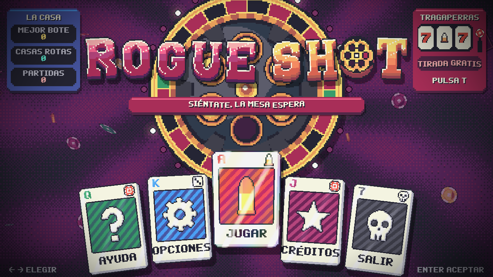 **RogueShot:** menú principal con cartas. | 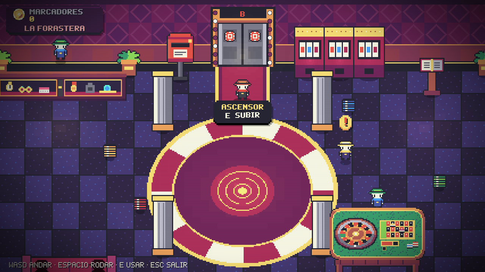 **RogueShot:** el vestíbulo del casino. |
| 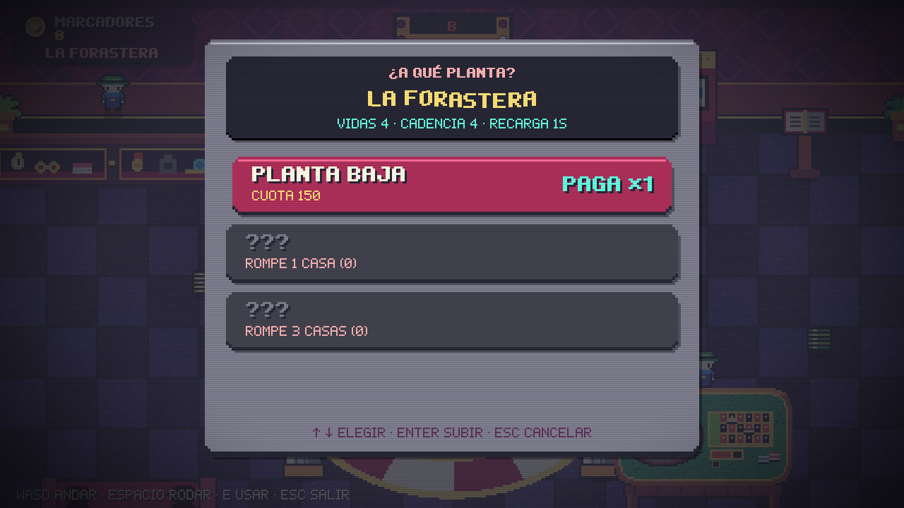 **RogueShot:** elegir planta en el ascensor. | 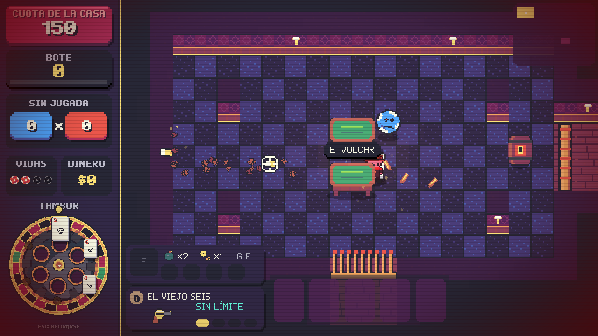 **RogueShot:** combate en una sala generada. |
| 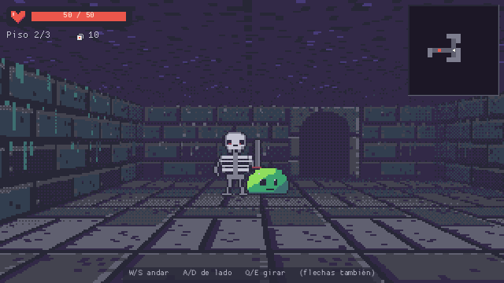 **Cripta de Naipes** (plantilla `crawler`): mazmorra en primera persona por casillas, con minimapa. | 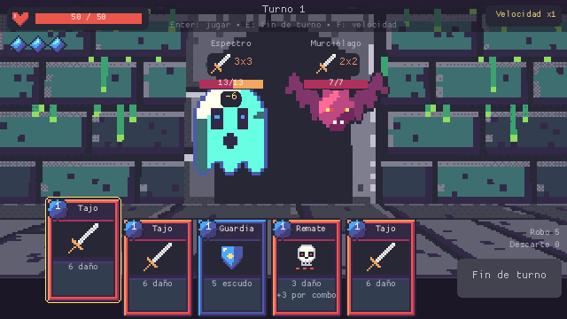 **Cripta de Naipes:** combate de cartas con intenciones y proyección del daño. |

## Cómo es un proyecto

```text
mi_juego/
  game.toml            nombre, resolución, orden de rooms, paleta de colores
  sprites/*.toml|png   imágenes: PNG (tiras o rejillas de frames) o pixel art escrito en el TOML
  sounds/*.toml|wav|ogg  audio, o efectos sintetizados descritos en el TOML
  fonts/*.toml|ttf     fuentes
  rooms/*.toml         niveles: tamaño, capas, instancias, mapas ASCII, cámara
  **/*.ms              ModScript: objetos, funciones y código inicial
```

Un objeto completo:

```js
object Coin {
    sprite = coin            // propiedades: se asignan a cada instancia nueva

    on step {
        y = ystart + dsin(steps() * 4) * 1.5
    }

    on collision(Player) {
        global.score += 10
        play_sound(snd_coin)
        destroy()
    }
}
```

Y una room que lo usa, dibujada con caracteres:

```toml
[[layer]]
type = "instances"
cell = [16, 16]
legend = { "#" = "Ground", "@" = "Player", "o" = "Coin" }
map = '''
.....ooo......
....#####.....
.@............
##############
'''
```

## De dónde viene cada idea

| Concepto (motores de objetos/eventos) | En Mod Engine |
|---|---|
| Objeto con eventos | `object Nombre : Padre { on step { ... } }` en ficheros `.ms` |
| Variables de instancia por defecto | líneas `nombre = valor` dentro del objeto |
| Herencia y "llamar al evento del padre" | `object Hijo : Padre` e `inherited()` |
| Room con capas | `rooms/*.toml` con capas `background`, `tiles` e `instances` |
| Colocar instancias en el editor de rooms | mapas ASCII con leyenda, o listas `instances = [...]` |
| Alarmas | `alarm[0] = 60` + `on alarm(0)` |
| `with`, `self`, `other`, `all` | mismos conceptos, sintaxis propia |
| Sprites con origen, frames y máscara | `sprites/*.toml` (PNG o pixel art en texto) |
| Variables globales | `global.nombre` |
| Instancias y rooms persistentes | `persistent = true` (objeto) / `persistent = true` (room) |
| Vista / cámara que sigue a un objeto | `[camera] follow = "Player"` + `camera_*()` |

## Documentación

- [docs/editor.md](docs/editor.md): el editor visual (rooms, objetos, sprites, sonidos, scripts).
- [docs/editor.md#agente](docs/editor.md#agente): el panel **Agente**, que conversa con Claude Code, Antigravity o Codex para que editen el proyecto.
- [docs/pixel-art.md](docs/pixel-art.md): **dibujar pixel art mediante código** (la guía que sigue el agente) y `modengine pixel-check`, que comprueba filas, paleta, alfa, anclaje y tiles y genera vistas previas.
- [docs/lenguaje.md](docs/lenguaje.md): ModScript paso a paso.
- [docs/proyecto.md](docs/proyecto.md): `game.toml`, sprites, sonidos, fuentes y rooms.
- [docs/funciones.md](docs/funciones.md): todas las funciones integradas.
- [docs/datos-y-cartas.md](docs/datos-y-cartas.md): **contenido como datos** (tablas `data/` con esquema, editables en el editor), mazos de cartas y la cola de acciones para separar lógica y presentación en juegos por turnos.
- [docs/mazmorras.md](docs/mazmorras.md): **mazmorras procedurales** (salas de plantillas ASCII o rooms, Delaunay + árbol mínimo + bucles, pasillos A\*, camino principal, eventos por reglas, reproducibles con semilla) y `modengine dungeon` para afinarlas con vistas previas PNG; rejillas `ds_grid`.
- [docs/plantilla-crawler.md](docs/plantilla-crawler.md): **Cripta de Naipes** (`modengine new --template crawler`), un *dungeon crawler* completo con combate de cartas: cómo está organizado, dónde añadir cartas, enemigos y salas, y cómo probarlo con saltos de depuración.
- [docs/exportar.md](docs/exportar.md): crear el juego para **Windows (.exe), Linux y Android (.apk)**.
- [docs/red.md](docs/red.md): **multijugador** por red local o Internet: `net_host`/`net_join`/`net_send`, o sockets y buffers como en GameMaker, y servidores sin ventana.
- [docs/arquitectura.md](docs/arquitectura.md): cómo está hecho el motor y el orden exacto del bucle de juego.
- [docs/pruebas.md](docs/pruebas.md): **probar el juego desde la terminal**: ratón simulado, capturas en pasos exactos sin ventana, `--seed`, `--assert`, `--no-save`, objetos de prueba y `--profile`.

## Línea de comandos

```text
modengine run <proyecto> [--room R] [--exec CODIGO] [--input SPEC] [--screenshot f.png] [--frames N]
modengine check <proyecto> [--room R] [--exec CODIGO] [--input SPEC] [--steps N] [--watch Objeto]
modengine server <proyecto> [--room R] [--exec CODIGO] [--input SPEC] [--steps N]   # sin ventana, en tiempo real (multijugador)
modengine new [--template vacio|basico|plataformas|top-down|crawler|showcase] [--name "Nombre"] <carpeta>
modengine new --template list                     # las plantillas
modengine export <proyecto> --target windows|linux|android [--out CARPETA] [--release]
modengine export --setup windows|linux|android   # instala lo que falte (en tu carpeta de usuario)
modengine export --doctor                         # qué plataformas están listas
modengine pixel-check <proyecto> <sprite>... | --all [--preview auto] [--tile] [--size 16x16]   # revisa pixel art (docs/pixel-art.md)
modengine dungeon <proyecto> <config.toml|tabla:id> --seed 1,2,3 --png out.png   # genera y dibuja mazmorras (docs/mazmorras.md)
modengine functions
```

`check` ejecuta el juego sin ventana y falla si hay errores de script: sirve para tests y CI.
`--input "10-200:right,30:space"` simula teclas (mantener `right` de los pasos 10 a 200, pulsar
`space` en el paso 30; `40:text=Ana` escribe «Ana») y `--exec "with Player x = 800"` ejecuta
código al arrancar. `run --instance N` pone la ventana N al lado de las demás para probar el
multijugador con varias copias; `server` (= `run --headless`) es un servidor dedicado.

Para pruebas automáticas (ver [docs/pruebas.md](docs/pruebas.md)): `--input` también mueve el
ratón y pulsa botones (`10:mouse=320,200, 20-80:mb_left, 90:wheel_up`), `--screenshot-at 200,500`
guarda capturas en esos pasos lógicos sin mostrar la ventana (`--crop x,y,w,h`), `--seed N` hace
reproducible el azar, `--exec-at PASO:CÓDIGO` y `--assert [PASO:]EXPR` (código de salida 3 si
falla), `--no-save` / `--save-dir DIR` protegen las partidas, `--test-script f.ms` añade objetos de
prueba y `--profile` mide cada evento. `check` devuelve 1 si hubo errores de ejecución.

## Estructura del código

| Crate | Qué contiene |
|---|---|
| `crates/modscript` | El lenguaje: lexer, parser, intérprete. No sabe nada de juegos. |
| `crates/modengine` | El motor: carga de proyectos, objetos, eventos, rooms, colisiones, cámara, funciones integradas. No depende de ninguna librería gráfica: produce una lista de órdenes de dibujo. |
| `crates/modengine-cli` | El ejecutable `modengine`: ventana, dibujo, input y audio con [macroquad](https://macroquad.rs), más el modo sin ventana. |
| `crates/modengine-editor` | El editor visual `modeditor` (con [egui](https://github.com/emilk/egui)): navegador de assets y editores de rooms, objetos, sprites, sonidos, scripts y ajustes. |

```bash
cargo test     # lenguaje, motor (juega el ejemplo sin ventana) y editor (con ratón simulado)
```

Disclaimer: Esto nace de un proyecto personal, para mi uso personal. Puedes usarlo pero no esperes que te de soporte.

## Licencia

Mod Engine se distribuye bajo la [licencia MIT](LICENSE). Puedes usarlo, modificarlo y
redistribuirlo libremente (también en proyectos comerciales), con una única condición:
**debes atribuirme**. Cualquier copia o parte sustancial del código debe conservar el aviso de
copyright y el texto de la licencia:

```text
Copyright (c) 2026 evilrender23
```

Si usas Mod Engine o parte de su código en tu proyecto, incluye un crédito visible, por ejemplo:
"Basado en Mod Engine de evilrender23 (https://github.com/evilrender23)".
