# Editor visual (`modeditor`)

```bash
cargo build --release              # compila el motor, el editor y el ejecutable del juego
./target/release/modeditor examples/platformer
```

Sin argumentos abre la [página de inicio](#proyectos) para crear, abrir o retomar un proyecto.
`modeditor <carpeta>` y `modeditor <carpeta>/game.toml` abren ese proyecto directamente. El editor
trabaja directamente sobre los ficheros del proyecto (`game.toml`, `sprites/`, `rooms/`, `.ms`...),
así que puedes alternar entre el editor y tu editor de texto favorito.

## Proyectos

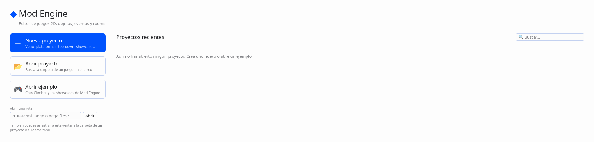

**Página de inicio** (sin proyecto abierto):

| | |
|---|---|
| **＋ Nuevo proyecto** (Ctrl+N) | Diálogo con nombre, ubicación (por defecto `~/Documentos/ModEngine`, o la última que usaste; **📂 Elegir…** abre el explorador de carpetas), plantilla, tamaño de pantalla y paleta. Debajo se ve la carpeta exacta que se creará y, si algo no vale (nombre vacío o con `/ \ : * ? " < > \|`, carpeta que ya existe y no está vacía, ya hay un proyecto ahí…), por qué. **Crear proyecto** lo crea y lo abre. |
| **📂 Abrir proyecto…** (Ctrl+O) | Explorador de carpetas (Inicio, Escritorio, Documentos, discos montados, favoritos ☆ y carpetas recientes). Las carpetas que son proyectos de Mod Engine (tienen `game.toml`) salen con 🎮 y el nombre del juego; doble clic las abre. También vale elegir el propio `game.toml` o pegar su ruta. **🗔 Usar el diálogo del sistema** abre el selector de carpetas de tu escritorio (portal XDG en KDE/GNOME, el de Windows o macOS). |
| **Abrir ejemplo** | Coin Climber y los showcases que vienen con Mod Engine (junto al editor instalado o en `examples/`). **Abrir una copia** la deja en tu carpeta de proyectos para cambiarla sin miedo; **Abrir el original** abre el ejemplo tal cual. |
| Recientes | Tarjetas con el nombre del juego (`[game] name`), la carpeta, cuándo lo abriste y una miniatura (`screenshot.png`/`thumbnail.png`/`icon.png` del proyecto, o el primer sprite: el del jugador si lo hay). 📍 fija un proyecto arriba, × lo quita de la lista (no borra nada). Los que ya no están en su carpeta salen en gris con **🔍 Localizar…** para decir dónde están ahora. Arriba a la derecha, **Buscar** filtra por nombre o ruta. |
| Abrir una ruta | Escribe o pega una ruta (`~/…`, `file://…`, la carpeta o su `game.toml`). |

También puedes **arrastrar a la ventana** la carpeta de un proyecto o su `game.toml` (con un
proyecto abierto, eso abre el otro en vez de importar).

**Plantillas** (las mismas que `modengine new --template …`):

| Plantilla | Qué trae |
|---|---|
| Vacío (`empty`) | `game.toml` con la paleta elegida y una room vacía |
| Básico (`basic`, la de `modengine new` sin más) | Un personaje que se mueve con flechas/WASD |
| Plataformas (`platformer`) | Copia de Coin Climber (`examples/platformer`): gravedad, saltos, enemigos, 4 rooms, sonidos |
| Top-down (`topdown`) | Vista cenital: muros, gemas que recoger y un marcador |
| Showcase (`showcase`) | Trayectorias, timelines, curvas y secuencias (`examples/showcase_assets_s2`) |

*Pantalla* cambia `[display] width/height/scale` (por defecto, el de la plantilla) y *Paleta*
pone una de tus paletas guardadas (Pear36 y las de [Paletas](#paletas-lospec)) y pasa cada
sprite de la plantilla al color más parecido. Las plantillas van dentro del programa, así que
funcionan igual en una copia instalada.

**Menú Archivo** con un proyecto abierto: **＋ Nuevo proyecto…** (Ctrl+Mayús+N), **📂 Abrir
proyecto…** (Ctrl+O), **Abrir reciente ▸**, **🗁 Mostrar en el gestor de archivos** y **Cerrar
proyecto**. Si hay cambios sin guardar, antes de cambiar de proyecto o cerrarlo pregunta
*Guardar y continuar / Descartar cambios / Cancelar*.

Los recientes se guardan en `~/.config/modengine/recent.txt` (ruta, fijado y fecha), la última
ubicación en `new_project_dir.txt` y los favoritos del explorador en `project_favorites.txt`.

## La ventana

| Zona | Qué hay |
|---|---|
| Arriba | Menús (Archivo, Crear, Juego, Editar, Workspace, Ver) y los botones ▶ Ejecutar y ✔ Comprobar |
| Izquierda | **Inspector**: miniatura y datos del asset seleccionado (tamaño, fotogramas, padre, eventos, hijos, variables con tipo, capas de la room…) y *Abrir editor* |
| Derecha | Navegador de assets: sprites (con miniatura), tile sets, objetos (con su padre), rooms (★ = la inicial), sonidos, fuentes, scripts, notas y el resto de tipos del menú Crear. Clic = verlo en el inspector, **doble clic = abrirlo en el workspace**. **+** crea uno nuevo; clic derecho → Eliminar |
| Centro | **Workspaces**: pestañas *Workspace 1, 2…* y, en cada una, un lienzo con los editores como ventanas flotantes |
| Abajo | Salida: problemas del proyecto, mensajes de `print()` y errores del juego en marcha |

Los paneles laterales se ocultan desde **Ver**, donde también está el panel **Agente** (ver [Agente](#agente)).

**Juego → ▶▶ Ejecutar 2 instancias** lanza dos copias del juego, una al lado de la otra (`[1]` y
`[2]` en el título), para probar el multijugador en un solo ordenador; en la Salida cada línea
lleva delante `[1]` o `[2]`, y ■ Detener cierra las dos. Ver [red.md](red.md#probar-en-un-solo-ordenador).

### Menú Crear y atajos Alt

Como el menú *Create* de GameMaker, **Crear** (en la barra de menús, con clic derecho en el
fondo del navegador de assets y en la cabecera de cada sección) lista todos los tipos de asset
con su icono y su atajo, que abre directamente el diálogo de nuevo asset:

| Tipo | Atajo | | Tipo | Atajo |
|---|---|---|---|---|
| Curva de animación | Alt+J | | Script | Alt+C |
| Extensión | Alt+E | | Secuencia | Alt+G |
| Fuente | Alt+F | | Shader | Alt+A |
| Línea de tiempo | Alt+T | | Sistema de partículas | Alt+K |
| Nota | Alt+N | | Sonido | Alt+S |
| Objeto | Alt+O | | Sprite | **Alt+I** |
| Room | Alt+R | | Tile set | Alt+B |
| Trayectoria | Alt+P | | Sprite desde un PNG | (sin atajo) |

GameMaker usa Alt+S para Sonido y para Sprite; aquí Sprite es **Alt+I** (imagen) para que ningún
atajo se repita. Los atajos no actúan con un diálogo abierto. Un tipo que todavía no tenga editor
aparece desactivado («próximamente»). El navegador tiene una sección por tipo, con **+** para
crear y su orden propio.

Para programadores: el menú y las secciones salen de dos tablas de
`crates/modengine-editor/src/kinds.rs` (`CREATE` y `SECTIONS`); añadir un tipo es una fila en
cada una más su variante de `NewKind`/`Open`.

## Workspaces

Funcionan como los de GameMaker:

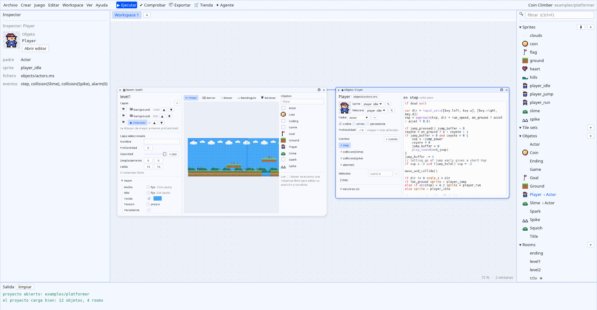

- Cada asset se abre como una **ventana** dentro del workspace: se arrastra por el título, se
  redimensiona desde el borde derecho, el inferior o la esquina, ▾ la pliega y 🗖 (o doble clic
  en el título) la maximiza dentro del workspace. ● en el título = cambios sin guardar.
- Lo que abres **desde** otra ventana (por ejemplo *Abrir objeto* en el editor de rooms, o
  *Abrir Actor* en un objeto) aparece a su derecha, **encadenado** con una línea.
- El fondo se arrastra para moverse; **Ctrl + rueda** hace zoom alrededor del cursor (25–200 %);
  la rueda sola desplaza. Clic derecho en el fondo → *Ver todas las ventanas* (Ctrl+0),
  *Zoom al 100 %* o *Cerrar todas*.
- **+** añade otro workspace; doble clic en su pestaña lo renombra; × lo cierra (cerrando sus
  ventanas). Si un asset ya está abierto en cualquier workspace, abrirlo de nuevo te lleva a él.
- Ctrl+Z / Ctrl+Y / Ctrl+W y Supr actúan sobre la ventana con foco (borde azul).
- La disposición (workspaces, ventanas, cadenas, zoom y paneles visibles) se guarda por proyecto
  en `~/.config/modengine/layouts/` y se recupera al abrirlo.

| Atajo | |
|---|---|
| Ctrl+S | guardar todo |
| F5 | guardar y ejecutar el juego (vuelve a pulsarlo para reiniciarlo) |
| F6 | comprobar: carga el proyecto con el motor real y ejecuta 300 pasos sin ventana |
| Ctrl+Z / Ctrl+Y | deshacer / rehacer (rooms y sprites; los campos de texto tienen su propio deshacer) |
| Ctrl+W | cerrar la ventana con foco |
| Ctrl+0 | ver todas las ventanas del workspace |
| Ctrl+F | buscar en el navegador de assets (Esc borra el filtro) |
| Supr | con un asset elegido en el navegador: eliminarlo (pide confirmación) |

### Arrastrar y soltar

Casi todo lo que está en una lista se puede arrastrar (el cursor cambia a una mano; un clic
sigue siendo un clic, el arrastre empieza al mover unos píxeles; Esc lo cancela):

| Arrastras… | …y lo sueltas en | Resultado |
|---|---|---|
| un asset del navegador | otra posición de su sección | cambia el orden de la lista (sólo en el editor) |
| un asset del navegador | el fondo vacío del workspace | se abre ahí (si ya estaba abierto, la ventana se mueve ahí) |
| un objeto (navegador o paleta de la room) | el lienzo de una room | coloca una instancia en esa celda (o libre, sin «ajustar a rejilla»); un solo paso de deshacer |
| un sprite | la zona de sprite de un objeto | pasa a ser el sprite del objeto |
| un objeto | el campo *Padre* de otro objeto | pasa a ser su padre (no deja crear ciclos) |
| una capa de la room | otra posición de la lista de capas | reordena las capas (deshacer con Ctrl+Z) |
| un evento o método | otra posición de su lista | cambia su orden en el fichero `.ms` |
| un fotograma del sprite | otra posición de la tira | reordena los fotogramas (Ctrl+Z) |
| una pestaña de workspace | otra posición de la barra | reordena los workspaces |
| el título de una ventana | la pestaña de otro workspace | mueve la ventana a ese workspace |

El orden personalizado del navegador se guarda con la disposición del proyecto
(`~/.config/modengine/layouts/`, tabla `[order]`), no dentro del proyecto: no cambia el juego
(el orden de las rooms del juego sigue siendo el de `game.toml`). Los assets nuevos aparecen al
final de su sección.

Al guardar, el editor vuelve a cargar el proyecto con el motor y avisa en la salida si algo no
compila. Lo que se elimina no se borra: se mueve a la carpeta `.trash/` del proyecto.

## Editor de rooms

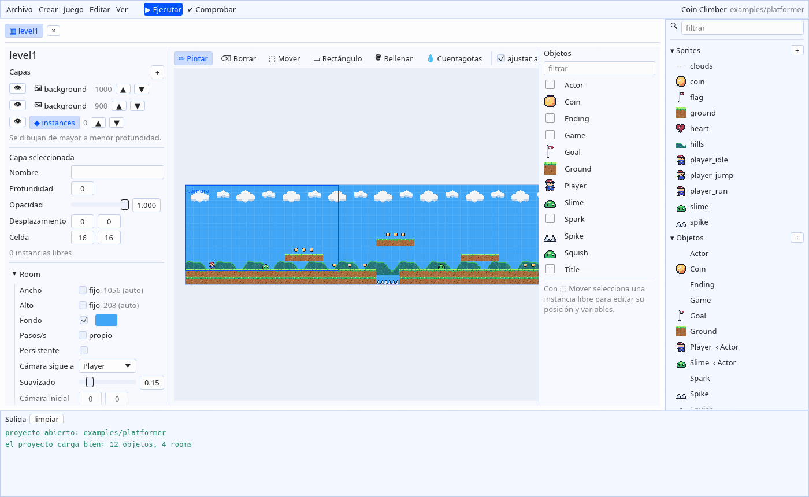

- **Capas** (izquierda): instancias, tiles y fondo. El ojo las oculta, ▲▼ las ordena en la lista;
  el orden de dibujo lo marca la profundidad. Debajo, las propiedades de la capa elegida y las de
  la room: tamaño (automático o fijo), color de fondo, pasos por segundo, persistencia, a quién
  sigue la cámara y el código de creación.
- **Paleta** (derecha): los objetos con su sprite, o los tiles del tileset de la capa.
- **Herramientas**:

| | |
|---|---|
| ✏ Pintar | coloca el objeto/tile elegido. Con *ajustar a rejilla* va al mapa de celdas; sin él crea una instancia libre donde haces clic |
| ⌫ Borrar | quita celdas e instancias libres (el clic derecho borra con cualquier herramienta) |
| ⬚ Mover | selecciona una instancia libre, arrástrala, edita su objeto, posición y variables propias; Supr la elimina |
| ▭ Rectángulo | rellena un rectángulo de celdas |
| 🪣 Rellenar | rellena la zona conectada de celdas iguales |
| 💧 Cuentagotas | toma el objeto o tile que hay bajo el cursor |

Rueda = zoom alrededor del cursor; botón central o Espacio + arrastrar = desplazar. El rectángulo
azul es la cámara al empezar la room.

Las instancias en rejilla se guardan como el mapa ASCII de siempre (el editor elige los
caracteres de la leyenda y reutiliza los que ya había); las libres, en la lista `instances`.

## Editor de objetos

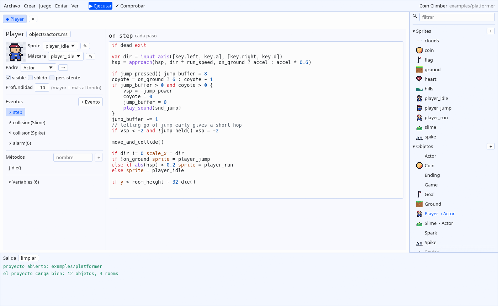

- Sprite, máscara y padre en desplegables; visible, sólido y persistente; profundidad.
- **Eventos**: **+ Evento** ofrece todos (colisión con cada objeto, cada tecla, alarmas, ratón,
  eventos de usuario…). Debajo, en gris, los eventos que el objeto **hereda** de sus padres:
  al seleccionarlos se ve su código y *Sobrescribir aquí* crea uno propio que empieza con
  `inherited()`. **Red (network)** añade el evento de multijugador (conexiones, desconexiones y
  mensajes, con los datos en `async_load`; ver [red.md](red.md)).
- **Métodos** y **Variables**: cada variable tiene nombre, tipo opcional (`num`, `int`, `bool`,
  `str`, `color`, `list`, o un tipo de asset) y valor inicial con el control de su tipo:
  deslizador si el número tiene límites, casilla, selector de color, desplegable... Si el valor
  es una expresión (`room_width / 2`) se edita como texto. Debajo aparecen en gris las
  variables con tipo **heredadas** del padre, con *Sobrescribir* para darles otro valor aquí.
- En el editor de rooms, al seleccionar una instancia libre, **Variables del objeto** muestra
  todas las variables con tipo de su objeto con su valor; cambiar una lo guarda solo para esa
  instancia, y ↺ vuelve al valor del objeto.
- El código se edita con resaltado de sintaxis; cualquier error de compilación aparece arriba
  con su línea.

El editor modifica solo el bloque `object ... { }` dentro de su fichero `.ms`: el resto del
fichero (otras funciones, comentarios) queda igual. El cuerpo de cada evento se guarda tal cual
lo escribes. Si un objeto usa algo que el editor visual no entiende, ofrece abrir el fichero
como texto.

## Editor de sprites

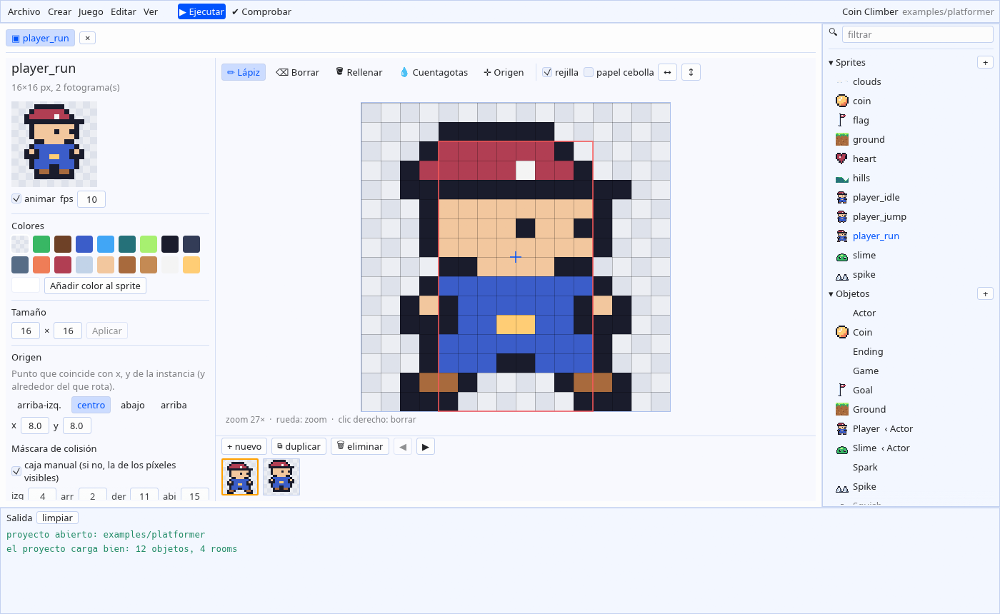

Para sprites de pixel art: lápiz, borrador, relleno, cuentagotas y herramienta de origen;
rejilla, papel cebolla (el fotograma anterior en transparencia), voltear, fotogramas (nuevo,
duplicar, eliminar, reordenar), vista previa animada con sus fps, colores de la paleta común
más colores propios del sprite, cambio de tamaño, origen y máscara de colisión manual o
automática. Abre también los sprites escritos con `pixels_rle`; la casilla **guardar compacto
(pixels_rle)** decide si se guardan por tramos (mucho más pequeño en sprites grandes) o con
`pixels`.

**Rotación** (pixel art y PNG): cómo se ve el sprite girado — *la del juego* (lo que diga
`[display] rotation`), `nearest`, **RotSprite (pixel art)** o *suave (lineal)* — y los **pasos**
por vuelta (0 = ángulo libre). Ver «Rotación de pixel art» en proyecto.md.

Para sprites PNG: tira o rejilla de fotogramas, fps, origen y máscara.

Las **muestras de color** son las de la paleta del proyecto en su orden (`0-9`, `A-Z`...), o
**Pear36** si el proyecto no tiene `[palette]` (los colores de Pear36 que use el sprite se
guardan en su `palette = {...}` para que el motor los conozca). Clic: color principal; clic
derecho: color **secundario**, el que pinta el botón derecho (por defecto `.` transparente, es
decir, borrar como antes; con el cuentagotas, el derecho toma el secundario). Al pasar el ratón
se ve el carácter, el `#rrggbb` y el índice. Debajo: «Izq./Der.» con los dos colores elegidos,
**🎨 Paletas (Lospec)…** y, si el sprite tiene colores propios que no están en la paleta del
proyecto, **🧲 Ajustar a la paleta** (cada uno pasa al color más parecido; un paso de deshacer).

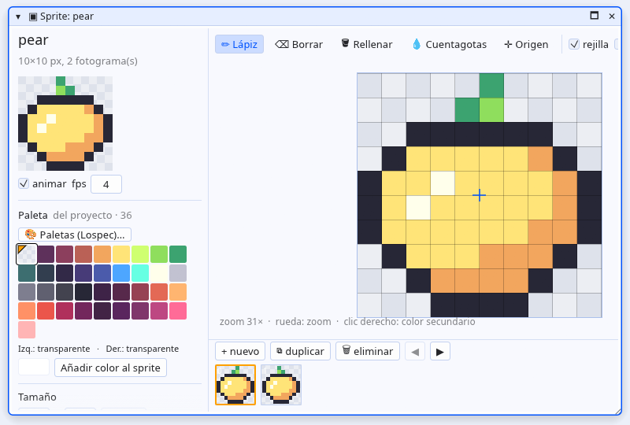

## Editor de fuentes

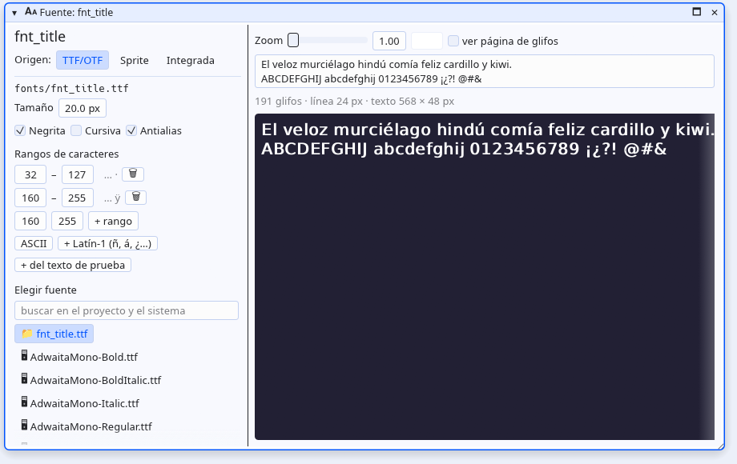

- **Origen**: un fichero TTF/OTF, un **sprite** (un fotograma por carácter, como
  `font_add_sprite`) o la fuente integrada.
- **Elegir fuente**: busca entre las fuentes del proyecto (📁) y las instaladas en el sistema
  (🖥, carpetas habituales de Linux, macOS y Windows). Una del sistema se copia a `fonts/` al guardar.
- **Tamaño**, **Negrita**, **Cursiva** (sintetizadas si la cara no lo es), **Antialias** (quítalo
  para pixel art), **espaciado** extra y **rangos de caracteres**, con atajos *ASCII*,
  *+ Latín-1 (ñ, á, ¿…)* y *+ del texto de prueba* (añade los caracteres del texto que falten).
- **Vista previa** en vivo hecha con el mismo código que usa el juego: texto de prueba editable,
  zoom, color, medidas y aviso en rojo de los caracteres que no se dibujarían; *ver página de
  glifos* muestra la textura horneada.

## Editor de notas

Texto Markdown con tres vistas: *Texto*, *Dividido* y *Vista previa* (títulos, **negrita**,
*cursiva*, `código`, listas, citas, bloques de código, enlaces y tareas `- [ ]`). Marcar una
casilla en la vista previa la marca en el texto; arriba se cuentan palabras y tareas hechas.

## Editor de tile sets

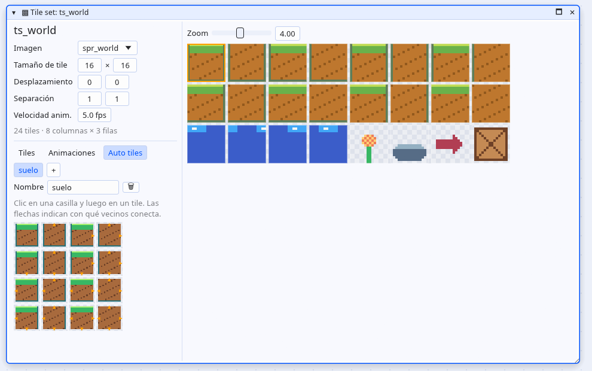

- **Imagen** (un sprite), **tamaño de tile**, **desplazamiento** y **separación**: la rejilla se
  recalcula al momento y abajo se ve cuántos tiles salen. Pasa el ratón para ver el número de tile.
- **Animaciones**: arrastra sobre varios tiles y *+ animación con la selección*; el primer
  fotograma es el que se pinta y la vista previa lo anima a los *fps* del tile set.
- **Auto tiles**: 16 casillas, una por combinación de vecinos (las flechas indican con cuáles
  conecta). Clic en una casilla y luego en el tile; o selecciona 16 tiles seguidos y pulsa +.
- Ctrl+Z / Ctrl+Y deshacen y rehacen.

### Pintar tiles en las rooms

Una capa **Tiles** elige su tile set (o, como antes, un sprite cuyos frames son los tiles). Con
un tile set la paleta muestra la imagen entera:

- clic = un tile; **arrastrar = un pincel de varios tiles** que se estampa tal cual;
- **↔ ↕ ⟳** (o las teclas **X**, **Y**, **Z**) espejan, voltean y giran el pincel;
- **Auto**: pinta con un auto tile, que elige el tile de cada celda según sus vecinos (borrar
  también recoloca los vecinos);
- Pintar, Borrar, Rectángulo (repite el pincel), Rellenar y Cuentagotas (toma también la
  transformación) funcionan como con los objetos. Los tiles animados se mueven en el editor.

Estas capas se guardan como `data` (filas de números) en vez de `legend` + `map`.

**Escala** (propiedades de una capa de tiles, ×x ×y): dibuja los tiles más grandes sin hornear
otra imagen (`scale = 3` en la room). La rejilla, la pintura, el tamaño de la room y el juego
usan celdas de `Celda × Escala` píxeles; `Celda` sigue siendo el tamaño del tile.

## Paletas (Lospec)

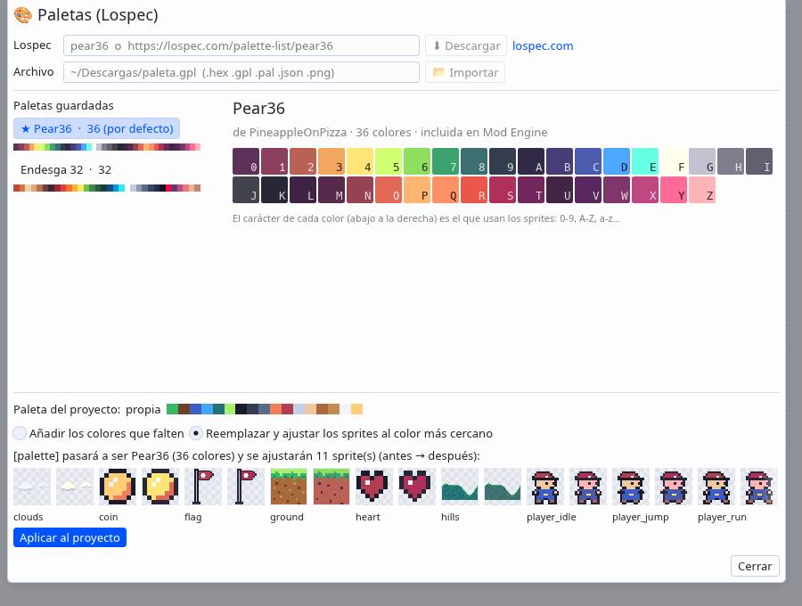

Se abre desde **Archivo → 🎨 Paletas (Lospec)…**, el editor de sprites o **Ajustes del juego**.

- **Lospec**: el nombre de una paleta (`pear36`, `endesga-32`) o su URL
  (`https://lospec.com/palette-list/pear36`) y **⬇ Descargar**. Pide
  `https://lospec.com/palette-list/<nombre>.json` con `curl` en un hilo aparte (curl viene con
  Linux, macOS y Windows 10+, así el editor no necesita una biblioteca HTTP/TLS y la interfaz no
  se bloquea).
- **Archivo**: importa `.hex`, `.gpl` (GIMP), `.pal` (JASC-PAL), `.json` (Lospec) o `.png`
  (tira de colores, p. ej. `pear36-1x.png`: cada color distinto en orden de lectura). Al escribir
  una carpeta se listan sus ficheros de paleta para elegir con un clic.
- **Paletas guardadas**: Pear36 (incluida, sin red) y las descargadas o importadas, que se
  guardan en `~/.config/modengine/palettes/<nombre>.json`. Al elegir una se ven sus colores con el
  carácter que tendrá cada uno.
- **Paleta del proyecto**: qué paleta usa ahora y cómo aplicar la elegida:
  *Añadir los colores que falten* (los caracteres existentes no cambian) o *Reemplazar y ajustar
  los sprites al color más cercano*, con una vista previa antes → después de cada sprite que
  cambia. **Aplicar al proyecto** guarda una copia en `.modengine/palette_backup/` y
  **↶ Deshacer la última aplicación** la restaura. Los editores abiertos sin cambios se recargan.

Para capturas: `modeditor <proyecto> --palettes pear36[:replace] --screenshot f.png`.

## Sonidos, scripts y ajustes

- **Sonidos**: todos los parámetros del sintetizador con deslizadores, ▶ Escuchar (usa
  `pw-play`, `paplay` o `aplay`) y unos cuantos puntos de partida (salto, moneda, golpe, láser).
- **Scripts**: editor de código con resaltado (los colores `#rrggbb` se muestran en su color) y
  comprobación de sintaxis en vivo.
- **Ajustes del juego**: nombre, room inicial, orden de las rooms, resolución, escala, pasos por
  segundo y la paleta compartida de pixel art (con su tira de colores y el botón
  🎨 Paletas (Lospec)…).

## Exportar

**Archivo → 📦 Exportar…** (o el botón 📦 Exportar de la barra) crea el juego para Windows
(.exe), Linux o Android (.apk), como «Create Executable» de GameMaker. Cada plataforma muestra si
está ✔ lista o qué falta, con un botón ⬇ Instalar que lo descarga en segundo plano. El progreso y
la salida aparecen en el diálogo y en Salida; al acabar, 📂 Abrir carpeta. Los ajustes (versión,
icono, paquete de Android, mando táctil…) se guardan en `game.toml`. Todo en
[exportar.md](exportar.md).

## Importar assets

Trae imágenes, sonidos y fuentes de cualquier carpeta del disco al proyecto:

| Fichero | Va a | Es |
|---|---|---|
| `.png` | `sprites/` | un sprite |
| `.wav`, `.ogg` | `sounds/` | un sonido |
| `.ttf`, `.otf` | `fonts/` | una fuente (tamaño 16) |

Se abre con **Archivo → Importar assets…**, con el botón **⬇** (o el clic derecho) en la cabecera
de **Sprites**, **Sonidos** o **Fuentes** del navegador, o **arrastrando ficheros desde el gestor
de archivos** a la ventana del editor (salvo encima del panel Agente, que los adjunta a la
conversación). El diálogo tiene:

- un campo para pegar una ruta (`~/…` y las rutas `file://` que pegan los gestores de archivos
  valen); un fichero va a la lista y una carpeta se abre en el explorador;
- un explorador de carpetas que solo enseña lo importable: clic para seleccionar varios y
  **Añadir seleccionados**, doble clic para añadir uno, **Añadir todos**. Recuerda la última
  carpeta en `~/.config/modengine/import.txt`;
- por cada fichero: el **nombre** del asset (sale del nombre del fichero, limpio —`Moneda dorada
  (2).png` → `moneda_dorada_2`— y sin repetir: `coin` pasa a `coin_2` si ya existe) y, para las
  imágenes, una vista previa con la rejilla de frames y el origen, el tamaño, **tira horizontal**
  con su número de frames o **rejilla** con el tamaño del frame, **origen** y **fps**. Un fichero
  `algo_strip4.png` llega ya como tira de 4 frames (convención de GameMaker).

Lo mismo se hace sin el editor con `modengine import` y `modengine inspect-image` (ver
[proyecto.md](proyecto.md#importar-arte-desde-la-terminal)); es lo que usa el panel Agente.

Al importar, el fichero se copia como `<nombre>.<ext>` en su carpeta. Solo si un sprite tiene
opciones distintas de las de un PNG suelto (un frame, origen arriba a la izquierda, 10 fps) se
escribe también su `<nombre>.toml` (`image`, `frames` o `frame_size`, `origin`, `fps`; ver
[proyecto.md](proyecto.md)). Luego se recargan las listas, se selecciona el asset nuevo, la
**Salida** dice `Importado: sprite 'hero' → sprites/hero.png, sprites/hero.toml` y se comprueba
que el proyecto carga.

Los problemas se ven en el diálogo, en rojo, y bloquean el botón **Importar** hasta corregirlos:
formato no soportado (JPG, MP3…), imagen que no se puede leer, `.wav`/`.ogg`/`.ttf` cuyo contenido
no es lo que dice la extensión, nombre no válido o repetido. Si el nombre es de otro asset del
mismo tipo aparece **Sobrescribir**: el antiguo va a `.trash/`. Los ficheros de más de 20 MB solo
avisan. No se pueden juntar varios PNG en un sprite: el motor lee una imagen por sprite (una tira
o una rejilla).

## Tienda de assets (OpenGameArt)

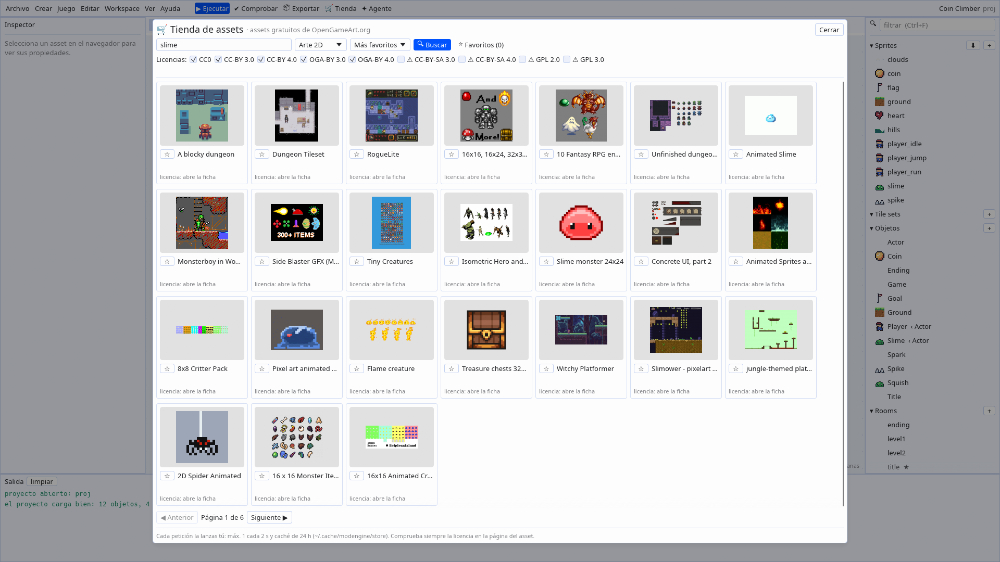

Busca e importa sprites, sonidos, música y fuentes **gratuitos** de
[OpenGameArt.org](https://opengameart.org). Se abre con el botón **🛒 Tienda** de la barra, con
**Archivo → 🛒 Tienda de assets (OpenGameArt)…** o con **Ver → 🛒 Tienda de assets**.

- **Buscar**: una palabra (en inglés hay muchos más resultados: `slime`, `coin`, `explosion`…), el
  **tipo** (Arte 2D, Texturas, Efectos de sonido, Música, Fuentes —OGA no tiene un tipo «fuente»:
  busca lo etiquetado `font`—), el **orden** (más favoritos, más recientes, relevancia) y las
  **licencias**. Por defecto solo CC0, CC-BY y OGA-BY; las de «compartir igual» (CC-BY-SA, GPL)
  se pueden marcar y llevan ⚠. Los resultados salen en una rejilla de 24 por página con su miniatura
  y **◀ Anterior / Siguiente ▶**.
- **Ficha** (clic en un resultado): vistas previas, autor y fecha, **licencias** con lo que te piden,
  la atribución que pide el autor, etiquetas, descripción (texto plano) y los **ficheros** con su
  tipo y tamaño. **🌐 Abrir en el navegador** abre la página original.
- **⭐ Favoritos**: marca la estrella en una tarjeta o en la ficha; el botón **⭐ Favoritos (n)**
  los lista. La última búsqueda y los favoritos se guardan en `~/.config/modengine/store.toml`.

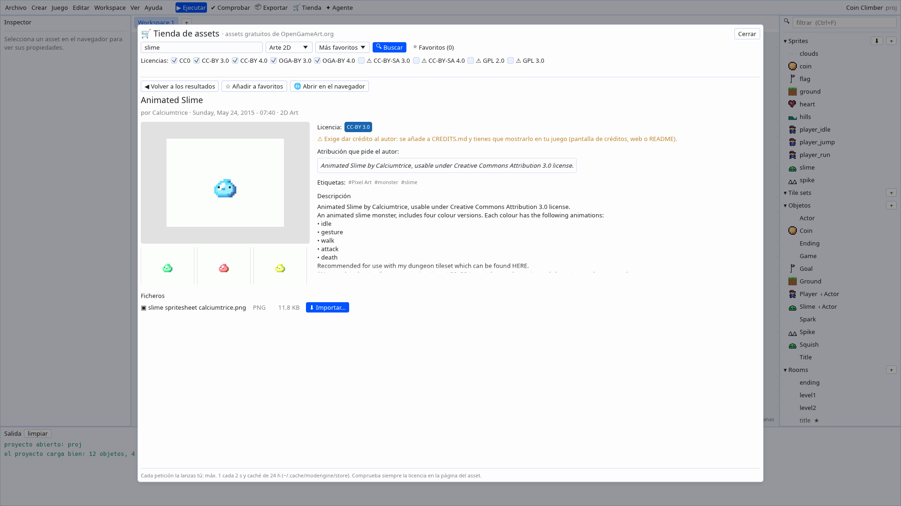

**Importar.** PNG, WAV, OGG, TTF y OTF tienen **⬇ Importar…**: se descargan a la caché (con barra
de progreso) y se abre el diálogo normal de [Importar assets](#importar-assets) con el fichero ya
puesto, para elegir nombre, tira/rejilla de frames, origen y fps. Un `.zip` tiene **⬇ Ver
contenido…**: se descarga, se listan sus ficheros y marcas los que quieras (PNG, WAV, OGG, TTF,
OTF) para **Importar seleccionados**. MP3 y otros formatos que el motor no carga se indican y no
se ofrecen. Las descargas de más de 50 MB piden confirmación, y el tamaño descargado tiene que
coincidir con el que anuncia la página (si no, se descarta).

**Licencias y créditos.** Todo lo que importas desde la tienda se apunta en **`CREDITS.md`** en la
raíz del proyecto (se crea si no existe): título, autor (con enlace), licencia(s) con enlace al
texto, URL de origen, el aviso de atribución del autor, qué ficheros del proyecto salen de él (y de
qué fichero o entrada del zip) y la fecha. Cada asset tiene su sección (marcada con
`<!-- oga:<slug> -->`): volver a importar del mismo asset añade los ficheros nuevos a esa sección.
Si el sprite tiene `.toml`, además lleva un comentario `# Origen: …` arriba. La **Salida** lo dice
y recuerda qué exige la licencia.

| Licencia | Qué te pide |
|---|---|
| CC0 | Nada (dominio público). Se apunta igualmente en CREDITS.md. |
| CC-BY 3.0 / 4.0 | **Dar crédito** al autor en tu juego (pantalla de créditos, web o README). |
| OGA-BY 3.0 / 4.0 | Como CC-BY, pero permite DRM (tiendas de consola…). Crédito obligatorio. |
| CC-BY-SA 3.0 / 4.0 | Crédito y **compartir igual**: si modificas el asset, tu versión se publica con la misma licencia (el resto del juego no). |
| GPL 2.0 / 3.0, LGPL | Crédito, el asset (y lo derivado) bajo GPL, con su texto y acceso a las fuentes. Puede chocar con algunas tiendas. |

Si un asset tiene varias licencias puedes elegir la que prefieras (CREDITS.md las apunta todas). Si
la página no tiene licencia o no se reconoce, la ficha lo marca en rojo y no deja importar hasta
marcar «He revisado la licencia…». Mod Engine no es abogado: ante la duda, lee la licencia.

**Cómo usa la web.** OpenGameArt no tiene API pública; la tienda lee las mismas páginas que un
navegador (`/art-search-advanced` y `/content/<asset>`) y descarga de `/sites/default/files/`, lo
que su `robots.txt` permite (nunca `/search/`, que prohíbe). Cada petición la lanza el usuario (buscar,
abrir una ficha, las miniaturas de la página que ves, descargar): no rastrea nada en segundo plano.
Se identifica con `User-Agent: ModEngine-Editor/<versión> (+https://github.com/evilrender23/Mod-Engine)`,
hace **como mucho una petición cada 2 s** en una cola (miniaturas incluidas: una página tarda ~50 s
en llenarse la primera vez) y guarda páginas, miniaturas y descargas en `~/.cache/modengine/store/`
durante 24 h (sin conexión usa la copia vieja si la hay). Los errores (sin conexión, OGA pidiendo
que esperemos —HTTP 429/503—, página con un formato inesperado) se muestran en la tienda con
**Reintentar**. Usa `curl` como Paletas (Linux, macOS y Windows 10+ lo traen).

Para capturas: `modeditor <proyecto> --store slime --screenshot t.png` abre la tienda buscando
`slime` y espera a las miniaturas; `--store-open animated-slime` abre esa ficha. Test contra la web
real (unas pocas peticiones; deja la copia del ejemplo en el directorio temporal):
`cargo test -p modengine-editor --release real_opengameart -- --ignored --nocapture` busca `slime`
(2D, CC0), abre resultados hasta uno con PNG, lo descarga, lo importa en una copia de
`examples/platformer`, escribe CREDITS.md y pasa `modengine check`. El resto de tests usa copias
recortadas de páginas reales (`crates/modengine-store/tests/fixtures/oga/`) y un cliente falso.

**Desde la terminal y con el agente.** Todo lo que no es la ventana (leer OpenGameArt, la caché, el
ritmo de peticiones, los zip y CREDITS.md) está en el crate `modengine-store`, que comparten la
tienda y la orden [`modengine store`](proyecto.md#la-tienda-desde-la-terminal-modengine-store)
(`search`, `show`, `download`, `get`), que es lo que usa el [agente](#assets-de-la-tienda-con-el-agente).
Comparten también la caché de 24 h y el límite de **una petición cada 2 s**: lo respetan juntos
aunque sean procesos distintos (se turnan con el fichero `~/.cache/modengine/store/rate-limit.lock`,
que guarda la hora de la última petición).

## Agente

El panel **Agente** (a la derecha; **✦ Agente** en la barra de arriba o **Ver → Agente**) conversa
con un agente de programación que trabaja en la carpeta del proyecto y escribe y edita sus objetos,
rooms, sprites, sonidos y scripts: **Claude Code** (`claude`), **Antigravity** (`agy`) o **Codex**
(`codex`), elegido en el desplegable de arriba. Hay que tener instalado su programa y haber
iniciado sesión en él una vez desde un terminal; si falta, el panel dice cómo instalarlo y tiene
*Comprobar de nuevo*.

- **Mensajes:** Intro envía (Mayús+Intro, nueva línea). La respuesta llega a medida que se escribe,
  con una línea por cada cosa que hace el agente (leer, editar, ejecutar…) y avisos de lo que
  falla o bloquean los permisos. Las respuestas se muestran como Markdown: títulos, **negrita**,
  *cursiva*, `código`, listas, citas, enlaces que se abren en el navegador y bloques de código
  (los de ModScript, `ms`, coloreados) con **⧉ Copiar**. Al pasar el ratón por un mensaje o una
  respuesta aparece **⧉** para copiarlo.
- **Capturas de pantalla:** copia una captura (Impr Pant, Spectacle, Recortes…) y pulsa **Ctrl+V**
  con el ratón sobre el panel, o **📋 Pegar imagen** encima del cuadro de mensaje. **📸 Captura del
  editor** adjunta lo que ves en la ventana del editor. La imagen se guarda como PNG en
  `~/.cache/modengine/agent/pegadas` (fuera del proyecto, así no sale en *Archivos cambiados*; se
  borran solas a los 7 días) y aparece como una etiqueta con miniatura; al pasar el ratón se ve en
  grande. Las de más de 2560 px se reducen. Le llegan al agente como cualquier imagen adjunta: Codex
  con `--image` y Claude Code y Antigravity con su ruta y permiso para leerla.
- **Cancelar un trabajo:** mientras el agente trabaja, junto a *Poner en cola* aparece **■ Cancelar**
  (también **Esc** en el cuadro de mensaje, **■** arriba o `/cancelar`). Para el programa y los
  comandos que haya lanzado: le pide que termine y, si a los 3 s sigue, lo cierra; en Windows cierra
  todo el árbol de procesos con `taskkill /T`. Lo que llegó a cambiar sale en *Archivos cambiados* y
  se puede deshacer con **Revertir** o `/deshacer`. Los mensajes en cola no se envían solos tras
  cancelar: quedan en pausa hasta **▶ Seguir**. La conversación se puede continuar con el mismo
  agente.
- **Barra de arriba:** **🕘** abre el historial, **＋** empieza otra conversación (la actual queda
  en el historial), **■** cancela el trabajo del agente y **⋯** tiene
  *Compactar conversación*, *Deshacer cambios del último turno*, *Exportar a Markdown*, *Copiar
  como Markdown*, *Copiar la orden para seguir en un terminal* (`claude --resume …`,
  `agy --conversation …`, `codex resume …`) y *Autocompactar*. Debajo, el estado y el medidor de
  contexto; bajo ellos, el título de la conversación.
- **Modelo** (bajo el mensaje): *Por defecto* usa el que tenga configurado el propio programa.
  Claude Code ofrece Fable, Opus, Sonnet y Haiku (siempre la última versión de cada uno); Codex y
  Antigravity enseñan la lista que dan `codex debug models` y `agy models`. *Otro modelo…* acepta
  cualquier nombre que el programa admita tras `--model`. La conversación indica qué modelo
  contesta cuando lo dice el programa.
- **Permisos:** *Solo planificar* (lee y propone), *Editar archivos* o *Editar y ejecutar
  comandos*, que es el modo por defecto. Ninguno se salta las aprobaciones del programa.
- **🌐 Internet** (el botón 🌐 junto a los permisos, resaltado si está activado; por proyecto, activado por defecto, también `/internet
  on|off`): deja que el agente busque en la web y lea páginas, ver [Internet](#internet).
- **Contexto:** el agente sabe que está en un proyecto de Mod Engine, cómo se organiza y dónde
  están `docs/lenguaje.md`, `docs/funciones.md` y `docs/proyecto.md` (con permiso para leerlos
  aunque estén fuera del proyecto). Las busca en `$MODENGINE_DOCS`, junto al ejecutable, en la
  instalación o en el código del que se compiló el editor.
- **Lo que ve y lo que cambia:** al enviar, el editor **guarda todo** para que el agente trabaje
  sobre lo que ves. Cada vez que el agente dice que ha escrito un fichero (o ha ejecutado un
  comando), y al terminar, el editor recarga del disco los scripts, `game.toml`, las listas de
  assets, los sprites y los editores abiertos de rooms, sprites, sonidos y ajustes cuyo fichero
  cambió. Al terminar, además, comprueba el proyecto y deja los errores del motor en **Salida**,
  junto con la lista de ficheros que cambió el agente.
- **Cambios sin guardar:** no se pisan. Si el agente cambia un fichero que tiene cambios sin
  guardar en el editor (cosa rara, porque se guarda al enviar), se conservan los tuyos y Salida lo
  avisa; guardar entonces sobrescribe la versión del agente.
- Agente, modelo de cada agente, permisos y la última lista de modelos de cada programa se
  recuerdan en `~/.config/modengine/agent.toml`; el agente, los permisos, el umbral de
  autocompactar y 🌐 Internet de cada proyecto, en su carpeta del historial (abajo). Cerrar el proyecto o el
  editor detiene el agente y guarda la conversación.

### Historial

Cada conversación se guarda sola (al terminar cada turno, al compactar, al cambiar de
conversación y al cerrar) en `~/.config/modengine/agent/history/<proyecto>-<hash>/<id>.json`:
título, agente, modelo, el id de sesión del programa, fechas, la conversación entera (con las
líneas de herramientas, los avisos y los adjuntos), los turnos y el uso de contexto y coste. El
título sale del primer mensaje. Al abrir el proyecto otra vez vuelve la conversación que estaba
abierta (`state.json` de esa carpeta), y el siguiente mensaje **sigue la misma sesión** del
programa (`--resume`, `--conversation`, `resume`).

**🕘** (o `/historial [texto]`) lista las conversaciones del proyecto, la más reciente arriba,
con su fecha, agente, número de mensajes y coste, y un buscador que mira títulos y mensajes. Un
clic la abre; **✎** la renombra (Intro guarda, Esc cancela), **⤓** la exporta a Markdown (a
Descargas, y la copia) y **🗑** la borra (pide un segundo clic). **← Volver** regresa al chat.

### Contexto, coste y compactar

El medidor junto al estado enseña los tokens que ocupa la conversación frente a la ventana del
modelo (`168k / 200k (84 %)`) y lo gastado (`0,42 $`); pasa a ámbar desde el 80 % (y la
conversación lo avisa una vez) y a rojo desde el 95 %. `/coste` da el detalle.

- **Claude Code:** los tokens del último mensaje (entrada + caché + salida) y la ventana y el
  coste del resultado (`contextWindow`, `total_cost_usd`, que es lo acumulado de la sesión).
- **Codex:** los tokens del turno (`turn.completed`) y la ventana del modelo según
  `codex debug models`; es una estimación (≈) y Codex no da coste.
- **Antigravity:** los tokens del último paso de respuesta (≈); sin ventana ni coste.

**Compactar** (`/compactar`, o *⋯ → Compactar conversación*) resume la conversación para liberar
contexto y deja una raya *✂ Conversación compactada*:

- **Claude Code y Antigravity:** se les manda su propio `/compact` en la sesión (los dos lo
  ejecutan en modo `--print`); la sesión sigue siendo la misma y Claude dice cuántos tokens
  quedan.
- **Codex** (que en `exec` no tiene `/compact`): se le pide un resumen completo de la
  conversación; se muestra plegado (*▸ Resumen de lo anterior*) y el siguiente mensaje empieza
  una sesión nueva que lo recibe delante, en un bloque `<earlier-conversation>`.

**Autocompactar** (*⋯*, o `/autocompactar 85`, `/autocompactar no`): al terminar un turno que pasa
de ese % del contexto, compacta solo antes de seguir con la cola. Se guarda por proyecto.

### Comandos

Un mensaje que empieza por `/` es un comando; al escribir `/` aparece la lista (flechas para
elegir, Tab completa, Intro ejecuta, Esc cierra) y el botón *Enviar* pasa a *Ejecutar*. `//texto`
envía un mensaje que empieza por `/`.

| Comando | Qué hace |
|---|---|
| `/nueva` | Conversación nueva (la actual queda en el historial) |
| `/historial [buscar]` | Abre el historial, filtrado |
| `/compactar` (`/compact`) | Compacta la conversación (si el agente trabaja, al terminar) |
| `/modelo <m>` | Cambia el modelo (`opus`, `sonnet`…; `defecto`, el del programa); sin nada, dice cuál es |
| `/permisos plan\|editar\|auto` | Solo planificar, editar archivos o también ejecutar comandos |
| `/agente claude\|codex\|agy` | Cambia de agente: sigue en una sesión nueva que recibe lo hablado |
| `/reintentar` | Reenvía el último mensaje desde antes de su respuesta |
| `/editar` | Pone el último mensaje en el cuadro para cambiarlo y reenviarlo |
| `/cancelar` | Cancela el trabajo en curso del agente (también Esc o **■ Cancelar**) |
| `/deshacer` | Devuelve los ficheros que cambió el último turno a como estaban |
| `/exportar` | Guarda la conversación como Markdown en Descargas y la copia |
| `/renombrar <título>` | Cambia el título |
| `/autocompactar <50-98\|no>` | Umbral para compactar solo |
| `/internet on\|off` (`/web`) | Deja (o no) que el agente busque en internet y lea páginas; sin nada, dice cómo está |
| `/coste` | Contexto, tokens y coste |
| `/ayuda` | La lista de comandos |

### Cola, reintentar y editar

- **Cola:** lo que envías mientras el agente trabaja (el botón pasa a *Poner en cola*) espera en
  *En cola*, con sus adjuntos, y se envía solo, en orden, al terminar el turno (guardando todo
  antes, como siempre). **✎** lo devuelve al cuadro de mensaje para cambiarlo y **×** lo quita. Si
  el turno falla o lo detienes, la cola se pausa hasta pulsar **▶ Seguir**.
- **↻ Reintentar** (bajo el último mensaje, o bajo el error si el turno falló, o `/reintentar`) y
  **✎ Editar** (`/editar`; un aviso permite *Cancelar*) quitan de la conversación el último
  mensaje y lo que vino después y lo envían otra vez (cambiado, si lo editaste) desde el punto
  anterior. Claude Code **bifurca** su sesión en ese punto (`--resume ID --fork-session
  --resume-session-at <último mensaje del agente antes>`); Codex y Antigravity, que no pueden,
  empiezan una sesión nueva que recibe la conversación hasta ahí. Los ficheros no se tocan: para
  devolverlos, *Revertir* o `/deshacer`.

### Cambios del agente

Antes de cada turno el editor fotografía en memoria los ficheros del proyecto (sin `.git`,
`target`, `build`, `node_modules` ni carpetas ocultas; hasta 2 MB por fichero y 96 MB en total).
Al terminar, si algo cambió, la conversación muestra **Archivos cambiados** con cada fichero
(nuevo ＋, modificado ✎ o borrado 🗑) y sus líneas `+añadidas −quitadas`:

- **Clic en el fichero:** abre una ventana con el diff unificado (antes del turno → ahora), con
  números de línea y las líneas añadidas en verde y las quitadas en rojo.
- **Revertir** (en la fila o en la ventana) devuelve ese fichero a como estaba antes del turno (o
  lo borra si el turno lo creó); **↶ Revertir todo** o `/deshacer`, todos los del último turno con
  cambios. El editor recarga lo revertido.
- Las fotos son de esta sesión del editor (los 12 últimos turnos con cambios): en una
  conversación reabierta del historial la lista se ve, pero ya no se puede revertir.

### Adjuntar contexto

**📎 Adjuntar** (junto al modelo) añade contexto al siguiente mensaje:

- **Asset seleccionado** en el navegador y **Ventana enfocada**: el fichero del asset (un objeto
  es el `.ms` que lo define; Ajustes, `game.toml`; un sprite PNG va como imagen).
- **Selección de la room**: la instancia libre seleccionada en la room enfocada (⬚ Mover), tal
  como la escribe el fichero de la room, con los cambios sin guardar.
- **Salida**: sus últimas 50 líneas (por ejemplo, los errores de *Comprobar*).
- **Fichero del proyecto** (lista con filtro) e **Imagen de un sprite** (los PNG).
- **💽 Desde el disco…:** un explorador para adjuntar cualquier cosa del ordenador, también de
  fuera del proyecto: a la izquierda *Lugares* (Inicio, Escritorio, Documentos, Descargas,
  Imágenes, la raíz `/` y los discos montados en `/mnt`, `/media` y `/run/media`; en Windows, las
  unidades), *Favoritos* (☆/★ marca la carpeta actual) y *Recientes* (las carpetas de las que se
  adjuntó algo); a la derecha la carpeta, con filtro, *Ocultos* y selección múltiple (casillas,
  Ctrl+clic, Mayús+clic para un rango; doble clic abre una carpeta). La ruta de arriba acepta
  rutas escritas o pegadas, `~/…` y URIs `file://` (varias, una por línea, quedan seleccionadas).
  **Adjuntar N elementos** o **Adjuntar esta carpeta**.
- **📝 Texto…:** un texto que escribes o pegas, con título; va dentro del mensaje.
- **🕘 Recientes de fuera del proyecto:** los últimos ficheros, carpetas y URLs adjuntados.
- **Ruta o URL:** cualquier fichero, carpeta o imagen (absoluta, con `~/`, `file://` o relativa al
  proyecto), o una página `http(s)://`, que el agente descarga y lee.
- **Pegar en el mensaje:** pegar (Ctrl+V) rutas absolutas o URIs `file://` que existen (lo que
  copia un gestor de archivos) las adjunta en vez de escribirlas.
- **Arrastrar y soltar:** un asset del navegador o ficheros del gestor de archivos soltados sobre el
  panel se adjuntan.
- **@ en el mensaje:** sugiere assets y ficheros del proyecto que coinciden con lo escrito;
  flechas para elegir, Tab o Intro para adjuntar (deja `@nombre` en el texto), Esc cierra.

Los adjuntos aparecen sobre el cuadro de mensaje, cada uno con su **×**. Se envían con el mensaje
(que puede ir vacío), quedan anotados bajo él en la conversación y se quitan. Al agente le llegan
en un bloque `<attached-by-the-user>` al final del mensaje:

- **Ficheros del proyecto:** su ruta relativa al proyecto (y qué asset es); el agente los abre él
  mismo. Como el editor guarda todo antes de enviar, ve lo mismo que tú.
- **Texto de fuera del proyecto, selección de la room y Salida:** dentro del mensaje, hasta 20 KB
  por adjunto (lo que pase se corta con una nota). Los binarios y carpetas de fuera, solo la ruta.
- **Imágenes:** Codex las recibe con `--image=<ruta>` (una por opción); Claude Code y Antigravity
  reciben su ruta y la miran con su herramienta de leer.
- **URLs:** «la página `<url>`: descárgala y léela»; Claude Code recibe además permiso para
  `WebFetch(domain:<host>)`.
- **Permisos:** lo adjuntado de fuera del proyecto se puede leer (solo eso): Claude Code con
  `--allowedTools "Read(//ruta)"` (`/**` si es carpeta); las carpetas además entran en su espacio
  de trabajo con `--add-dir`, pero con `--disallowedTools "Edit(//carpeta/**)" "Write(//carpeta/**)"`
  para que sigan siendo de solo lectura. Antigravity: `read_file(ruta)` en sus `--settings` y
  `--add-dir` para las carpetas (sus escrituras fuera del proyecto siguen pidiendo permiso, que en
  este modo se niega). Codex lee fuera del proyecto en cualquier modo (su `--add-dir` daría
  permiso de escritura, así que no se usa).

Cómo se lanza cada programa (en la carpeta del proyecto, sin ventana):

| Agente | Orden |
|---|---|
| Claude Code | `claude --print --output-format stream-json --verbose --include-partial-messages --permission-mode plan\|acceptEdits\|auto --append-system-prompt-file <contexto> [--model M] [--resume ID [--fork-session --resume-session-at UUID]] [--add-dir <carpetas> --disallowedTools "Edit(//c/**)" "Write(//c/**)"…] --allowedTools "Read(//<docs>/**)" ["Read(//<adjunto>)"…] ["WebFetch(domain:h)"…] ["Bash(<modengine> import *)" "Bash(<modengine> inspect-image *)"]`, mensaje y adjuntos por stdin (`/compact` para compactar) |
| Antigravity | `agy --output-format stream-json --mode plan\|accept-edits\|auto --settings <permisos JSON> [--model M] [--conversation ID] [--add-dir <carpeta>…] --print=<contexto + mensaje>` (`--print=/compact` para compactar) |
| Codex | `codex exec --json --skip-git-repo-check --sandbox read-only\|workspace-write [--model M] [resume ID] [--image=<imagen>…] -`, contexto + mensaje + adjuntos por stdin |

### Importar arte con el agente

Las herramientas de ficheros de los agentes no saben copiar PNG, WAV o TTF, así que el editor les
da el importador de Mod Engine, [`modengine import`](proyecto.md#importar-arte-desde-la-terminal),
el mismo código que el diálogo **Importar assets** (escriben exactamente los mismos ficheros):

1. Adjunta la carpeta con el arte (o varias imágenes): **📎 Adjuntar**, arrastrándola al panel o
   pegando su ruta. Suele estar fuera del proyecto; el agente la puede leer, no tocar.
2. Junto a los adjuntos aparece **🖼 Importar al proyecto**: escribe en el mensaje *«Importa al
   proyecto el arte de la carpeta «…»: mira cada imagen, decide qué es sprite (con sus frames y
   origen) y qué es tile set, e impórtalo con modengine import. Si hay ficheros de licencia o
   créditos, añádelos con --credit.»*. Puedes cambiarlo antes de enviarlo («los personajes con
   origen abajo», «llámalos spr_…»).
3. El agente **mira cada imagen** (Claude Code las abre con su herramienta de lectura) y ejecuta
   `modengine inspect-image <carpeta> --json`, que da tamaño, colores, los dibujos separados y las
   maneras probables de cortarla (tira de N frames, rejilla de W×H, tile set de 16×16…) con las
   opciones de importar de cada una. Después importa fichero a fichero
   (`modengine import . <fichero> --frames 6 --origin bottom-center --name hero_run`, `--kind
   tileset --tile 16x16`, `--grid 32x32 --row-names idle,walk,attack` para hojas con una animación
   por fila, `--crop X,Y,W,H` para sacar un sprite de un atlas…).
4. Si la carpeta trae `LICENSE`, `README`, `credits.txt`… el mensaje se lo señala y el agente pasa
   autor y licencia con `--credit`, que los apunta en `CREDITS.md`.
5. Al terminar el turno, los assets nuevos aparecen en el navegador, **Salida** dice `Importado por
   el agente: sprite 'hero_run', tile set 'ts_cave'…` y **Archivos cambiados** los lista (los PNG
   como binarios): **Revertir** o `/deshacer` los borran.

**Permisos:** en *Editar archivos* el agente puede ejecutar **solo** esos comandos (y `modengine
store`, abajo): Claude Code recibe `--allowedTools "Bash(<modengine> import *)" "Bash(<modengine>
inspect-image *)" "Bash(<modengine> store *)"` y Antigravity las reglas `command(<modengine>
import)`, `command(<modengine> inspect-image)` y `command(<modengine> store)` en sus `--settings`;
Codex ejecuta comandos en su sandbox `workspace-write`, que escribe solo en el proyecto y lee en
todas partes. En *Editar y ejecutar comandos* también. En *Solo planificar* no se importa nada (el
botón queda desactivado y al agente no se le habla del importador). `<modengine>` es la ruta
absoluta del `modengine` que hay junto al editor (o `$MODENGINE_BIN`, o el del `PATH`).

### Assets de la Tienda con el agente

Pídeselo con tus palabras («busca un sprite de slime CC0 e impórtalo», «añade un sonido de salto
gratis») o con **📎 Adjuntar → 🛒 Buscar en la Tienda…**, que escribe la instrucción (usa lo que
ya hubieras escrito como descripción). El agente usa [`modengine store`](proyecto.md#la-tienda-desde-la-terminal-modengine-store),
el mismo código que la [Tienda](#tienda-de-assets-opengameart):

1. `store search <palabras> --licencia cc0 --json` busca (en inglés hay más resultados) y `store
   show <slug> --json` lee la ficha: autor, licencias y lo que exigen, ficheros y, con `--zip`, lo
   que hay dentro de cada zip.
2. Antes de importar **mira la imagen**: `store download <slug> [fichero] [--zip-entry ruta]` la
   deja en la caché (`~/.cache/modengine/store/`, que puede leer), la abre y ejecuta `modengine
   inspect-image` para elegir frames, rejilla y origen.
3. `store get <slug> . --file … --zip-entry … --frames N --origin bottom-center --name moneda`
   la descarga, la importa con el importador de siempre y **añade su sección a `CREDITS.md`**
   (autor, licencias con enlace, URL, ficheros y fecha, con la marca `<!-- oga:<slug> -->`).
4. Prefiere CC0; CC-BY y OGA-BY se importan escribiendo el crédito (y el agente te recuerda que hay
   que mostrarlo en el juego). Las licencias «compartir igual» (CC-BY-SA, GPL) o que no se pueden
   leer **no se importan** sin `--acepto-licencia` (la orden termina con código 4 y explica qué
   implican): el agente solo lo usa si tú lo has dicho; si no, busca otra o te pregunta.
5. Al terminar, **Salida** dice `Descargado por el agente de la Tienda: «Spinning Coin» (CC0) →
   sprite 'coin'` (además de `Importado por el agente: …`) y **Archivos cambiados** lista los
   ficheros nuevos y el cambio de `CREDITS.md`: **Revertir** o `/deshacer` los quitan.

Las peticiones las hace `modengine`, no el agente, con el mismo `User-Agent`, la lista de rutas que
permite el `robots.txt` de OpenGameArt, la caché de 24 h y el límite de una petición cada 2 s
compartido con la Tienda del editor (el contexto le pide al agente pocas búsquedas y bien
escogidas).

**Permisos por agente:**

| | Editar archivos / Editar y ejecutar | Solo planificar |
|---|---|---|
| Claude Code | `Bash(<modengine> store *)` y `Read(<caché de la tienda>/**)` | solo `Bash(<modengine> store search *)` y `… store show *` |
| Antigravity | `command(<modengine> store)` y `read_file(<caché>)` | solo `command(<modengine> store search)` y `… store show)` |
| Codex | sandbox `workspace-write` con red (`-c sandbox_workspace_write.network_access=true`) y la caché escribible (`--add-dir <caché>`), **solo con 🌐 Internet activado** | nada: su sandbox `read-only` no tiene red |

Codex no puede abrir la red a un solo programa: con 🌐 Internet activado sus comandos tienen red en
*Editar archivos* (las escrituras siguen limitadas al proyecto y a la caché de la tienda); con
Internet desactivado, `modengine store` falla por red dentro de su sandbox y el agente lo dice.

### Internet

**🌐 Internet** (junto a los permisos, o `/internet on|off`) se guarda por proyecto y está
**activado** por defecto. Con él, el agente puede buscar en la web y leer páginas en cualquier modo,
también en *Solo planificar* (es de solo lectura): documentación, cómo se hace algo en GameMaker u
otros motores para pasarlo a ModScript, referencias, o fuentes de assets gratuitos (OpenGameArt,
itch.io, Kenney). El contexto le pide que **cite las URL** que use, que respete las licencias y que
para OpenGameArt use `modengine store`. En la conversación cada búsqueda sale como `🌐 Buscar en la
web <consulta>` y cada página como `🌐 Descargar <url>`.

| | 🌐 Internet activado | desactivado |
|---|---|---|
| Claude Code | `--allowedTools WebSearch WebFetch` | `--disallowedTools WebSearch WebFetch` (si adjuntas URLs, solo `WebFetch(domain:…)` de esas) |
| Codex | `-c web_search="live"` (su búsqueda web) y red en el sandbox para `modengine store` | `-c web_search="disabled"` |
| Antigravity | `read_url(*)` en `allow` | `read_url(*)` en `deny` y se le pide que no busque: su búsqueda web (`search_web`) no tiene regla de permisos y no se puede bloquear |

## Tema

**Ver → Tema claro / Tema oscuro.** El claro (por defecto) reproduce el tema claro de Hermes
Agent Desktop: fondos azulados muy suaves (`#f8f9fe`, barra lateral `#f3f7ff`), superficie de
edición blanca, acento `#0053fd`, bordes con un tinte del acento y código con los colores de
GitHub Light. La elección se guarda en `~/.config/modengine/theme.txt`. Los colores están en
`crates/modengine-editor/src/theme.rs`.

## Editor de sistemas de partículas

**Crear → Sistema de partículas (Alt+K)** o abrirlo desde la sección *Sistemas de partículas*
del navegador. A la izquierda, las listas de **emisores** y **tipos de partícula** (añadir +,
duplicar ⧉, eliminar 🗑) y el formulario del elegido; ⚙ Sistema tiene la profundidad y el orden
de dibujo. A la derecha, una **vista previa animada** que ejecuta la misma simulación que el
juego y se reinicia (con un segundo ya simulado) con cada cambio:

- ⏸/▶ pausa, ⟲ reinicia vacío, 💥 vuelve a disparar las ráfagas, velocidad y color de fondo.
- Las regiones de los emisores se dibujan encima; la del emisor elegido se **arrastra** para
  moverla y su esquina inferior derecha la redimensiona.
- Rueda: zoom; botón central o Espacio+arrastrar: mover la vista.
- Los tipos se eligen con una paleta de las 14 formas integradas o un sprite del proyecto
  (animar, estirar a la vida, frame al azar); colores (1–3, o mezcla al azar), alphas (1–3),
  mezcla aditiva, tamaño/velocidad/dirección/orientación con incremento y oscilación,
  gravedad, vida y subpartículas en cada paso o al morir. Renombrar un tipo actualiza los
  emisores y subpartículas que lo usan.
- **✚ Añadir preset** añade efectos hechos (fuego, humo, chispas, nieve, lluvia, explosión,
  magia) con nombres únicos; los sistemas que solo tienen ráfagas se repiten en la vista previa.
- Ctrl+Z / Ctrl+Y deshacen y rehacen.

## Editor de shaders

**Crear → Shader (Alt+A)** crea `shaders/<nombre>.vsh` y `.fsh` con el shader de paso de
GameMaker. El editor tiene dos pestañas de código (**Fragment** y **Vertex**) con resaltado
GLSL, y a la derecha:

- **Comprobación** estática en cada pulsación (llaves, `main`, `gl_FragColor`, `;`,
  GLSL 3 no válido, varyings que no coinciden); las líneas con error se marcan en rojo.
- **⚙ Compilar en GPU** guarda y ejecuta `modengine shader <proyecto> <nombre> --check`, que
  compila de verdad con OpenGL; el resultado sale en el panel y en Salida.
- **📷 Vista previa** renderiza el shader sobre el sprite elegido (o una imagen de prueba) y
  muestra la imagen; **▶ Vista en vivo** abre una ventana animada (`u_time` avanza) que se
  recarga cada vez que guardas.
- **Uniforms** declarados, con un botón 📋 que copia la llamada ModScript para darles valor.

## Editor de extensiones

**Crear → Extensión (Alt+E)** crea `extensions/<nombre>/` con `extension.toml` y un script de
ejemplo. El editor muestra el formulario de metadatos (nombre, versión, autor, descripción,
activa, funciones *al empezar* y *al terminar* elegidas de las que definen sus scripts),
la tabla de **constantes** (valores TOML) y la de **funciones exportadas** (nombre, argumentos,
ayuda; en rojo las que no están definidas; *exportar todas* las rellena). A la derecha, los
**ficheros en orden de carga** (⏶/⏷ para cambiarlo, clic para abrirlos en el editor de
scripts, *+ Nuevo fichero*) y las funciones que definen.

## Formato de los ficheros guardados

El editor escribe TOML ordenado y legible (mapas y pixel art como bloques `'''`). Los
comentarios que hubiera en un `.toml` editado desde el editor se pierden al guardar; los de
los `.ms` se conservan.

## Tests

```bash
cargo test -p modengine-editor
```

Además de comprobar que todos los objetos y rooms del ejemplo se leen y se vuelven a escribir sin
cambios, hay tests que manejan la interfaz con ratón simulado (`egui_kittest`): pintar y borrar
en una room, deshacer y guardar; pintar un píxel; añadir un evento desde el menú.
Los del panel Agente usan un `claude` falso (un script de shell) que guarda sus argumentos y su
stdin y escribe JSON como el de verdad; no hace falta red ni los programas reales. Para probar
uno real: `MODENGINE_AGENT_SMOKE=claude cargo test -p modengine-editor -- --ignored smoke`
(o `codex`, `agy`; también compacta la conversación). Los del historial, la cola, compactar (con
el `/compact` de Claude y con el resumen de Codex), reintentar, editar y bifurcar, deshacer y el
diff, los comandos, pegar rutas y los argumentos de adjuntos de fuera (`--add-dir`…) también
usan CLIs falsos y carpetas temporales.

Para capturas automáticas: `modeditor <proyecto> --open room:level1 --screenshot captura.png`
(`--open` acepta `room:`, `object:`, `sprite:`, `sound:`, `script:`, `font:`, `note:`, `tileset:` y `settings`;
`--layer Mundo` elige esa capa en las rooms abiertas; `--agent` muestra el panel Agente;
`--agent-demo history|queue|diff|browser` lo llena con datos de ejemplo, sin tocar el historial de verdad).
`--import <fichero o carpeta>` (repetible) abre el diálogo de importar con ellos y
`--import-run` además pulsa **Importar**. Sin proyecto, `--screenshot` captura la página de
inicio; `--new-project-dialog [plantilla]` abre Nuevo proyecto, `--open-project-dialog [carpeta]`
el explorador de Abrir proyecto y `--config-dir DIR` lee los recientes de `DIR` en vez de
`~/.config/modengine` (capturas reproducibles).


## Trayectorias, líneas de tiempo, curvas y secuencias

Se crean desde **Crear** (Alt+P trayectoria, Alt+T línea de tiempo, Alt+J curva de animación,
Alt+G secuencia) o con el «+» de su sección del navegador. `modeditor <proyecto> --open
path:loop` (también `timeline:`, `curve:` y `sequence:`) abre el editor directamente; con
`--select` se abre con algo seleccionado (capturas). Todos tienen deshacer/rehacer (Ctrl+Z /
Ctrl+Y), guardan con Ctrl+S y escriben el TOML de [proyecto.md](proyecto.md).

### Editor de trayectorias

Lienzo con rejilla (rueda: zoom; botón central o Espacio+arrastrar: desplazar). **Clic**
añade un punto al final, **Ctrl+clic** sobre un tramo inserta ahí, **arrastrar** mueve un punto
(con «ajustar a rejilla»), **clic derecho** o **Supr** lo borra. Panel lateral: cerrada,
curva suave y precisión, **room de fondo** (se dibuja la room con sus fondos, tiles e
instancias para trazar la ruta sobre el nivel), tabla de puntos con su velocidad relativa,
y botones Invertir / Espejo / Voltear. La **vista previa** mueve un punto (o el sprite que
elijas) por la trayectoria a la velocidad indicada en px/paso; el punto 0 es verde y las
flechas indican el sentido.

### Editor de líneas de tiempo

Arriba, una regla con los momentos (rombos) y un cursor rojo que avanza como
`timeline_position` en el juego (reproducir/pausa, bucle y `timeline_speed`); los momentos se
iluminan al pasar. Clic en la regla elige un momento o mueve el cursor; doble clic crea un
momento en ese paso. A la izquierda la lista de momentos (⚠ si tienen errores), a la derecha el
código del momento con resaltado de sintaxis y comprobación al escribir; se puede cambiar su
paso, duplicarlo o borrarlo.

### Editor de curvas de animación

Gráfico con todos los canales (el elegido resaltado). Clic añade un punto, arrastrar lo mueve
(y, en bezier, sus tiradores), clic derecho lo borra. Panel: canales (añadir, renombrar,
borrar), tipo (lineal, suave, bezier), **presets** con su forma dibujada (lineal, ease in/out,
suave, rebote, elástico, retroceso, seno, escalón, constante), el menú «Más curvas de
GameMaker» (las 27 de su biblioteca: cubic, quart, expo, circ, back, elastic y bounce en
in/out/inout, quad, quint, sine, fast_out_slow_in y slow_middle) y la tabla de puntos. La vista
previa recorre la curva con un cursor y mueve un cuadrado según el valor.

### Editor de secuencias

- **Barra**: ▶/⏸, al principio/final, frame actual (también arrastrable), duración, fps,
  reproducción (una vez, bucle, ping-pong) y tamaño del lienzo.
- **Lienzo**: la secuencia en el frame actual con sprites girados, escalados y con alpha; la
  pista elegida muestra su recorrido punteado. **Arrastrar** una pista en el lienzo crea o mueve
  su clave en el frame actual.
- **Hoja de claves**: una fila por pista con su rango y sus claves (◆) y la fila de momentos.
  Clic mueve el cursor o elige una clave; doble clic añade una clave (o un momento); arrastrar
  una ◆ cambia su frame; clic derecho la borra. «+ pista» añade una pista de sprite, objeto o
  sonido; «◆ clave aquí» fija todas las propiedades en el frame actual.
- **Inspector**: nombre, asset y rango de la pista; en la clave elegida, qué propiedades fija
  y sus valores, y el **suavizado** hasta la siguiente (incluidas las curvas de animación del
  proyecto); la lista de momentos con su código.
