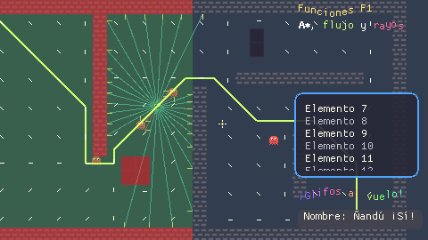

# Referencia de funciones

`modengine functions` lista todas las funciones integradas. Los argumentos entre corchetes son
opcionales. Los ángulos están en grados, con 0 = derecha y 90 = arriba (la Y de pantalla crece
hacia abajo). Los colores son números `0xRRGGBB`, que se escriben cómodamente como `#rrggbb`.

## Variables de instancia

| Variable | Significado |
|---|---|
| `x`, `y` | posición |
| `xprev`, `yprev` | posición al empezar el paso actual |
| `xstart`, `ystart` | posición donde se creó |
| `hspeed`, `vspeed` | velocidad horizontal/vertical (se suma a la posición en cada paso) |
| `speed`, `direction` | la misma velocidad en forma polar; cambiar una actualiza las otras |
| `gravity`, `gravity_dir` | aceleración añadida cada paso (dirección por defecto 270 = abajo) |
| `friction` | se resta a `speed` cada paso |
| `sprite`, `mask` | sprite que se dibuja / sprite cuya caja se usa para colisiones (`null` = el propio sprite) |
| `frame`, `frame_count` | frame actual (con decimales) / número de frames del sprite |
| `anim_speed` | multiplicador de la velocidad de animación (0 = parada) |
| `scale_x`, `scale_y` | escala; negativa = espejo |
| `angle` | rotación en grados (solo visual, la caja de colisión no rota) |
| `alpha`, `tint` | opacidad 0–1 / color que multiplica al sprite |
| `depth` | orden de dibujo: mayor = más al fondo |
| `visible` | si es `false` no se dibuja ni recibe eventos de dibujo |
| `solid` | ver "colisiones con sólidos" abajo |
| `persistent` | sobrevive al cambio de room |
| `alarm` | array de 12 contadores: `alarm[0] = 30` dispara `on alarm(0)` dentro de 30 pasos |
| `id`, `object` | la propia instancia / su objeto (solo lectura) |
| `bbox_left`, `bbox_right`, `bbox_top`, `bbox_bottom` | caja de colisión actual (solo lectura) |
| `sprite_width`, `sprite_height` | tamaño del sprite con la escala aplicada (solo lectura) |

Valores globales de solo lectura: `room`, `room_width`, `room_height`, `mouse_x`, `mouse_y`
(ratón en coordenadas de la room), `pi`, `infinity`, y las tablas `key`, `mouse`, `color`, `align`.

## Instancias

| Función | |
|---|---|
| `spawn(obj, x, y, [depth], [vars])` | crea una instancia y devuelve su id. `vars` es un struct de variables a asignar antes de `create`: `spawn(Bullet, x, y, 0, { speed: 6 })` |
| `destroy([objetivo], [run_event=true])` | destruye la instancia actual, una instancia, todas las de un objeto o `all` |
| `exists(objetivo)` | ¿existe esa instancia o alguna de ese objeto? |
| `count(obj)` | cuántas instancias hay (incluye hijos) |
| `find(obj, n)` | la n-ésima instancia, o `null` |
| `instances(obj)` | array con todas las instancias |
| `nearest(obj, [x, y])`, `furthest(obj, [x, y])` | la más cercana/lejana a un punto (por defecto, a quien llama) |
| `inst_at(x, y, obj)` | instancia cuya caja contiene el punto, o `null` |
| `is_a(inst_u_obj, obj)` | ¿es de ese objeto o de un hijo suyo? |
| `asset_name(asset_o_inst)` | nombre como texto |
| `distance_to(obj)` | distancia a la instancia más cercana de ese objeto |

### Pools de instancias

Para objetos que se crean y destruyen a cientos (balas), un pool guarda el almacenamiento de las
instancias liberadas y lo reutiliza:

| Función | Qué hace |
|---|---|
| `instance_pool_create(obj, n)` | reserva `n` huecos para `obj` (y fija en `n` cuántos se guardan como mucho; sin llamarla, 256) |
| `pool_spawn(obj, x, y, [depth], [vars])` | igual que `spawn`, reutilizando un hueco libre si lo hay |
| `pool_release([inst], [evento_destroy=false])` | saca la instancia de la room como `destroy`, pero **sin** su evento `destroy` (salvo que pases `true`), y guarda su hueco |
| `pool_free_count(obj)`, `pool_stats()` | huecos libres; `{reused, created, released}` |

Semántica (para que nada cambie al pasar de `spawn` a `pool_spawn`): la instancia reutilizada recibe
un **id nuevo** (una referencia vieja a una bala liberada sigue dando `exists() == false`), sus
variables se vacían y se vuelven a ejecutar los inicializadores de propiedades, los `vars` y el
evento `create`, en ese orden, exactamente como con `spawn`. Las alarmas vuelven a −1.

Rendimiento medido (`cargo test --release --test f2_functions -- --nocapture`): crear y destruir
20 000 balas seguidas tarda ~27 ms con `spawn`/`destroy` y ~24 ms con pool (≈ 11 % menos); con 2000
balas vivas y 100 sustituidas por paso no hay diferencia apreciable (~0,6 ms por paso en ambos casos).
En Mod Engine crear una instancia es barato; el coste está en el código de sus eventos. Usa pools si
tu objeto crea mucho en sus propiedades; para lo demás `spawn`/`destroy` va bien.

## Colisiones

Las colisiones usan cajas alineadas con los ejes (la caja del sprite, o la de `mask`).

| Función | |
|---|---|
| `collides_at(x, y, obj)` | ¿chocaría con `obj` si estuviera en (x, y)? |
| `collider_at(x, y, obj)` | igual, pero devuelve la instancia (o `null`) |
| `colliders_at(x, y, obj)` | array con todas |
| `free_at(x, y)` | ¿no hay ninguna instancia `solid` ahí? |
| `rect_hits(x1, y1, x2, y2, obj)` | primera instancia que toca el rectángulo |
| `circle_hits(x, y, r, obj)` | primera instancia que toca el círculo |
| `line_hits(x1, y1, x2, y2, obj)` | primera instancia que cruza el segmento |
| `move_contact(dir, [max], [obj])` | avanza píxel a píxel en `dir` hasta tocar `obj` (o un sólido). Devuelve la distancia recorrida |

**Colisiones con sólidos:** en el evento `collision`, si la otra instancia es `solid`, la que
recibe el evento vuelve antes a su posición del paso anterior.

### Capas de colisión

Cada instancia tiene dos variables de bits: `collision_layer` (en qué capas está, por defecto
`1`) y `collision_mask` (con qué capas choca, por defecto todas, `-1`). Una instancia **A** ve a
**B** si `B.collision_layer & A.collision_mask != 0`. Lo respetan `collides_at`, `collider_at`,
`colliders_at`, `free_at`, `move_contact`, los eventos `collision`, el rebote contra sólidos y
las funciones de GameMaker de abajo, siempre con la máscara **de quien pregunta** (la regla no
es simétrica). Con los valores por defecto todo choca con todo, como antes.

```
// capas: 1 = muros, 2 = fosos
object Foso { sprite = spr_foso  collision_layer = 2 }
object Bala { sprite = spr_bala  collision_mask = 1 }      // atraviesa fosos, no muros
object Jugador { sprite = spr_jug  collision_mask = 1 | 2 } // no puede pisar fosos
```

### Nombres de GameMaker

| Función | |
|---|---|
| `place_meeting(x, y, obj)`, `instance_place(x, y, obj)`, `instance_place_list(x, y, obj)` | = `collides_at` / `collider_at` / `colliders_at` (la lista es un array) |
| `place_free(x, y)`, `place_empty(x, y, [obj=all])` | ¿sin sólidos? / ¿sin nada? bajo la caja de quien llama |
| `position_meeting(x, y, obj)`, `instance_position(x, y, obj)`, `instance_position_list(x, y, obj)` | instancias cuya caja contiene el punto (incluida quien llama) |
| `collision_point(x, y, obj, [prec], [notme=true])`, `collision_rectangle(x1, y1, x2, y2, obj, [prec], [notme])`, `collision_circle(x, y, r, obj, [prec], [notme])` | primera instancia, o `null`. También `_list` (array). `prec` se acepta pero las cajas son siempre rectángulos |
| `collision_line(x1, y1, x2, y2, obj, [prec], [notme])` | la instancia **más cercana al inicio** del segmento |
| `collision_line_list(x1, y1, x2, y2, obj, [prec], [notme], [ordered=true])` | todas, de la más cercana a la más lejana |
| `tile_rect_hits(x1, y1, x2, y2, capa)` | ¿hay algún tile no vacío de esa capa de tiles en el rectángulo? (para la caja de una instancia, `tile_meeting`) |

### Rayos y línea de visión

Un rayo puede chocar con (`objetivo`): un objeto, una instancia, `all`, **el nombre de una capa
de tiles** (cualquier tile no vacío bloquea), **una rejilla `mp_grid`** (sus celdas ocupadas), o
un array que mezcle varios: `[Muro, "Muros", global.rejilla]`. Quien llama nunca se ve a sí
misma. `mask` (opcional) filtra por capas de colisión: por defecto la `collision_mask` de quien
llama (todas desde código global); `-1` = todas.

| Función | |
|---|---|
| `raycast(x1, y1, x2, y2, objetivo, [mask])` | primer impacto o `null`: `{ inst, x, y, distance, fraction, nx, ny }` (`nx, ny` = normal de la cara: `-1, 0` es la izquierda; `0, 0` si el rayo empieza dentro). Tiles y rejillas añaden `source`, `cell_x`, `cell_y` e `inst = null` |
| `raycast_dir(x, y, dir, largo, objetivo, [mask])` | igual con dirección (grados) y longitud |
| `raycast_all(x1, y1, x2, y2, objetivo, [mask], [stop_at_walls=true])` | todos los impactos ordenados por distancia. De tiles y rejillas solo cuenta la primera celda; con `stop_at_walls` lo que hay detrás de ella se descarta (atravesar enemigos hasta la pared) |
| `line_of_sight(x1, y1, x2, y2, bloqueos, [mask])` | `true` si nada de `bloqueos` corta el segmento |

```
// ¿ve el enemigo al jugador? Las paredes son tiles y las cajas, instancias
var j = nearest(Jugador)
if j != null and line_of_sight(x, y, j.x, j.y, ["Muros", Caja]) disparar()
// láser que atraviesa enemigos y se para en la pared
var hits = raycast_all(x, y, mouse_x, mouse_y, [Enemigo, "Muros"])
for (var i = 0; i < len(hits); i++) if hits[i].inst != null hits[i].inst.vida -= 1
```

## Movimiento

| Función | |
|---|---|
| `motion_set(dir, speed)` | fija dirección y velocidad |
| `motion_add(dir, speed)` | suma un empujón a la velocidad actual |
| `move_towards(x, y, speed)` | apunta la velocidad hacia un punto |
| `step_towards(x, y, step)` | mueve directamente hacia un punto sin pasarse; devuelve `true` al llegar |
| `move_wrap([hor=true], [ver=true], [margen])` | al salir por un borde aparece por el contrario |

## Rejillas de navegación



Rejillas de celdas libres/ocupadas para buscar caminos (A\*), con los nombres de GameMaker, más
mapas de distancias (BFS) y campos de flujo para muchos enemigos a la vez. Una rejilla es un
número (`id`); los caminos rodean las celdas ocupadas y en diagonal no cortan esquinas.

| Función | |
|---|---|
| `mp_grid_create(left, top, hceldas, vceldas, ancho_celda, alto_celda)` | crea una rejilla y devuelve su id |
| `mp_grid_destroy(g)`, `mp_grid_exists(g)`, `mp_grid_clear_all(g)` | |
| `mp_grid_add_cell(g, cx, cy)`, `mp_grid_clear_cell(g, cx, cy)` | marca / libera una celda |
| `mp_grid_add_rectangle(g, x1, y1, x2, y2)`, `mp_grid_clear_rectangle(...)` | celdas que toca el rectángulo (píxeles, esquinas incluidas) |
| `mp_grid_add_instances(g, obj, [prec])` | celdas que tocan las cajas de esas instancias |
| `mp_grid_add_tilemap(g, capa, [tiles])` | celdas cuyo centro cae en un tile no vacío de la capa (o en uno de los índices del array `tiles`). Devuelve cuántas marcó |
| `mp_grid_get_cell(g, cx, cy)`, `mp_grid_cell_at(g, x, y)` | `-1` ocupada (o fuera), `0` libre |
| `mp_grid_cell_of(g, x, y)` → `[cx, cy]`, `mp_grid_cell_center(g, cx, cy)` → `[x, y]` | conversión píxel ↔ celda |
| `mp_grid_rect_free(g, x1, y1, x2, y2)`, `mp_grid_place_free(g, x, y)` | ¿solo celdas libres bajo el rectángulo / bajo la caja de quien llama en (x, y)? |
| `mp_grid_path(g, path, x1, y1, x2, y2, diagonal)` | rellena una trayectoria (`path_add()`) con el camino; `false` si no hay. Se sigue con `path_start` |
| `mp_grid_path_points(g, x1, y1, x2, y2, [diagonal=true])` | el camino como array `[[x, y], ...]` (inicio, centros de celda, destino); `[]` si no hay |
| `mp_grid_distance_map(g, x, y, [diagonal=false], [max])` | filas de distancias en celdas desde (x, y) (`-1` = inalcanzable). `x, y` puede ser un array de puntos `[[x, y], ...]` (varios orígenes) |
| `mp_grid_raycast(g, x1, y1, x2, y2)` | primera celda ocupada del segmento: `{ x, y, distance, nx, ny, cell_x, cell_y }` o `null` |
| `mp_grid_draw(g, [color_libre], [color_ocupada])` | pinta la rejilla (depuración) |
| `mp_flow_create(g, x, y, [diagonal=true], [max])` | campo de flujo hacia un destino (o un array de destinos); devuelve su id |
| `mp_flow_dir(f, x, y)` | dirección (grados) hacia la siguiente celda; `-1` en el destino o si no se llega |
| `mp_flow_next(f, x, y)` → `[x, y]` o `null`, `mp_flow_distance(f, x, y)` | siguiente centro de celda / distancia en celdas (`-1` = inalcanzable) |
| `mp_flow_update(f, [x, y])`, `mp_flow_destroy(f)` | recalcula tras cambiar la rejilla (opcionalmente con otro destino) |

```
// room: una rejilla con los muros (tiles) y un campo de flujo hacia el jugador
// (en el step del jugador, cada 20 pasos: mp_flow_update(global.flujo, x, y))
global.nav = mp_grid_create(0, 0, room_width / 16, room_height / 16, 16, 16)
mp_grid_add_tilemap(global.nav, "Muros")
var j = find(Jugador, 0)
global.flujo = mp_flow_create(global.nav, j.x, j.y)

// Enemigo, on step
var d = mp_flow_dir(global.flujo, x, y)
if d >= 0 motion_set(d, 1.5) else speed = 0
```

## Eventos y rooms

| Función | |
|---|---|
| `inherited()` | ejecuta la versión del padre del evento actual; dentro de un método, la del método (ver [lenguaje.md](lenguaje.md#métodos-del-padre-inherited-y-super)) |
| `event_user(n, [objetivo])` | dispara `on user(n)` |
| `goto_room(room)` | cambia de room al terminar el paso |
| `next_room()`, `prev_room()` | según el orden de `game.toml`; devuelven `false` si no hay más |
| `restart_room()`, `restart_game()`, `quit()` | |
| `room_name()` | nombre de la room actual |

## Cámara

`camera_set(x, y)` (deja de seguir; la posición se ajusta a la room al final del paso), `camera_follow(objetivo, [suavizado])`,
`camera_shake(intensidad, [pasos=10])`, `camera_x()`, `camera_y()`, `camera_w()`, `camera_h()`.

## Entrada

| Función | |
|---|---|
| `key_down(k)`, `key_pressed(k)`, `key_released(k)` | estado de una tecla (`key.space`, `key.a`...) |
| `key_any()`, `key_any_pressed()` | ¿alguna tecla? |
| `input_axis(neg, pos)` | -1, 0 o 1. Acepta teclas o arrays de teclas: `input_axis([key.left, key.a], [key.right, key.d])` |
| `mouse_down(b)`, `mouse_pressed(b)`, `mouse_released(b)` | botones (`mouse.left`, `mouse.right`, `mouse.middle`) |
| `mouse_wheel()` | movimiento de la rueda este paso |
| `gui_mouse_x()`, `gui_mouse_y()` | ratón en coordenadas de pantalla (para `draw_gui`) |
| `touch_count()`, `touch_x(i)`, `touch_y(i)` | dedos en una pantalla táctil (Android), en coordenadas de pantalla; un solo dedo también mueve el ratón |

### Texto escrito y cursor

`keyboard_string` es lo que el jugador ha escrito (mayúsculas, `ñ`, tildes y cualquier carácter
del teclado del sistema; Retroceso borra un carácter y, mantenido, repite tras medio segundo;
hasta 1024 caracteres). Como en GameMaker es una **variable** que se lee y se asigna
(`keyboard_string = ""` para vaciarla), desde instancias o código global. `keyboard_lastchar` es
el último carácter escrito. Siguen valiendo `keyboard_string()`, `keyboard_lastchar()` y
`keyboard_string_set(t)`. Desde la terminal: `--input "40:text=Ñandú"`.

| Función / variable | |
|---|---|
| `window_set_cursor(cr)`, `window_get_cursor()` | cursor del sistema: `cr_default`, `cr_none` (oculto), `cr_arrow`, `cr_cross`, `cr_beam`, `cr_handpoint`, `cr_size_ns`, `cr_size_we`, `cr_size_nesw`, `cr_size_nwse`, `cr_size_all`, `cr_drag`, `cr_hourglass`... |
| `cursor_sprite` (variable), `cursor_set_sprite(spr_o_null)` | sprite dibujado en el ratón encima de todo (después de `draw_gui`, animado a sus fps); mientras hay uno, el cursor del sistema se oculta |

```
on create { cursor_sprite = spr_mira }   // la mira sustituye al cursor del sistema
```

## Dibujo

Solo tiene efecto dentro de los eventos de dibujo. Los ajustes (`set_color`...) se reinician al
empezar cada frame.

| Función | |
|---|---|
| `draw_self()` | dibuja la instancia como lo haría el motor por defecto |
| `draw_sprite(spr, frame, x, y)` | |
| `draw_sprite_ext(spr, frame, x, y, sx, sy, angle, color, alpha)` | |
| `draw_sprite_stretched(spr, frame, x, y, w, h)` | |
| `sprite_set_rotation(spr, modo, [pasos])` | cómo se ve girado el sprite: `"nearest"` o `"rotsprite"` (pixel art limpio, ver «Rotación» en proyecto.md); `pasos` redondea el ángulo a N pasos por vuelta (0 = libre). `"smooth"` solo se puede poner en el TOML del sprite |
| `sprite_get_rotation(spr)`, `sprite_get_rotation_steps(spr)` | el modo (`"nearest"`, `"rotsprite"`, `"smooth"`) y los pasos actuales |
| `draw_rect(x1, y1, x2, y2, [contorno])`, `draw_circle(x, y, r, [contorno])` | |
| `draw_line(x1, y1, x2, y2, [grosor])`, `draw_tri(x1, y1, x2, y2, x3, y3, [contorno])`, `draw_point(x, y)` | |
| `draw_text(x, y, texto)` | con el color, alpha, fuente y alineación actuales; `\n` = nueva línea |
| `draw_text_ext(x, y, texto, escala, [color], [alpha])` | |
| `draw_bar(x1, y1, x2, y2, fracción, [fondo], [relleno])` | barra de vida/progreso |
| `set_color(c)`, `get_color()`, `set_alpha(a)`, `get_alpha()` | |
| `set_font(fuente_o_null)`, `set_align(h, [v])` | `align.left/center/right`, `align.top/middle/bottom` |
| `text_width(t)`, `text_height(t)` | |
| `layer_visible(nombre, visible)` | muestra u oculta una capa de la room |
| `tile_at(x, y, [capa])`, `tile_set(x, y, n, [capa])` | leer/cambiar tiles (-1 = vacío); más en [Tile maps](#tile-maps-y-tile-sets) |

Colores: `rgb(r, g, b)` (0–255), `hsv(h, s, v)` (h 0–360, s y v 0–1), `color_mix(a, b, t)`,
`color_r(c)`, `color_g(c)`, `color_b(c)` y la tabla `color.white`, `color.red`, `color.gold`...

### Paleta del juego

La `[palette]` de game.toml (Pear36 en los proyectos nuevos). Los índices van en el orden de
los caracteres `0-9`, `A-Z`, `a-z`, símbolos (el orden original de una paleta importada).

| Función | |
|---|---|
| `palette_size()` | número de colores |
| `palette_color(i)`, `palette_color("c")` | color por índice o por su carácter de pixel art (error si no existe) |
| `palette_char(i)` | carácter del color `i` (`""` si no existe) |
| `palette_nearest(c)` | índice del color de la paleta más parecido a `c` (-1 si está vacía) |

```
set_color(palette_color("F"))                  // Pear36: #ffffeb
tint = palette_color(palette_nearest(#ff0000)) // el rojo más cercano de la paleta
```

## Fuentes y texto

Las fuentes de `fonts/` (ver `docs/proyecto.md`) se usan con `set_font` / `draw_set_font`. Las
medidas salen de la fuente horneada, igual en el juego y sin ventana.

| Función | |
|---|---|
| `draw_set_font(f)` (= `set_font`), `draw_get_font()` (= `get_font`) | fuente actual (`null` = la integrada) |
| `string_width(t)`, `string_height(t)` | = `text_width` / `text_height` con la fuente actual |
| `string_width_ext(t, sep, w)`, `string_height_ext(t, sep, w)` | medidas del texto partido a `w` píxeles; `sep` = separación entre líneas (-1 = la de la fuente). También `text_width_ext`, `text_height_ext` |
| `draw_text_wrap(x, y, t, sep, w)` | dibuja partiendo líneas a `w` píxeles (respeta `set_align`) |
| `text_wrap(t, w)` | array con las líneas en que se parte el texto |
| `font_get_name(f)`, `font_get_fontname(f)` | nombre del asset / fichero TTF o sprite de origen |
| `font_get_size([f])` | tamaño en píxeles (sin argumento: el de la fuente actual) |
| `font_get_bold(f)`, `font_get_italic(f)` | estilo |
| `font_get_first(f)`, `font_get_last(f)` | primer y último carácter de sus rangos |
| `font_has_char(f, "ñ")` | ¿ese carácter está horneado en la fuente? |
| `font_get_info(f)` | struct `{ name, fontname, size, bold, italic, antialias, ranges, line_height, ascent, glyphs }` |

**Fuentes de sprite:** si la fuente no trae una letra, se usa la de la otra caja (`a` → `A`), y si
no trae el espacio, cuenta como un hueco del ancho de la `n` (o media línea). Así medir,
`text_wrap` y `draw_text_wrap` parten bien por palabras aunque los `chars` no incluyan `" "`.

### Texto por glifos y texto enriquecido

| Función | |
|---|---|
| `draw_text_glyphs(x, y, texto, fn)` | dibuja carácter a carácter llamando a `fn(i, ch, x, y, linea)` para cada uno; puede devolver `null` o un struct con `dx`, `dy`, `color`, `alpha`, `scale`, `char` (otro carácter) y `visible`. Respeta fuente, color, alpha y `set_align`. Devuelve `{ w, h, lines }` |
| `draw_text_rich(x, y, texto, [w=-1], [sep=-1])` | texto con etiquetas, partido a `w` píxeles por palabras. Devuelve `{ w, h, lines }` |
| `text_rich_size(texto, [w], [sep])` | lo mismo sin dibujar |
| `text_rich_strip(texto)` | el texto sin etiquetas |

Etiquetas: `[c=#f00]` / `[c=red]` / `[color=...]` color, `[a=0.5]` opacidad, `[s=2]` escala,
`[wave]` / `[wave=4]` ondas (amplitud en píxeles), `[shake]` / `[shake=2]` temblor, `[rainbow]`,
`[b]` negrita (el glifo dos veces, 1 px aparte). Se cierran con `[/c]`, `[/wave]`... o `[/]`
(la última abierta); `[[` escribe un `[`, y una etiqueta desconocida se dibuja tal cual. Las
animaciones usan el contador de pasos, así que son deterministas en pruebas.

```
draw_text_rich(20, 20, "¡[c=gold][wave]Tesoro[/wave][/c] encontrado! [shake][c=#e53935]-3[/][/]")
draw_text_glyphs(x, y, "¡Hola!", function(i, ch, gx, gy) {
    return { dy: sin(steps() / 8 + i) * 3, color: hsv(i * 40, 0.6, 1) }
})
```

### Recorte y rectángulos redondeados

| Función | |
|---|---|
| `gpu_set_scissor(x, y, w, h)` o `gpu_set_scissor({ x, y, w, h })` | solo se pinta dentro del rectángulo, en las coordenadas actuales: de la room en `draw` (respeta la cámara), de pantalla en `draw_gui`, de la surface si se dibuja en una |
| `gpu_get_scissor()` | `{ x, y, w, h }` o `null` |
| `gpu_reset_scissor()` | sin recorte |
| `gpu_push_scissor(x, y, w, h)`, `gpu_pop_scissor()` | recortes anidados: el nuevo se corta con el actual y `pop` vuelve al anterior (listas dentro de paneles) |
| `draw_roundrect(x1, y1, x2, y2, [contorno], [radio=6])` | rectángulo redondeado con el color actual |
| `draw_roundrect_ext(x1, y1, x2, y2, rx, ry, [contorno], [grosor=1])` | con radios propios |
| `draw_roundrect_colour(x1, y1, x2, y2, relleno, borde, [contorno])`, `draw_roundrect_colour_ext(x1, y1, x2, y2, rx, ry, relleno, borde, [contorno])` | relleno de un color y borde de otro (también `_color`); GameMaker hace un degradado, aquí son dos colores planos |

El recorte se reinicia al empezar cada frame y al pasar a `draw_gui` (y en cada cambio de
cámara o de surface).

```
on draw_gui {
    draw_roundrect_ext(10, 10, 210, 130, 8, 8)
    gpu_push_scissor(14, 14, 192, 112)       // la lista no se sale del panel
    for (var i = 0; i < len(items); i++) draw_text(18, 18 + i * 16 - scroll, items[i])
    gpu_pop_scissor()
}
```

## Tile maps y tile sets

Un *tile map* es una capa de tiles de la room. Las funciones aceptan su nombre (`"Mundo"`), el
id que devuelve `layer_tilemap_get_id` o `null` (la primera capa de tiles). Las celdas se cuentan
desde 0 a partir del desplazamiento de la capa. Un *dato de tile* es el número de tile más los
bits de espejo/volteo/giro; `-1` = vacío.

| Función | |
|---|---|
| `layer_tilemap_get_id(capa)` | id del tile map de esa capa, o -1 |
| `layer_tilemap_exists(capa)` | ¿hay una capa de tiles con ese nombre? |
| `layer_tilemap_create(nombre, x, y, tileset, ancho, alto, [depth])` | crea una capa de tiles vacía (ancho × alto celdas) y devuelve su id |
| `tilemap_get(tm, cx, cy)`, `tilemap_set(tm, dato, cx, cy)` | leer / poner el dato de una celda |
| `tilemap_get_at_pixel(tm, x, y)`, `tilemap_set_at_pixel(tm, dato, x, y)` | lo mismo con coordenadas de la room |
| `tilemap_get_cell_x_at_pixel(tm, x, y)`, `tilemap_get_cell_y_at_pixel(tm, x, y)` | celda bajo un punto |
| `tilemap_get_width(tm)`, `tilemap_get_height(tm)`, `tilemap_set_width(tm, n)`, `tilemap_set_height(tm, n)` | tamaño en celdas |
| `tilemap_get_tile_width(tm)`, `tilemap_get_tile_height(tm)` | tamaño de celda en píxeles de la room (con la escala de la capa) |
| `tilemap_set_scale(tm, sx, [sy=sx])` | dibuja los tiles a esa escala (16 px a ×3 llenan celdas de 48 px); celdas, colisiones y `tilemap_*` usan el tamaño escalado. Como `scale = 3` en la capa (ver proyecto.md) |
| `tilemap_get_scale_x(tm)`, `tilemap_get_scale_y(tm)` | escala de la capa (1 = sin escalar) |
| `tilemap_get_x(tm)`, `tilemap_get_y(tm)`, `tilemap_x(tm, x)`, `tilemap_y(tm, y)` | posición de la capa |
| `tilemap_get_tileset(tm)`, `tilemap_tileset(tm, ts)` | tile set de la capa / cambiarlo |
| `tilemap_clear(tm, [dato])` | vacía la capa (o la rellena con `dato`) |
| `tilemap_autotile(tm, auto, cx, cy, [poner=true])` | pinta o borra con el auto tile `auto` (nombre o número) y recoloca los vecinos |
| `tile_meeting(x, y, [tm])` | ¿la caja de quien llama tocaría algún tile si estuviera en (x, y)? (colisiones con el escenario) |
| `tile_get_index(d)`, `tile_set_index(d, n)` | número de tile de un dato / cambiarlo conservando los bits |
| `tile_get_empty(d)`, `tile_set_empty(d)` | ¿vacío? / el dato vacío (-1) |
| `tile_get_mirror(d)`, `tile_get_flip(d)`, `tile_get_rotate(d)` | bits de transformación |
| `tile_set_mirror(d, [b])`, `tile_set_flip(d, [b])`, `tile_set_rotate(d, [b])` | devuelven el dato con ese bit puesto (o quitado con `false`) |
| `tileset_get_info(ts)` | struct `{ name, tile_width, tile_height, tile_count, columns, rows, fps, animations, autotiles }` |
| `draw_tile(ts, dato, frame, x, y)` | dibuja un tile (frame de un tile animado; -1 = el actual) |
| `draw_tilemap(tm, x, y)` | dibuja una capa de tiles en otra posición (minimapas, previsualizaciones) |

```js
// romper el bloque que hay bajo el ratón y dejar hierba alrededor
var tm = layer_tilemap_get_id("Mundo")
var cx = tilemap_get_cell_x_at_pixel(tm, mouse_x, mouse_y)
var cy = tilemap_get_cell_y_at_pixel(tm, mouse_x, mouse_y)
if mouse_pressed(mouse.right) tilemap_autotile(tm, "suelo", cx, cy, false)
```

## Audio

`play_sound(snd, [bucle=false], [volumen=1])`, `stop_sound(snd, [fundido_ms])`, `stop_all_sounds()`,
`sound_volume(snd, v, [fundido_ms])`.

Cada reproducción es una **voz**: `play_sound` y los `audio_play_sound*` devuelven su número, y
las funciones que reciben un sonido aceptan también una voz (el sonido afecta a todas sus voces).
Mod Engine mezcla el audio él mismo (no depende de lo que permita el sistema), así que el tono, el
panorama y los fundidos funcionan igual en Linux, Windows y Android, y también sin ventana
(`--headless`, `check`, tests): ahí el tiempo de audio avanza un paso de juego por paso, de modo que
`audio_is_playing` o la posición de pista dan lo mismo que jugando.

```js
// opciones con nombre (todas opcionales)
var v = play_sound(snd_disparo, { pitch: rand_range(0.9, 1.1), volume: 0.7, pan: -0.5 })
play_sound(mus_jefe, { loop: true, fade: 2000 })        // entra con fundido de 2 s
play_sound(snd_explosion, { x: x, y: y, ref: 100, max: 600 })  // posicional (ver abajo)
stop_sound(v, 300)                                      // sale con fundido de 300 ms
```

Opciones de `play_sound(snd, {...})`: `loop`, `volume` (o `gain`), `pitch` (1 = normal, 2 = una
octava más agudo y el doble de rápido), `pan` (−1 izquierda … 1 derecha), `offset` (segundos desde
los que empieza), `priority`, `fade` (ms de entrada desde silencio), `x`/`y` con `ref`, `max`,
`factor` (sonido posicional) o `emitter`. Una opción mal escrita da error.

Nombres de GameMaker (mismos argumentos):

| Función | Qué hace |
|---|---|
| `audio_play_sound(snd, prioridad, bucle, [gain], [offset], [pitch])` | reproduce; devuelve la voz |
| `audio_play_sound_at(snd, x, y, z, ref, max, factor, bucle, prioridad, [gain], [offset], [pitch])` | en una posición fija de la room |
| `audio_play_sound_on(emisor, snd, bucle, prioridad, [gain], [offset], [pitch])` | en un emisor que puede moverse |
| `audio_stop_sound(snd \| voz, [fundido_ms])`, `audio_stop_all()` | parar (con fundido opcional: extensión) |
| `audio_pause_sound`, `audio_resume_sound`, `audio_pause_all`, `audio_resume_all`, `audio_is_paused` | pausa |
| `audio_is_playing(snd \| voz)` | ¿suena? |
| `audio_sound_gain(snd \| voz, gain, ms)`, `audio_sound_get_gain` | volumen con fundido lineal de `ms` milisegundos; sobre un sonido afecta a todas sus voces, también a las futuras |
| `audio_sound_pitch(snd \| voz, pitch)`, `audio_sound_get_pitch(voz)` | tono (cambia también la velocidad, como en GameMaker) |
| `audio_sound_pan(voz, pan)` | panorama −1 … 1 (extensión) |
| `audio_sound_get_track_position(voz)`, `audio_sound_set_track_position(voz, s)` | posición en segundos |
| `audio_sound_length(snd \| voz)` | duración en segundos (con la intro, si la tiene) |
| `audio_sound_loop(voz, activo)`, `audio_sound_get_loop(voz)` | activar/quitar el bucle de una voz |
| `audio_sound_loop_start(snd, s)`, `audio_sound_loop_end(snd, s)` | puntos de bucle (segundos) |
| `audio_master_gain(gain, [ms])`, `audio_get_master_gain()` | volumen general |
| `audio_group_set_gain(grupo, gain, ms)`, `audio_group_get_gain(grupo)`, `audio_group_stop_all(grupo, [ms])` | grupos de volumen |
| `audio_sound_get_audio_group(snd)` | nombre del grupo de un sonido |
| `audio_listener_position(x, y, [z])`, `audio_listener_follow_view()` | oyente |
| `audio_emitter_create()`, `audio_emitter_free`, `audio_emitter_exists`, `audio_emitter_position(e, x, y, [z])`, `audio_emitter_falloff(e, ref, max, factor)`, `audio_emitter_gain`, `audio_emitter_pitch` | emisores |
| `audio_play_sound_intro_loop(intro, bucle, [gain])` | toca `intro` una vez y enlaza `bucle` en bucle sin hueco; una sola voz (extensión) |
| `audio_voices()` | lista de structs `{id, sound, gain, pitch, pan, position, loop, paused}` de las voces que suenan (depurar y tests) |

**Grupos de volumen.** Cada sonido pertenece a un grupo: `group = "musica"` en su TOML (ver
[proyecto.md](proyecto.md#sonidos-sounds)); sin `group` va a `"default"` (`audiogroup_default`). El
volumen final de una voz es `master × grupo × sonido (audio_sound_gain) × volume del TOML × voz`.
Un menú de opciones solo necesita `audio_group_set_gain("musica", global.op.musica, 0)`.

**Intro → bucle.** Con `intro = "x_intro.wav"` (o `loop_start` / `loop_end`) en el TOML del sonido,
`play_sound(snd, true)` toca la intro una vez y repite solo la parte del bucle, sin calcular a mano
cuándo termina. Con dos sonidos sueltos, `audio_play_sound_intro_loop(intro, bucle)` hace lo mismo.

**Sonido posicional.** El volumen baja con la distancia al oyente según el modelo «lineal con
límites» de GameMaker: volumen completo hasta `ref` píxeles, `1 − factor` a partir de `max`
(por defecto `ref` 100, `max` 600, `factor` 1). El panorama es `(x − oyente_x) / max` (−1 … 1). El
oyente sigue el centro de la vista salvo que lo coloques con `audio_listener_position`; el emisor
de un objeto que se mueve se actualiza con `audio_emitter_position(em, x, y)` en su `step`.

Límite: 128 voces a la vez; si se llena, una voz nueva sustituye a la de menor prioridad (la más
antigua entre iguales), o no suena si todas tienen más prioridad que ella (devuelve 0).

## Tiempo y estado

`steps()` (pasos desde que empezó el juego), `time()` (segundos de juego), `fps()`,
`step_rate()`, `set_step_rate(n)`, `debug_mode([activo])`.

## Corrutinas y llamadas diferidas

Una corrutina es una función que se puede parar a medias con `wait(pasos)` o `yield()` y seguir
más tarde desde el mismo sitio, con sus variables locales intactas. Sirven para patrones de balas,
fases de jefes, cinemáticas… sin máquinas de estados.

```js
on create {
    coroutine(function() {
        repeat (3) {                          // 3 ráfagas de 8 balas
            for (var i = 0; i < 8; i++) spawn(Bala, x, y, 0, { direction: i * 45 })
            wait(20)                          // 20 pasos
        }
        var a = 0
        while (a < 720) {                     // espiral: una bala por paso
            spawn(Bala, x, y, 0, { direction: a })
            a += 15
            yield()
        }
        wait_until(function() { return count(Bala) == 0 })
        fase = 2
    })
}
```

| Función | Qué hace |
|---|---|
| `coroutine(función, [args...])` | la arranca: se ejecuta **ya** hasta su primer `wait`/`yield` y devuelve un número que la identifica |
| `wait(pasos)` | sigue dentro de `pasos` pasos (`wait(1)` = el siguiente; `wait(0)` no espera) |
| `yield()` | igual que `wait(1)` |
| `wait_seconds(s)` | `s` segundos de juego (pasos según `step_rate`) |
| `wait_until(función)` | sigue cuando la función devuelva verdadero (se comprueba una vez por paso, desde el siguiente) |
| `coroutine_running(c)`, `coroutine_stop(c)`, `coroutine_pause(c)`, `coroutine_resume(c)` | control |
| `coroutine_stop_all([instancia])`, `coroutine_count([instancia])` | todas, o las de una instancia |
| `call_later(periodo, unidades, función, [repetir=false])` | llama a `función` dentro de `periodo` pasos (`time_source_units_frames`) o segundos (`time_source_units_seconds`); con `repetir`, cada `periodo`. Nombre de GameMaker |
| `call_cancel(id)` | cancela un `call_later` |

Reglas:

- Las corrutinas se reanudan una vez por paso, **justo después del evento `step`** de todas las
  instancias (antes del movimiento y las colisiones), en orden de creación. Los `call_later` se
  comprueban a continuación.
- `self` dentro de la corrutina es quien la creó. Si la creó una instancia, la corrutina (y sus
  `call_later`) se para cuando la instancia se destruye o deja la room (también al salir de una room
  persistente). Las creadas desde código global siguen entre rooms hasta que terminan o se paran;
  `game_restart()` las borra todas.
- `wait`/`yield`/`wait_seconds`/`wait_until` solo funcionan como **instrucción** del cuerpo de la
  corrutina, también dentro de `if`, `{ }`, `while`, `for`, `for-in`, `repeat` y `do-until`. No
  dentro de funciones que la corrutina llama, ni dentro de `switch` o `with` (error claro). Fuera de
  una corrutina dan error. Si defines tu propia función `wait`, se llama a la tuya.
- Un error dentro de una corrutina se informa con su línea (`in coroutine ...`) y la detiene.
- `return v` o `exit` la terminan.

## Guardar datos

`save_data(nombre, valor)` guarda números, textos, arrays y structs como JSON en
`<proyecto>/saves/<nombre>.json` (en un juego exportado, en la carpeta de datos del usuario; con
`--save-dir` / `--no-save`, donde digan esas opciones); `load_data(nombre, [por_defecto])` los
recupera. `to_json(v)` y `from_json(texto)` convierten sin tocar el disco.

- **Guardado atómico.** `save_data` escribe `<nombre>.json.tmp`, lo vuelca al disco y solo entonces
  lo renombra sobre `<nombre>.json`: un cierre o un disco lleno a mitad nunca deja una partida a
  medias. Antes copia la versión anterior (si era válida) a `<nombre>.json.bak`. Devuelve `false`
  (y avisa en la consola) si no pudo guardar.
- **Copia de seguridad.** Si `<nombre>.json` está dañado o falta, `load_data` carga el `.bak` y lo
  avisa en la consola (`[aviso] load_data('progreso'): ...`).
- **Valores por defecto fusionados.** Si lo guardado es un struct y `por_defecto` también, las
  claves que falten en lo guardado se rellenan con las de `por_defecto`, también dentro de structs
  anidados. Así una versión nueva del juego puede añadir opciones sin romper partidas viejas. Lo
  guardado siempre gana (aunque sea de otro tipo); los arrays no se mezclan. Sin partida devuelve
  una copia de `por_defecto`.
- `save_exists(nombre)` y `save_delete(nombre)` (borra también el `.bak`).

```js
global.op = load_data("ajustes", { musica: 0.7, efectos: 0.9, idioma: "es" })
// una partida de la versión anterior sin `idioma` se carga con idioma: "es"
```

## Matemáticas

`abs sign round floor ceil frac sqrt sqr pow exp ln log2 log10`,
`sin cos tan asin acos atan atan2` (radianes), `dsin dcos` (grados), `deg rad`,
`min(...) max(...) clamp(v, lo, hi) lerp(a, b, t) wrap(v, lo, hi)`,
`approach(v, objetivo, paso)` (acerca sin pasarse),
`dist(x1, y1, x2, y2)`, `angle_to(x1, y1, x2, y2)` (0 = derecha, 90 = arriba),
`angle_diff(a, b)` (= `b − a` en (−180, 180]: positivo es girar en sentido antihorario),
`len_x(longitud, dir)`, `len_y(longitud, dir)`.

Aleatorio: `rand([max=1])`, `rand_range(a, b)`, `irand(a, b)` (enteros, ambos incluidos),
`chance(p)`, `choose(a, b, ...)`, `seed(n)`, `randomize()`.

### Generadores aleatorios separados

Las funciones de arriba comparten un único generador: cualquier llamada de más (una partícula, una
variación de un sonido) desplaza todos los números siguientes, y la misma semilla ya no da el mismo
mapa. Un **generador separado** tiene su propio estado:

| Función | Qué hace |
|---|---|
| `rng_create([semilla])` | crea un generador; la semilla es un número o un texto (`"mazmorra-3"`). Sin semilla la saca del generador general, así que `seed(n)` y `--seed N` también lo fijan |
| `rng_random(r, [max=1])`, `rng_random_range(r, a, b)` | decimales en `[0, max)` / `[a, b)` |
| `rng_irandom(r, n)`, `rng_irandom_range(r, a, b)` | enteros de 0 a `n` / de `a` a `b`, ambos incluidos (como `irandom` de GameMaker) |
| `rng_chance(r, p)`, `rng_choose(r, a, b, ...)` o `rng_choose(r, array)`, `rng_shuffle(r, array)` | como `chance`, `choose`, `shuffle` |
| `rng_seed(r, semilla)`, `rng_get_state(r)`, `rng_set_state(r, estado)` | reiniciar; guardar/restaurar el punto exacto de la secuencia (texto) |
| `rng_destroy(r)`, `rng_exists(r)` | liberar |

Receta generación / juego:

```js
// al empezar una partida: la semilla del mundo sale del generador general (--seed la fija)
global.semilla = irand(0, 999999999)
global.gen = rng_create(global.semilla)
generar_mazmorra(global.gen)            // solo rng_* con global.gen: el mapa depende solo de la semilla
// el resto del juego usa rand()/irand()/choose(); lo que pase en combate no cambia el mapa
save_data("partida", { semilla: global.semilla, gen: rng_get_state(global.gen) })
```

## Texto

`str(v)`, `num(texto)` (`null` si no es un número), `len(v)`, `upper`, `lower`, `trim`,
`substr(t, inicio, [cantidad])`, `replace(t, buscar, poner)`, `split(t, sep)`, `join(array, [sep])`,
`starts_with`, `ends_with`, `contains(t, sub)`, `index_of(t, sub)`, `chr(n)`, `ord(t)`,
`format("{} de {}", a, b)`, `pad(valor, ancho, [relleno])` → `pad(42, 6, "0")` = `"000042"`.

## Arrays y structs

Arrays: `array([n], [relleno])`, `range([desde], hasta)`, `push(a, v...)`, `pop(a)`,
`insert(a, i, v)`, `remove(a, i)`, `clear(a)`, `contains(a, v)`, `index_of(a, v)`, `first(a)`,
`last(a)`, `reverse(a)`, `slice(a, [inicio], [fin])`, `copy(v)`, `sum(a)`, `shuffle(a)`,
`sort(a, [comparar])` (ordena el array en su sitio), `map(a, f)`, `filter(a, f)`. Las funciones
que se pasan pueden usar las variables locales de donde se escriben (ver
[cierres](lenguaje.md#cierres-las-funciones-anónimas-ven-las-locales)).

Structs: `keys(s)`, `has(s, clave)`, `get(s, clave, [defecto])`, `set(s, clave, v)`,
`remove_key(s, clave)`.

Tipos: `type_of(v)`, `is_num`, `is_str`, `is_array`, `is_struct`, `is_func`, `is_inst`, `is_null`.

Otros: `print(...)` o `show_debug_message(...)` (a la consola / Salida), `error(mensaje)`,
`call(f, args...)`.

Texto tecleado: `keyboard_string()` (lo que el jugador ha escrito; borrar quita el último
carácter) y `keyboard_string_set(texto)`. Para nombres, IPs, chat… Ver [red.md](red.md#texto-escrito-por-el-jugador).


## Trayectorias

Variables de instancia (como en GameMaker): `path_index` (la trayectoria o `-1`, solo lectura),
`path_position` (0–1), `path_positionprevious`, `path_speed` (píxeles por paso; negativa = hacia
atrás), `path_scale`, `path_orientation` (grados, antihorario), `path_endaction`.
Mientras sigue una trayectoria, `direction` apunta hacia donde se mueve. Evento:
`on path_ended` (la trayectoria termina con `path_action.stop`).

| Función | |
|---|---|
| `path_start(path, velocidad, [fin=path_action.stop], [absoluta=false])` | recorre la trayectoria. Relativa: empieza donde está la instancia. Absoluta: usa las coordenadas de la trayectoria. `fin`: `path_action.stop`, `.restart` (vuelve al principio), `.continue` (sigue desde donde acabó), `.reverse` (ida y vuelta) |
| `path_end()` | deja de seguirla |
| `path_get_length(p)`, `path_get_number(p)` | longitud en píxeles / número de puntos |
| `path_get_x(p, pos)`, `path_get_y(p, pos)`, `path_get_speed(p, pos)` | punto en la posición 0–1 |
| `path_get_point_x(p, n)`, `path_get_point_y`, `path_get_point_speed` | datos del punto n |
| `path_get_closed(p)`, `path_get_kind(p)` (0 recta, 1 suave), `path_get_precision(p)`, `path_get_name(p)`, `path_exists(p)` | |
| `path_add()`, `path_duplicate(p)`, `path_delete(p)`, `path_assign(destino, origen)`, `path_append(destino, origen)` | crear y copiar trayectorias en tiempo de juego |
| `path_add_point(p, x, y, [vel=100])`, `path_insert_point(p, n, x, y, [vel])`, `path_change_point(p, n, x, y, [vel])`, `path_delete_point(p, n)`, `path_clear_points(p)` | editar puntos |
| `path_set_closed(p, b)`, `path_set_kind(p, 0/1)`, `path_set_precision(p, 1–8)` | |
| `path_reverse(p)`, `path_mirror(p)`, `path_flip(p)`, `path_shift(p, dx, dy)`, `path_rescale(p, sx, sy)`, `path_rotate(p, grados)` | transformar (alrededor del centro) |
| `draw_path(p, x, y, absoluta)` | dibuja la trayectoria con el color actual |

## Líneas de tiempo

Variables de instancia: `timeline_index` (timeline o `-1`), `timeline_position` (paso actual,
con decimales), `timeline_speed` (por defecto 1), `timeline_running` (por defecto `false`),
`timeline_loop`. Cada paso, después de `step_begin`, se ejecutan los momentos entre la posición
anterior y la nueva, en el contexto de la instancia. Con `timeline_loop`, al pasar el último
momento vuelve a 0.

```
on create {
    timeline_index = intro
    timeline_running = true
}
```

| Función | |
|---|---|
| `timeline_start(tl, [velocidad=1], [bucle=false])` | atajo: asigna la timeline, posición 0 y en marcha |
| `timeline_stop()` | la para y vuelve a 0 |
| `timeline_add()`, `timeline_delete(tl)`, `timeline_exists(tl)`, `timeline_get_name(tl)` | |
| `timeline_moment_add_script(tl, paso, función)` | añade una función a un momento |
| `timeline_moment_clear(tl, paso)`, `timeline_clear(tl)` | |
| `timeline_size(tl)`, `timeline_max_moment(tl)` | número de momentos / último paso |

## Curvas de animación

Como en GameMaker, una curva es un struct `{ name, channels }` y cada canal
`{ name, type, iterations, points: [{ posx, value }] }` (`type`: `"linear"`, `"smooth"` o
`"bezier"`; también 0, 1, 2).

| Función | |
|---|---|
| `animcurve_get(curva)` | struct con todos los canales |
| `animcurve_get_channel(curva, nombre_o_índice)` | struct del canal |
| `animcurve_channel_evaluate(canal, x)` | valor del canal en `x` (0–1) |
| `animcurve_evaluate(curva, canal, x)` | atajo rápido sin structs: `animcurve_evaluate(salto, "y", t)` |
| `animcurve_get_channel_index(curva, nombre)` | índice o `-1` |
| `animcurve_exists(curva)` | |
| `animcurve_create()`, `animcurve_channel_new()`, `animcurve_point_new()`, `animcurve_destroy(c)` | crear curvas en tiempo de juego (structs que se evalúan igual) |

```
t = (t + 1 / 60) mod 1
y = base - 40 * animcurve_evaluate(bounce, "y", t)
```

## Secuencias

Una secuencia en juego es un *elemento* (un número) creado en una capa de la room; se dibuja a
la profundidad de esa capa y avanza sola cada paso a su `fps`.

| Función | |
|---|---|
| `layer_sequence_create(capa, x, y, seq)` | la crea en la capa (nombre, o una profundidad) y devuelve el elemento |
| `sequence_create(seq, x, y, [depth=0])` | atajo sin capa |
| `layer_sequence_destroy(el)`, `layer_sequence_exists([capa], el)` | |
| `layer_sequence_play(el)`, `layer_sequence_pause(el)`, `layer_sequence_is_paused(el)`, `layer_sequence_is_finished(el)` | `play` en una secuencia terminada vuelve a empezar |
| `layer_sequence_headpos(el, frame)`, `layer_sequence_headdir(el, 1/-1)`, `layer_sequence_speedscale(el, k)` | cabeza de reproducción, sentido y velocidad |
| `layer_sequence_x(el, x)`, `_y`, `_angle`, `_xscale`, `_yscale` | mover, girar y escalar toda la secuencia |
| `layer_sequence_get_x(el)`, `_get_y`, `_get_angle`, `_get_xscale`, `_get_yscale`, `_get_headpos`, `_get_headdir`, `_get_speedscale`, `_get_length`, `_get_sequence` | |
| `layer_sequence_get_track_instance(el, pista)` | instancia creada por una pista `object` (o `null`) |
| `sequence_exists(seq)`, `sequence_get(seq)` | struct con `name`, `length`, `playback_speed`, `playback`, `xorigin`, `yorigin`, `tracks`, `moments` |

Constante nueva: `path_action` (`stop`, `restart`, `continue`, `reverse`). Tipos de variables:
`path`, `timeline`, `animcurve`, `sequence` (`ruta: path = patrol`).

## Partículas

Funciones con los nombres de GameMaker (`colour` también se acepta como `color`). Sistemas,
tipos y emisores son números. Las coordenadas de las partículas son relativas a la posición del
sistema (que se mueve, gira y tiñe entero con `part_system_position/angle/color`).

| Función | |
|---|---|
| `part_system_create([asset])` | crea un sistema vacío o a partir de `particles/<asset>.toml`; las ráfagas del asset se disparan al crearlo |
| `part_system_create_layer(capa, persistente, [asset])` | igual, a la profundidad de esa capa de la room |
| `part_system_destroy(ps)`, `part_system_exists(ps)`, `part_system_clear(ps)` | `clear` quita partículas y emisores |
| `part_system_position(ps, x, y)`, `part_system_angle(ps, grados)` | mueve / gira todo lo que dibuja |
| `part_system_color(ps, color, alpha)` | tinte y opacidad de todo el sistema |
| `part_system_depth(ps, d)`, `part_system_layer(ps, capa)` | orden de dibujo entre instancias y capas |
| `part_system_automatic_update(ps, b)`, `part_system_automatic_draw(ps, b)` | con `false`, se actualiza / dibuja a mano con `part_system_update(ps)` / `part_system_drawit(ps)` |
| `part_system_draw_order(ps, viejas_a_nuevas)` | |
| `part_system_get_info(ps)` | struct `{ name, x, y, depth, particle_count, emitters: [{ ind, name, enabled, type }] }` |
| `part_particles_create(ps, x, y, tipo, n)` | crea `n` partículas (negativo: una con probabilidad 1/n) |
| `part_particles_create_color(ps, x, y, tipo, color, n)` | con un color fijo |
| `part_particles_burst(ps, x, y, asset)` | dispara una vez todos los emisores de un asset en (x, y) |
| `part_particles_count(ps)`, `part_particles_clear(ps)` | |
| `part_type_create()`, `part_type_destroy(t)`, `part_type_exists(t)`, `part_type_clear(t)` | destruir un tipo borra sus partículas |
| `part_type_shape(t, pt_shape_*)` | `pt_shape_pixel, disk, square, line, star, circle, ring, sphere, flare, spark, explosion, cloud, smoke, snow` |
| `part_type_sprite(t, spr, animar, estirar, al_azar)` | |
| `part_type_size(t, min, max, incr, osc)`, `part_type_scale(t, xs, ys)` | tamaño 1 = 64 px con las formas |
| `part_type_speed(t, min, max, incr, osc)`, `part_type_direction(t, min, max, incr, osc)` | |
| `part_type_gravity(t, cantidad, dir)` | |
| `part_type_orientation(t, min, max, incr, osc, relativa)` | |
| `part_type_color1/2/3(t, c1, [c2], [c3])`, `part_type_color_mix(t, c1, c2)` | colores a lo largo de la vida / uno fijo al azar |
| `part_type_color_rgb(t, rmin, rmax, gmin, gmax, bmin, bmax)`, `part_type_color_hsv(...)` | color fijo al azar por canal (0–255) |
| `part_type_alpha1/2/3(t, a1, [a2], [a3])`, `part_type_blend(t, aditiva)` | |
| `part_type_life(t, min, max)` | en pasos |
| `part_type_step(t, n, otro_tipo)`, `part_type_death(t, n, otro_tipo)` | subpartículas en cada paso / al morir |
| `part_emitter_create(ps)`, `part_emitter_destroy(ps, em)`, `part_emitter_destroy_all(ps)`, `part_emitter_exists(ps, em)`, `part_emitter_clear(ps, em)` | |
| `part_emitter_region(ps, em, xmin, xmax, ymin, ymax, ps_shape_*, ps_distr_*)` | `ps_shape_rectangle/ellipse/diamond/line`, `ps_distr_linear/gaussian/invgaussian` |
| `part_emitter_stream(ps, em, tipo, n)`, `part_emitter_burst(ps, em, tipo, n)` | flujo continuo / ráfaga inmediata |
| `part_emitter_enable(ps, em, b)`, `part_emitter_interval(ps, em, min, max)`, `part_emitter_delay(ps, em, min, max)` | intervalo y retardo en pasos |
| `part_emitter_find(ps, nombre)` | índice del emisor de un asset por nombre (o -1); propio de Mod Engine |

```
fuego = part_system_create(ps_fire)
part_system_position(fuego, x, y)

chispa = part_type_create()
part_type_shape(chispa, pt_shape_spark)
part_type_size(chispa, 0.1, 0.2, -0.002, 0)
part_type_color2(chispa, #ffffff, #ffcd75)
part_type_alpha2(chispa, 1, 0)
part_type_blend(chispa, true)
part_particles_create(fuego, 0, 0, chispa, 10)
```

## Shaders y modos de mezcla

| Función | |
|---|---|
| `shader_set(sh)`, `shader_reset()`, `shader_current()` | lo que se dibuja después usa ese shader (cada frame empieza sin shader) |
| `shader_is_compiled(sh)` | `false` si la GPU lo rechazó (sin ventana: si la comprobación estática falla) |
| `shader_get_uniform(sh, "nombre")` | identificador del uniform, o -1 si no existe |
| `shader_set_uniform_f(u, v1, [v2], [v3], [v4])`, `shader_set_uniform_i(u, ...)` | tantos valores como el tipo (`float`, `vec2`…, `int`, `ivec2`…) |
| `shader_set_uniform_f_array(u, array)`, `shader_set_uniform_i_array(u, array)`, `shader_set_uniform_matrix(u, array16)` | arrays y `mat4` |
| `shader_get_sampler_index(sh, "nombre")`, `texture_set_stage(sampler, sprite)` | texturas extra (`uniform sampler2D`) |
| `gpu_set_blendmode(bm_normal / bm_add / bm_subtract / bm_max)`, `gpu_get_blendmode()` | modo de mezcla de lo que se dibuja después |

```
on draw {
    shader_set(sh_wave)
    shader_set_uniform_f(shader_get_uniform(sh_wave, "u_time"), time())
    draw_self()
    shader_reset()
}
```

**Mezcla y canal alfa.** Todo lo que se dibuja (con o sin shader, en cualquier modo de mezcla)
mezcla el alfa con `origen + destino·(1 − alfa_origen)`: lo semitransparente nunca baja el alfa
del lienzo, y lo que se pinta encima con un shader sale igual de opaco. El lienzo se vuelca a la
ventana siempre opaco. `shader_reset()` vuelve al material por defecto, que tiene el mismo
blending que los shaders: no hace falta un shader «de paso» para no estropear el alfa.

**Uniforms.** Cada `shader_set_uniform_*` se aplica a los dibujos que vienen después; para
dibujar dos cosas con valores distintos, cambia el valor entre los dos dibujos.

## Surfaces y post-proceso

Una surface es una imagen en la GPU donde se puede dibujar y que luego se dibuja como un
sprite (como en GameMaker). Los identificadores son números; `application_surface` (0) es el
fotograma del juego (ancho × alto de `[display]`).

| Función | |
|---|---|
| `surface_create(ancho, alto)` | nueva surface (transparente); devuelve su número. De 1 a 8192 píxeles por lado |
| `surface_free(s)`, `surface_exists(s)` | liberar / comprobar (`surface_exists(-1)` es `false`) |
| `surface_get_width(s)`, `surface_get_height(s)`, `surface_resize(s, ancho, alto)` | tamaño (al cambiarlo se pierde el contenido) |
| `surface_set_target(s)`, `surface_reset_target()` | lo que se dibuja entre las dos va a la surface, en sus coordenadas (0,0 = su esquina superior izquierda, sin cámara). Se pueden anidar |
| `surface_get_target()` | surface de destino actual, o -1 |
| `draw_surface(s, x, y)` | dibuja la surface con su tamaño |
| `draw_surface_ext(s, x, y, escala_x, escala_y, ángulo, color, alfa)` | escalas negativas la reflejan sobre x/y; gira alrededor de (x, y) |
| `draw_surface_stretched(s, x, y, ancho, alto)`, `draw_surface_stretched_ext(s, x, y, ancho, alto, color, alfa)` | estirada |
| `draw_surface_part(s, izq, arriba, ancho, alto, x, y)`, `draw_surface_part_ext(..., escala_x, escala_y, color, alfa)` | solo un rectángulo de la surface |
| `draw_clear(color)`, `draw_clear_alpha(color, alfa)` | borra el destino actual entero (surface o fotograma); `draw_clear_alpha(#000000, 0)` deja una surface transparente |
| `application_surface_draw_enable(bool)`, `application_surface_is_draw_enabled()` | con `false`, la ventana solo muestra lo que dibuje `post_draw` |

Se puede dibujar en una surface en cualquier evento (por ejemplo prepararla una vez en
`create`): lo que va entre `surface_set_target` y `surface_reset_target` fuera de los eventos de
dibujo se aplica al principio del siguiente fotograma. Lo que se dibuja fuera de los eventos de
dibujo y fuera de una surface se ignora. Una surface que se queda como destino al acabar el
evento se cierra sola y se informa del error. Dibujar una surface dentro de sí misma no hace
nada. Lo semitransparente dibujado en una surface transparente guarda su alfa (cobertura): al
dibujar la surface encima del juego se mezcla bien.

**Post-proceso de pantalla completa.** El evento `post_draw` se ejecuta después de `draw_gui`,
sobre el fotograma ya terminado, en coordenadas de GUI (las del juego, no las de la ventana).
Empieza con una copia de `application_surface`; dibujar `application_surface` con un shader
encima la sustituye entera, así que el shader puede deformar, desplazar y aclarar, no solo
oscurecer:

```
object Pantalla {
    on post_draw {
        shader_set(crt)
        shader_set_uniform_f(shader_get_uniform(crt, "u_t"), time())
        draw_surface(application_surface, 0, 0)
        shader_reset()
    }
}
```

```glsl
// shaders/crt.fsh: curvatura, líneas de barrido y brillo
varying vec2 v_vTexcoord;
varying vec4 v_vColour;
uniform float u_t;

void main() {
    vec2 q = v_vTexcoord - 0.5;
    vec2 uv = 0.5 + q * (1.0 + dot(q, q) * 0.18);          // curvatura
    if (uv.x < 0.0 || uv.x > 1.0 || uv.y < 0.0 || uv.y > 1.0) { gl_FragColor = vec4(0.0, 0.0, 0.0, 1.0); return; }
    vec3 c = texture2D(gm_BaseTexture, uv).rgb;
    vec3 glow = (texture2D(gm_BaseTexture, uv + vec2(0.002, 0.0)).rgb + texture2D(gm_BaseTexture, uv - vec2(0.002, 0.0)).rgb) * 0.5;
    c = c * 1.15 + max(glow - 0.55, 0.0) * 0.8;            // brillo tipo bloom
    c *= 0.82 + 0.18 * step(1.0, mod(uv.y * 720.0, 3.0));   // líneas de barrido
    gl_FragColor = vec4(c, 1.0);
}
```

El evento `pre_draw` se ejecuta antes de `draw_begin`, sobre el fotograma recién borrado y en
coordenadas de GUI (sirve para fondos de pantalla completa). Diferencia con GameMaker: allí
`pre_draw`/`post_draw` dibujan sobre la ventana, aquí sobre el fotograma del juego (que luego
se escala a la ventana).

Sin GPU (`modengine check`) las surfaces existen con su tamaño y todo se comprueba igual; solo
no hay píxeles.

## Extensiones

`extension_exists(nombre)` (¿está cargada y activa?) y `extension_get_info(nombre)` (struct
`{ name, version, author, description, enabled, files, functions }`). Las funciones y
constantes de las extensiones se usan como cualquier otra función global.

## Red y multijugador

Guía completa con ejemplos en [red.md](red.md). Todo lo que llega de la red se recibe en el
evento `on network`, con los datos en `async_load`.

Capa sencilla (jugadores con número, mensajes con cualquier valor):

| Función | |
|---|---|
| `net_host(puerto, [max_jugadores=4], [nombre])` | crea la partida (eres el jugador 1); devuelve el puerto o `false` |
| `net_join(host, puerto, [nombre])` | se une; llega `connect` (o `failed`) en `on network` |
| `net_send(a, tipo, [dato])` | `a` = número de jugador o `all`; `dato` = número, texto, array, struct… |
| `net_peers()`, `net_peer_name(n)`, `net_my_id()`, `net_is_host()`, `net_is_online()`, `net_status()`, `net_port()` | |
| `net_disconnect()` | sale (el host cierra la partida para todos) |

Estilo GameMaker (sockets y bytes):

| Función | |
|---|---|
| `network_create_server(tipo, puerto, max)`, `network_create_server_raw(...)` | `network_socket_tcp` o `network_socket_udp`; `-1` si falla |
| `network_create_socket(tipo)`, `network_create_socket_ext(tipo, puerto)` | |
| `network_connect(s, host, puerto)`, `network_connect_raw(...)` (y `_async`) | asíncrono: `network_type_non_blocking_connect` |
| `network_send_packet(s, buffer, tamaño)`, `network_send_raw(...)` | |
| `network_send_udp(s, host, puerto, buffer, tamaño)` (y `_raw`), `network_send_broadcast(s, puerto, buffer, tamaño)` | |
| `network_destroy(s)`, `network_set_timeout(s, lectura_ms, escritura_ms)`, `network_set_config(c, v)` | |
| `network_resolve(nombre)`, `network_get_port(s)`, `network_get_status(s)`, `network_exists(s)` | |

Buffers:

| Función | |
|---|---|
| `buffer_create(tamaño, buffer_fixed\|grow\|wrap\|fast, alineación)`, `buffer_delete(b)`, `buffer_exists(b)` | |
| `buffer_write(b, tipo, v)`, `buffer_read(b, tipo)`, `buffer_peek(b, pos, tipo)`, `buffer_poke(b, pos, tipo, v)` | tipos `buffer_u8 s8 u16 s16 u32 s32 u64 f16 f32 f64 bool string text` |
| `buffer_seek(b, buffer_seek_start\|relative\|end, n)`, `buffer_tell(b)`, `buffer_get_size(b)`, `buffer_get_used_size(b)` | |
| `buffer_resize`, `buffer_fill`, `buffer_copy`, `buffer_sizeof(tipo)`, `buffer_get_type`, `buffer_get_alignment` | |
| `buffer_base64_encode(b, [pos], [tamaño])`, `buffer_base64_decode(texto)` | |
| `buffer_save(b, fichero)`, `buffer_save_ext(b, fichero, pos, tamaño)`, `buffer_load(fichero)` | en la carpeta de guardado |
