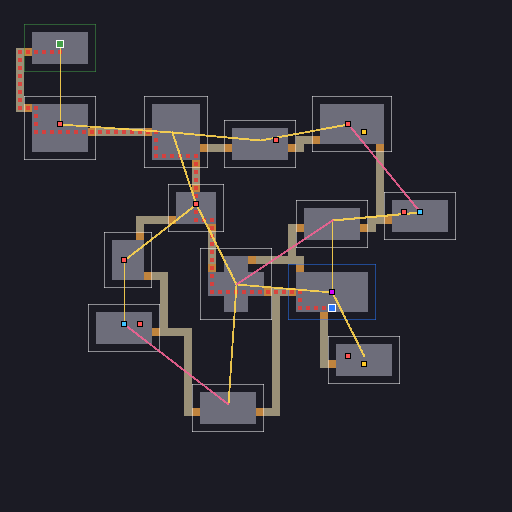

# Mazmorras procedurales

El generador de `dungeon_*` construye mapas de casillas a partir de salas (plantillas dibujadas
a mano o rectángulos), las une con pasillos, analiza el resultado y coloca eventos (enemigos,
cofres, jefe...) según reglas. Está pensado para juegos de exploración por casillas (vista en
primera persona, roguelikes, mazmorras top-down), pero el resultado es una simple rejilla
(`ds_grid`) que cualquier juego puede dibujar o recorrer.



Las funciones están en [funciones.md](funciones.md#mazmorras-procedurales); las rejillas, en
[funciones.md](funciones.md#rejillas-2d-ds_grid).

## La tubería

Cada generación pasa por estas capas, en orden. Todas leen la configuración y todas usan el mismo
generador de números aleatorios, iniciado con la semilla:

1. **Salas**: se elige cuántas (`rooms`) y cuáles: plantillas (`templates`, por peso, con mínimos
   y máximos) y rectángulos (`rect_weight`, tamaño en `room_size`). Las plantillas con
   `rotate = true` se giran y voltean al azar.
2. **Separación (muelles)**: las salas aparecen amontonadas cerca del centro (`spread`) y se
   empujan entre sí hasta que ninguna se solapa, dejando `spacing` casillas entre paredes. Las que
   no caben se recolocan en huecos libres o se descartan; si quedan menos de las pedidas, se
   reintenta (`attempts`) y al final se avisa.
3. **Grafo**: triangulación de Delaunay de los centros de las salas → árbol de expansión mínima
   (todas las salas conectadas con los pasillos más cortos) → una parte (`extra_edges`) de las
   aristas de Delaunay que sobran vuelve como **bucles**, para que la mazmorra no sea un árbol.
   Solo cuentan como candidatas las aristas no mucho más largas que la media del árbol
   (`extra_max_length`), así los bucles unen salas vecinas y no cruzan medio mapa.
4. **Pasillos**: por cada arista, A\* sobre las casillas libres desde una puerta posible de una
   sala hasta una de la otra. Girar cuesta (`turn_cost`, pasillos rectos), reutilizar un pasillo
   es barato (`reuse_cost`, los pasillos se juntan) y el ruido (`noise`) los hace sinuosos. Nunca
   atraviesan otras salas salvo que no haya otro camino (entonces se avisa). Las puertas
   usadas se marcan como puerta (`doors = true`).
5. **Análisis**: inicio y salida (marcadores `S`/`X` de las plantillas o las dos salas más
   alejadas), distancia andando desde el inicio a cada casilla, camino principal, profundidad de
   cada sala en el grafo, distancia de cada sala al camino principal y callejones sin salida.
6. **Eventos**: las reglas de `events`, en orden, colocan eventos en casillas libres.

El resultado:

| Celda | Valor |
|---|---|
| suelo de sala | `0` |
| pared | `1` |
| puerta | `2` |
| pasillo | `3` |

`dungeon_grid(id)` lo da como `ds_grid` (un id fijo que se actualiza en cada generación), y
`dungeon_rooms`, `dungeon_events`, `dungeon_start`, `dungeon_exit`, `dungeon_main_path`,
`dungeon_distance` dan el resto.

## Configuración

La misma configuración vale como struct de ModScript, fichero TOML/JSON del proyecto
(`dungeon_create("mazmorras/piso1.toml")`) o registro de una tabla de datos
(`dungeon_create(data_get("pisos", "piso1"))`). Todo es opcional:

| Clave | Por defecto | |
|---|---|---|
| `width`, `height` (o `size = [w, h]`) | `64`, `64` | tamaño del mapa en casillas (el borde siempre es pared) |
| `rooms` | `[8, 12]` | número de salas: `n` o `[mín, máx]` |
| `room_size` | `{ min = [4, 4], max = [9, 8] }` | suelo de las salas rectangulares (sin paredes) |
| `templates` | `[]` | plantillas (ver abajo) |
| `rect_weight` | `1` sin plantillas, `0` con plantillas | peso de una sala rectangular frente a las plantillas |
| `spacing` | `2` | casillas mínimas entre las paredes de dos salas |
| `spread` | `0.6` | radio inicial de la nube de salas (0–1 del mapa): menos = más apiñadas |
| `extra_edges` (o `loops`) | `0.15` | fracción (0–1) de las aristas candidatas que se convierten en bucles |
| `extra_max_length` | `2` | longitud máxima de un bucle, en veces la arista media del árbol (`0` = sin límite) |
| `corridor` | `"astar"` | `"astar"`, `"l"` (rectos, en L), `"wiggly"` (sinuosos), o un struct `{ mode, turn_cost, noise, reuse_cost, width }` |
| `corridor_width` | `1` | ancho de los pasillos (1–4) |
| `doors` | `true` | marcar las entradas de las salas como puertas (`2`); con `false` son suelo |
| `start` | `"auto"` | `"auto"` (marcadores `S`/`X`, si no las dos salas más alejadas), `"farthest"`, `"random"` |
| `events` | `[]` | reglas de eventos (ver abajo) |
| `attempts` | `30` | reintentos si no caben `rooms[0]` salas |

Las claves desconocidas no son error, pero se avisan (en la consola del juego, en
`dungeon_info(id).warnings` y en `modengine dungeon`), para pillar faltas de ortografía. Los
avisos (también los de reglas que no pudieron colocar todos sus eventos) se imprimen una vez y no
cuentan como errores de ejecución: `modengine check` no falla por ellos.

### Plantillas de sala

Una plantilla es un dibujo ASCII:

| Carácter | |
|---|---|
| `.` | suelo |
| `#` | pared (opcional: alrededor del suelo siempre se añade pared) |
| espacio | fuera de la sala (para salas con forma de cruz, L...) |
| `D` o `+` | sitio de puerta: si la plantilla tiene alguno, los pasillos solo entran por ahí |
| cualquier otra letra o cifra | **marcador** sobre suelo: `S` inicio, `X` salida, `E`, `C`, `B`... los que quieras para las reglas de eventos |

Sin `D`, los pasillos pueden entrar por cualquier pared recta que dé al exterior.

```toml
[[templates]]
name = "cruz"
weight = 2            # probabilidad relativa
rotate = true         # girar y voltear al azar
tags = ["normal"]     # para filtrar reglas por sala (room_tags)
rows = '''
  ...
  .E.
.......
.E.C.E.
.......
  ...
'''

[[templates]]
name = "trono"
min = 1               # al menos una por mazmorra
max = 1               # como mucho una
tags = ["jefe"]
rows = ["#########", "#...B...#", "#.......#", "D...X...D", "#########"]
```

`rows` puede ser una lista de textos o un texto de varias líneas. Otras fuentes:

- `file = "mazmorras/salas/cruz.txt"`: el dibujo en un fichero del proyecto.
- `room = "rm_sala_trono", layer = "Muros", markers = { Marca_enemigo = "E", Cofre = "C" }`: una
  room del proyecto dibujada en el editor. Cada celda de la capa de tiles `layer` (por defecto la
  primera) con un tile es pared y las vacías son suelo; las instancias de los objetos de
  `markers` ponen esa letra en su celda. La celda es el tamaño de celda de la capa.

### Reglas de eventos

Cada regla coloca entre `count` eventos. Se aplican en orden: las primeras eligen antes.

| Clave | Por defecto | |
|---|---|---|
| `type` | — | tipo del evento (texto), o una lista ponderada: `[{ type = "cofre_oro", weight = 1 }, { type = "cofre", weight = 3 }]` |
| `count` | `1` | `n` o `[mín, máx]` |
| `where` | `"room"` | `room` (salas), `dead_end` (salas al final de un ramal), `start_room`, `exit_room`, `corridor`, `dead_end_cell` (casillas con una sola salida), `main_path` (casillas del camino principal), `marker` (solo casillas con `marker`), `any` |
| `marker` | — | letra preferida: primero se prueban las casillas con ese marcador; si no hay, el centro de la sala y luego cualquier suelo (las casillas con otros marcadores se dejan para el final) |
| `per_room` | `1` en reglas de sala, sin límite en las demás | máximo de eventos de esta regla por sala |
| `on_main_path` | — | `true` solo en el camino principal, `false` solo fuera (`not_on_main_path = true` es lo mismo que `false`) |
| `min_distance_from_start`, `max_distance_from_start` | — | en pasos andando desde el inicio |
| `min_spacing` | `1` | distancia mínima (casillas, Chebyshev) a cualquier otro evento |
| `exclude_start_room` | `true` | no poner nada en la sala de inicio |
| `room_tags` | — | solo en salas cuya plantilla tenga alguna de estas etiquetas |
| `prefer` | `"random"` | `"far"` (las salas/casillas más lejanas del inicio primero) o `"near"` |
| `chance` | `1` | probabilidad de que la regla se aplique |
| `data` | — | cualquier struct: se copia en cada evento (`ev.data`) |

Nunca hay dos eventos en una casilla, ni en el inicio, la salida o una puerta. Si una regla no
puede colocar todos sus eventos, coloca los que quepan y lo avisa.

```toml
[[events]]
type = "enemigo"
count = [5, 8]
where = "room"
marker = "E"
min_distance_from_start = 6
data = { nivel = 1 }

[[events]]
type = "cofre"
count = [1, 3]
where = "dead_end"
marker = "C"

[[events]]
type = "jefe"
where = "exit_room"
marker = "B"

[[events]]
type = [{ type = "tienda", weight = 1 }, { type = "pozo", weight = 2 }]
count = 2
where = "room"
on_main_path = false
```

Cada evento de `dungeon_events(id)` es
`{ type, x, y, room, distance, t, on_main_path, rule, data }`: `t` es la distancia al inicio
de 0 a 1 (útil para subir la dificultad hacia el final) y `room` es `-1` fuera de las salas.

## Reproducibilidad

- La misma configuración y la misma semilla dan **siempre** la misma mazmorra
  (`dungeon_info(id).hash` lo comprueba), en cualquier equipo.
- La semilla puede ser un número o un texto: `dungeon_generate(id, "semana-12")`.
- Sin semilla, `dungeon_generate(id)` la saca de los números aleatorios del juego (`--seed N` la
  fija en las pruebas) y `dungeon_generate(id, null, rng)` de un generador de `rng_create`, que no
  se ve afectado por el resto del juego. Lo habitual: un generador para la mazmorra, creado con
  la semilla de la partida, y guardar su estado (`rng_get_state`) en la partida.
- Para guardar un piso basta la semilla (y la configuración). Si el jugador cambia el mapa
  (puertas abiertas, paredes rotas), guarda también `ds_grid_write(dungeon_grid(id))` y al cargar
  regenera con la semilla y haz `ds_grid_read`.

## Piso a piso

```
// objeto Partida, on create
global.semilla = 12345
global.piso = 1
global.rng_mazmorra = rng_create(global.semilla)
global.gen = dungeon_create("mazmorras/piso.toml")
nuevo_piso()

function nuevo_piso() {
    dungeon_generate(global.gen, null, global.rng_mazmorra)
    global.mapa = dungeon_grid(global.gen)          // 0 suelo, 1 pared, 2 puerta, 3 pasillo
    var s = dungeon_start(global.gen)
    with Jugador { cx = s.x; cy = s.y }
    // un objeto por evento; la dificultad crece con el piso y con la distancia
    with Evento destroy()
    var evs = dungeon_events(global.gen)
    for (var i = 0; i < len(evs); i++) {
        var ev = evs[i]
        spawn(Evento, ev.x * 16, ev.y * 16, 0, { tipo: ev.type, nivel: global.piso + ev.t * 2 })
    }
}

// objeto Jugador, al moverse a (nx, ny)
if global.mapa[# nx, ny] != 1 { cx = nx; cy = ny }
var ex = dungeon_exit(global.gen)
if cx == ex.x and cy == ex.y {
    global.piso += 1
    nuevo_piso()
}
```

Para cambiar de configuración según el piso (más salas, otro bioma), crea un generador por
configuración (`dungeon_create`) o guarda las configuraciones en una tabla de datos y elige con
`data_get("pisos", "piso" + str(global.piso))`.

Con otras partes del motor:

- **Caminos y campos de flujo**: `mp_grid_create(0, 0, w, h, 16, 16)` +
  `mp_grid_add_grid(mp, dungeon_grid(id))` marca las paredes; luego `mp_grid_path`,
  `mp_flow_create`...
- **Vista en primera persona y minimapa**: `fpview_set_map` y `draw_minimap` aceptan la
  `ds_grid` directamente (ver [primera-persona.md](primera-persona.md)).
- **Depuración**: `dungeon_debug_draw(id, x, y, px_celda, { delaunay: true, distance: true })`
  pinta cada capa encima del mapa; `dungeon_ascii(id)` lo da como texto.

## Afinar desde la terminal

```sh
modengine dungeon mijuego mazmorras/piso.toml --seed 1,2,3 --png /tmp/piso.png
modengine dungeon mijuego pisos:piso3 --seed 7 --json
modengine dungeon - config.toml --seed abc --png out.png --scale 6 --show delaunay,distance
```

Imprime el mapa en ASCII (`#` pared, `.` suelo, `,` pasillo, `+` puerta, `S`/`X` inicio y
salida, los eventos por la inicial de su tipo) y un resumen por semilla (salas, aristas,
bucles, longitud del camino, eventos por tipo, milisegundos, hash). Con `--png` escribe una
imagen por semilla (`piso_1.png`, `piso_2.png`...; o usa `{seed}` en el nombre) con los mismos
colores que `dungeon_debug_draw`; con `--json`, todo (salas, grafo, eventos, avisos). `<config>`
es un fichero (relativo a la carpeta actual o al proyecto) o `tabla:id` de las tablas de datos
del proyecto; `-` como proyecto = sin proyecto (no hay plantillas desde rooms).

Códigos de salida: `0` bien, `1` configuración no válida o mazmorra imposible, `2` argumentos
mal, `3` hubo avisos (salas o eventos de menos) con `--strict`.

Es la forma rápida de ajustar una configuración: cambia un número, genera tres semillas y mira
los PNG. Señales de que algo falla: pasillos muy largos (sube `spread` o baja el mapa), salas
apiñadas (`spacing`), pocas ramas para `dead_end` (baja `extra_edges` o sube `rooms`), avisos
de reglas sin colocar.

## Rendimiento

Una mazmorra de 64×64 con 15 salas y reglas de eventos se genera en 1–2 ms (compilación
release), así que se puede generar al cargar el piso sin pantallas de carga.
`dungeon_debug_draw` junta las casillas iguales seguidas en un solo rectángulo (unos cientos
por mapa) y se puede llamar cada fotograma.
