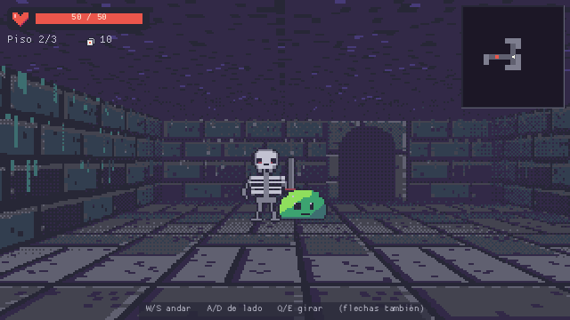
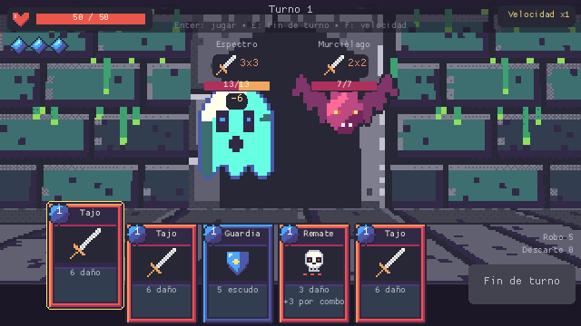

# Plantilla «crawler»: Cripta de Naipes

*Cripta de Naipes* (`examples/crawler`, plantilla `crawler`) es un juego pequeño pero completo:
una mazmorra en primera persona por casillas, tres pisos generados con una semilla y combate de
cartas por turnos contra enemigos que se ven en la misma vista 3D. Usa casi todas las piezas
nuevas del motor y sirve de punto de partida para tu propio *dungeon crawler* o *deckbuilder*.

```sh
modengine new --template crawler mi_crawler       # o en el editor: Nuevo proyecto → Crawler de cartas
modengine run mi_crawler
```




## Cómo se juega

- **Título**: Nueva partida, Continuar (si hay una partida guardada), Idioma (es / en) y Salir.
  Flechas para elegir, Enter para aceptar (o el ratón).
- **Explorar**: W/S (o ↑/↓) avanzar y retroceder, A/D paso lateral, Q/E (o ←/→) girar 90°.
  Chocar con una pared hace un pequeño «rebote». Esc vuelve al título.
- **Casillas con eventos**: enemigos (se ven al fondo de los pasillos; caminar hacia ellos
  empieza el combate), cofres (elige 1 de 3 cartas para el mazo), fuente (cura una vez) y
  escaleras (bajan al piso siguiente y guardan la partida). En el piso 3, el **Rey Osario**
  espera en la sala de salida: vencerle gana la partida.
- **Combate**: ←/→ eligen carta (o el ratón), Enter la juega, E termina el turno, F cambia la
  velocidad de las animaciones (x1, x2, x4, instantánea) y Tab salta las pendientes. Cada turno:
  3 de maná y 5 cartas. Cada carta jugada en el turno sube el **combo**, que suma +1 al daño de
  los golpes siguientes (Remate suma +3 por punto). Encima de cada enemigo está su **intención**
  (atacar N, escudo N, fuerza +N) y, con una carta de ataque enfocada, la **proyección** del daño
  (y «muere» si lo mataría).
- Al morir o al ganar sale el **resumen** de la partida.

## Cómo está organizado

| Fichero | Qué hay |
|---|---|
| `game.toml` | 640×360 a escala 2, rooms `title` y `crypt`, idiomas (`es` base, `en` reserva), paleta Pear36 |
| `scripts/run.ms` | **La partida** (modelo puro): `new_run`, `save_run`/`load_run`, `generate_floor`, `chest_offer`, los flujos aleatorios y la lista de saltos de depuración |
| `scripts/combat.ms` | **El combate** (modelo): `start_combat`, `start_turn`, `play_card`, `end_turn`, los manejadores de efectos (`global.apply`), la proyección (`global.preview`) y el texto de las cartas (`global.describe`) |
| `scripts/actions.ms` | **La presentación** del combate: una función por acción de la cola (`anim_draw`, `anim_hit`, `anim_enemy_attack`…), con destellos, números flotantes, *hit-stop*, temblor y tweens |
| `objects/explorer.ms` | `Explorer`: vista en primera persona, movimiento por casillas con cámara animada, eventos de las casillas, billboards (también los enemigos en combate), minimapa y HUD |
| `objects/combat_ui.ms` | `CombatUI` (entrada y HUD del combate) y `CardView` (una carta en pantalla: mano o cofre) |
| `objects/screens.ms` | `Title`, `ChestUI` y `Summary` |
| `data/cards.toml`, `enemies.toml`, `floors.toml` (+ `.schema.toml`) | Todo el contenido: 13 cartas, 7 enemigos + jefe y los 3 pisos |
| `dungeons/piso1..3.toml` | Configuración del generador de cada piso (plantillas ASCII de sala y reglas de eventos) |
| `lang/es.toml`, `lang/en.toml` | Todos los textos (`loc()`) |
| `sprites/` | Pixel art en texto (paleta Pear36): paredes, suelo, techo, arco de puerta, enemigos, cofre, fuente, cartas, iconos |
| `sounds/` | Efectos sintetizados (`[synth]`) y dos capas de música de 4 s (`mus_calm`, `mus_fight`) |
| `fonts/` | La fuente integrada a 13, 16 y 26 px, con Latin-1 (acentos y ñ) |

### Lógica y presentación

Como recomiendan [primera-persona.md](primera-persona.md) y [datos-y-cartas.md](datos-y-cartas.md):

- **Exploración**: la casilla y la dirección (`Explorer.px`, `py`, `dir`) cambian al instante; la
  cámara (`cx`, `cy`, `ca`) las sigue con una curva suave. Las teclas pulsadas durante un paso se
  guardan y se ejecutan al terminar.
- **Combate**: `play_card` y `end_turn` resuelven todo en el momento (vida, escudo, muertes,
  robos) y encolan acciones en `global.q`. La vista solo enseña lo que esas acciones revelan
  (`shown_hp` de cada enemigo, `global.pv` del jugador, las `CardView` de la mano). Por eso la
  velocidad no cambia el resultado y la lógica se prueba sin ventana.
- Los enemigos del combate son **billboards** en la misma vista: la cámara retrocede, baja un
  poco y la imagen 3D sube para dejar sitio a la mesa de cartas (`cam_back`, `view_y`). Sus
  destellos son tintes del billboard (`color`), el «salto» al atacar es `lunge`.

### Máquina de estados

`global.run.state` es un texto (se guarda y se depura fácil):

```text
explore ──(caminar hacia un enemigo)──> combat ──(victoria)──> explore
   │                                       └──(derrota)──> lost
   ├──(cofre)──> chest ──> explore
   └──(escaleras)──> descend ──> explore (piso siguiente, partida guardada)
combat contra el jefe ──(victoria)──> won
```

Dentro del combate, `global.cb.state`: `player` → `enemy` → `player` … → `won` | `lost`.

### Flujos aleatorios y guardado

Tres generadores separados (`rng_create`): `global.rng_gen` (mazmorras), `global.rng_cb`
(barajar e intenciones) y `global.rng_loot` (cofres). Lo que pase en un combate nunca cambia el
mapa. `save_run()` se llama al empezar cada piso y guarda el mazo, la vida, el piso, las
estadísticas y el estado de los tres generadores (el de la mazmorra, **antes** de generar el
piso): «Continuar» reconstruye exactamente el mismo piso.

## Añadir contenido

- **Una carta**: un registro en `data/cards.toml` con `name = "card.<id>"`, coste, tipo
  (`attack`, `skill`, `power`: el color del marco), `art` (fotograma de `card_art`) y sus
  `effects`; y el texto `card.<id>` en `lang/es.toml` y `lang/en.toml`. La descripción de la carta
  sale sola de los efectos. Los efectos disponibles están en `data/cards.schema.toml`; uno nuevo
  es un tipo más en el esquema y un manejador en `global.apply` (y en `global.preview` /
  `global.describe` si hace daño o necesita texto).
- **Un enemigo**: un registro en `data/enemies.toml` (sprite, vida, escala del billboard, `top` =
  dónde está su cabeza para poner la intención encima, `float` para los voladores, `pattern` para
  intenciones en orden) y su nombre en `lang/`. Para que salga, añádelo a un grupo de
  `data/floors.toml`.
- **Un piso o un bioma**: un registro en `data/floors.toml` (fichero de mazmorra, textura de
  pared con 3 fotogramas —lisa, antorcha, nicho—, color de niebla, grupos de enemigos y, si
  quieres, un jefe) y súbelo en `global.MAX_FLOOR` (`scripts/run.ms`).
- **Salas**: plantillas ASCII en `dungeons/piso*.toml` (`E` enemigo, `C` cofre, `F` fuente, `B`
  jefe, `X` salida, `D` puertas). Mira el resultado sin abrir el juego:

  ```sh
  modengine dungeon examples/crawler dungeons/piso1.toml --seed 1,2,3 --png /tmp/piso1.png
  ```

- **Arte**: los sprites son texto; tras editarlos, `modengine pixel-check examples/crawler --all
  --preview auto` (ver [pixel-art.md](pixel-art.md)).

## Probarlo desde la terminal

Los **saltos de depuración** (la lección de los estudios de *crawlers*: poder ir directo a
cualquier estado) se piden con `global.debug` y `--exec-at`; `Explorer` los atiende en su
siguiente paso:

| `global.debug = ...` | Qué hace |
|---|---|
| `"combat"`, `"combat:N"` | combate con el grupo 0 (o N) del piso actual, delante de ti |
| `"boss"` | va al piso 3 y empieza el combate contra el jefe |
| `"floor:N"` | genera el piso N y te pone en su inicio |
| `"look:T"` | te coloca mirando al primer evento de tipo T (`enemy`, `chest`, `fountain`, `stairs`, `boss`) |
| `"chest"`, `"fountain"`, `"descend"` | abre un cofre, bebe de una fuente, baja las escaleras |
| `"win_combat"` | mata a todos los enemigos del combate actual |
| `"won"`, `"lost"` | las pantallas de final |

```sh
# un combate, jugar con Enter la carta con foco y comprobar que el enemigo pierde vida
modengine check examples/crawler --room crypt --seed 3 --no-save --steps 240 \
    --exec-at '20:global.debug = "combat:0"' --exec-at '21:global.hp0 = global.cb.enemies[0].hp' \
    --input '110:enter' --assert '200:global.cb.enemies[0].hp < global.hp0'

# capturas de la exploración, de un cofre y del jefe (sin ventana en el escritorio)
modengine run examples/crawler --room crypt --seed 1 --no-save \
    --exec-at '30:global.debug = "look:enemy"' --exec-at '130:global.debug = "chest"' \
    --screenshot-at 40,170 --screenshot /tmp/crawler_%04d.png
```

`--room crypt` empieza una partida nueva con una semilla sacada de `--seed`; `--no-save` no toca
`saves/`. Los tests de `crates/modengine-cli/tests/crawler_example.rs` hacen lo mismo (combate
con teclado, ganar un combate solo con teclas, bajar escaleras y guardar, y la plantilla nueva
pasando `modengine check`).
