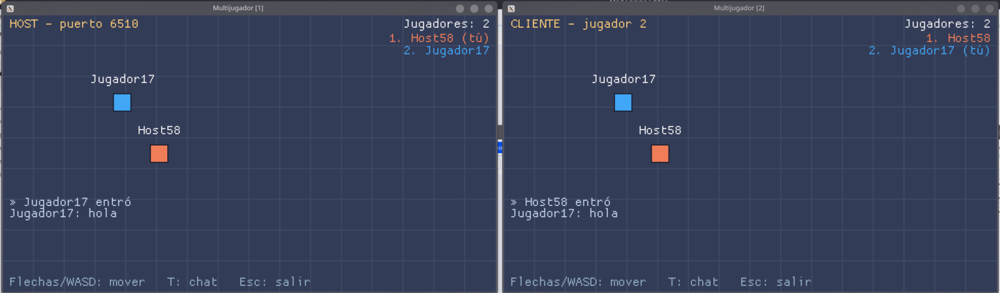

# Red y multijugador

Mod Engine puede conectar varias copias de un juego por la red (LAN o Internet) con el mismo
modelo que GameMaker: **sockets** que creas tú, un evento **`network`** que se ejecuta cada vez
que pasa algo y la información de lo ocurrido en **`async_load`**.

Hay dos formas de usarlo:

- **La capa sencilla `net_*`**: una partida con un *host* y jugadores, cada uno con un número, y
  mensajes con nombre que llevan cualquier valor (números, textos, arrays, structs). No hay que
  tocar bytes. Es la recomendada para empezar.
- **La API estilo GameMaker** (`network_*` + `buffer_*`): sockets TCP y UDP y buffers binarios,
  con los mismos nombres que en GameMaker. Para quien la conoce o necesita controlar cada byte
  (hablar con un servidor que no es Mod Engine, UDP, protocolos propios).



El ejemplo completo está en [`examples/multijugador`](../examples/multijugador): sala de espera
con nombre e IP, de 2 a 4 jugadores moviendo un cuadrado por la misma room, lista de jugadores,
chat (T) y movimiento suavizado de los demás.

## Conceptos

- **Host** (anfitrión): la copia del juego que abre un puerto y espera. Su número de jugador es
  siempre **1**. Puede jugar a la vez (como en el ejemplo) o ser un **servidor dedicado** sin
  ventana (`modengine server`, ver abajo).
- **Cliente**: se conecta a la IP y el puerto del host. Recibe un número (2, 3, …) al entrar.
- Todo pasa **por el host**: un cliente que envía «a todos» manda el mensaje al host y este lo
  reenvía. Los clientes no se conectan entre sí.
- **Puerto**: un número (1024–65535) que eliges para tu juego, por ejemplo 6510. El host lo abre;
  los clientes lo usan para conectar.
- Todo es **asíncrono**: `net_join()` o `network_connect()` vuelven al momento y el resultado
  (conectado, falló, llegó un mensaje…) llega después, en el evento `network`.
- La red se revisa **una vez por paso**, al principio (antes de `step_begin`). Ningún evento se
  queda esperando a la red: el juego nunca se congela por ella.

## El evento `network`

```
object Red {
    on network {
        // async_load describe lo que acaba de pasar
        if async_load.kind == "message" print(async_load.peer, async_load.tipo, async_load.data)
    }
}
```

Se ejecuta en **todas las instancias que lo tienen**, una vez por cada cosa que pasó en la red.
En el editor: **+ Evento → Red (network)**. Fuera de ese evento `async_load` vale `null`.

`async_load` es un struct que **siempre tiene todos los campos** (los que no aplican valen `-1`,
`0`, `""` o `null`), así que leer cualquiera nunca da error:

| Campo | Capa sencilla (`net_*`) | API GameMaker (`network_*`) |
|---|---|---|
| `kind` | `"connect"`, `"disconnect"`, `"message"` o `"failed"` | `"socket"` |
| `type` | `network_type_connect` / `_disconnect` / `_data` / `_non_blocking_connect` (para `failed`) | el tipo de evento |
| `peer` | número del jugador que entra, sale o envía | `0` |
| `peer_name` | su nombre | `""` |
| `tipo` | nombre del mensaje (`"pos"`, `"chat"`…) | `""` |
| `data` | el valor enviado (struct, array, número, texto…) | `null` |
| `reason` | por qué falló (`"failed"`) | `""` |
| `id` | `-1` | socket que generó el evento (en `connect`/`disconnect` de un servidor: el socket servidor) |
| `socket` | `-1` | el socket del cliente que entra o sale |
| `ip`, `port` | `""`, `0` | dirección del otro lado |
| `buffer`, `size` | `-1`, `0` | datos recibidos (`network_type_data`) y su tamaño en bytes |
| `succeeded` | `false` solo en `failed` | resultado de `network_connect` |

## La capa sencilla: `net_*`

```
// host
if net_host(6510, 4, "Ana") goto_room(arena)     // puerto, jugadores máximo, nombre

// cliente
net_join("192.168.1.20", 6510, "Bea")            // vuelve al momento; espera "connect" o "failed"

// enviar (cualquiera): a todos o a un jugador
net_send(all, "pos", { x: x, y: y })
net_send(1, "pregunta", "¿empezamos?")

// recibir
on network {
    var k = async_load.kind
    if k == "connect" print(async_load.peer_name + " entró")
    else if k == "disconnect" print(async_load.peer_name + " salió")
    else if k == "message" and async_load.tipo == "pos" {
        // async_load.peer envió async_load.data
    } else if k == "failed" print("no se pudo unir: " + async_load.reason)
}
```

| Función | |
|---|---|
| `net_host(puerto, [max_jugadores=4], [nombre="Host"])` | abre la partida; devuelve el puerto abierto (con `0` el sistema elige uno libre) o `false` si no se pudo (puerto ocupado…) |
| `net_join(host, puerto, [nombre="Jugador"])` | empieza a unirse (`host` = IP o nombre de equipo); devuelve `false` si ni siquiera pudo empezar |
| `net_send(a, tipo, [dato])` | `a` = número de jugador, o `all` (o `-1`) para todos los demás. `false` si no estás en una partida |
| `net_peers()` | array con los números de todos los jugadores, **incluido tú** |
| `net_peer_name(n)` | nombre del jugador `n` |
| `net_my_id()` | tu número (`1` si eres el host, `0` si no estás en una partida) |
| `net_is_host()`, `net_is_online()` | |
| `net_status()` | `"off"`, `"connecting"` u `"online"` |
| `net_port()` | puerto del host (`-1` si no eres host) |
| `net_disconnect()` | sales de la partida (si eres el host, se cierra para todos). No genera eventos en tu propia copia |

Qué eventos llegan:

- **Al unirte**: un `connect` por cada jugador que ya estaba (el host primero). Desde ese
  momento `net_my_id()` tiene tu número.
- **Cuando entra alguien**: `connect` en todos los demás.
- **Cuando alguien se va** (o se corta su conexión): `disconnect` en todos los demás.
- **Si el host se va**: los clientes reciben `disconnect` de cada jugador y, al final, del 1
  (el host). La partida terminó: `net_status()` vuelve a `"off"`.
- **Si no se pudo entrar**: `failed` con `reason` (no hay nadie en esa IP/puerto, la partida está
  llena, es otro juego o otra versión del protocolo).
- Quien envía **no** recibe su propio mensaje.

Detalles:

- El host solo acepta jugadores **del mismo juego** (mismo `[game] name` en `game.toml`).
- `net_send` acepta lo que acepta `to_json`: números, textos, booleanos, `null`, arrays y structs
  (anidados hasta 64 niveles). Instancias, assets o funciones dan error. Los structs llegan con
  sus campos en orden alfabético.
- El remitente que ve el receptor (`async_load.peer`) lo pone el host: un cliente no puede
  hacerse pasar por otro.

### Formato en el cable (por si quieres hablar con otro programa)

TCP. Cada paquete es un entero de 4 bytes *little-endian* con la longitud, seguido de esa cantidad
de bytes de **JSON** (máximo 1 MB). Mensajes:

```text
cliente → host   {"op":"hello","name":"Bea","game":"<[game] name>","v":1}
host → cliente   {"op":"welcome","id":2,"peers":[{"id":1,"name":"Ana"}]}  o  {"op":"reject","reason":"…"}
host → todos     {"op":"join","id":3,"name":"Cris"}   {"op":"leave","id":3}
cualquiera       {"op":"msg","from":2,"to":-1,"k":"pos","d":{"x":5,"y":6}}   (to = -1: todos)
```

JSON es sencillo y fácil de depurar; para juegos que envían mucho (decenas de objetos 60 veces
por segundo) la API de buffers produce paquetes más pequeños.

## La API estilo GameMaker: `network_*`

Mismos nombres y constantes que GameMaker:

```
// servidor
global.server = network_create_server(network_socket_tcp, 6510, 8)
if global.server < 0 show_debug_message("no se pudo abrir el puerto")

// cliente
global.sock = network_create_socket(network_socket_tcp)
network_connect(global.sock, "127.0.0.1", 6510)   // asíncrono: llega network_type_non_blocking_connect

// enviar
var b = buffer_create(64, buffer_grow, 1)
buffer_write(b, buffer_u8, 1)           // tipo de mensaje
buffer_write(b, buffer_s16, x)
buffer_write(b, buffer_string, "hola")
network_send_packet(global.sock, b, buffer_tell(b))
buffer_delete(b)

// recibir
on network {
    var t = async_load.type
    if t == network_type_connect {            // (servidor) entra un cliente
        push(global.clientes, async_load.socket)
    } else if t == network_type_disconnect {  // sale (o en un cliente: se cayó el servidor)
        remove(global.clientes, index_of(global.clientes, async_load.socket))
    } else if t == network_type_non_blocking_connect {
        if not async_load.succeeded show_debug_message("no se pudo conectar")
    } else if t == network_type_data {
        var b = async_load.buffer
        var kind = buffer_read(b, buffer_u8)
        var px = buffer_read(b, buffer_s16)
        var msg = buffer_read(b, buffer_string)
    }
}
```

| Función | |
|---|---|
| `network_create_server(tipo, puerto, max_clientes)` | servidor TCP (con paquetes, ver abajo) o socket UDP en ese puerto. Devuelve el socket o `-1` |
| `network_create_server_raw(...)` | igual, pero TCP sin formato de paquetes: llegan los bytes tal cual |
| `network_create_socket(tipo)` | socket cliente TCP, o socket UDP en un puerto libre |
| `network_create_socket_ext(tipo, puerto)` | socket UDP en un puerto concreto |
| `network_connect(socket, host, puerto)` | conecta (con paquetes). **Siempre asíncrono**: devuelve `0` y el resultado llega como `network_type_non_blocking_connect` (`async_load.succeeded`). `-1` si no pudo ni empezar. También `network_connect_async` |
| `network_connect_raw(...)` | igual, sin formato de paquetes (para hablar con servidores que no son Mod Engine). También `network_connect_raw_async` |
| `network_send_packet(socket, buffer, tamaño)` | envía los primeros `tamaño` bytes del buffer. Devuelve los bytes enviados o `-1`. Se puede llamar mientras conecta: se envía al conectar |
| `network_send_raw(socket, buffer, tamaño)` | envía sin la cabecera de longitud, aunque el socket use paquetes |
| `network_send_udp(socket, host, puerto, buffer, tamaño)` | un datagrama UDP (máx. 65 507 bytes). También `network_send_udp_raw` |
| `network_send_broadcast(socket, puerto, buffer, tamaño)` | datagrama UDP a toda la red local (para anunciar partidas en LAN) |
| `network_destroy(socket)` | cierra el socket; un servidor cierra también los de sus clientes |
| `network_set_timeout(socket, lectura_ms, escritura_ms)` | desconecta si no llega nada en `lectura_ms`, o si no se puede enviar en `escritura_ms` (`0` = nunca) |
| `network_set_config(config, valor)` | `network_config_connect_timeout` (ms, por defecto 5000). Las demás (`use_non_blocking_socket`, `avoid_time_wait`, `enable_reliable_udp`…) se aceptan y no hacen nada; devuelve `-1` con las desconocidas |
| `network_resolve(nombre)` | IP de un nombre de equipo (`""` si no existe) |
| `network_get_port(socket)` | puerto local (útil al crear con puerto `0`) — no existe en GameMaker |
| `network_get_status(socket)` | `"server"`, `"udp"`, `"connecting"`, `"connected"`, `"closed"` o `"none"` — no existe en GameMaker |
| `network_exists(socket)` | |

Constantes: `network_socket_tcp`, `network_socket_udp` (`network_socket_ws` existe pero aún no
está soportado), `network_type_connect`, `network_type_disconnect`, `network_type_data`,
`network_type_non_blocking_connect`, `network_config_*`.

**Paquetes**: los sockets normales (sin `_raw`) envían cada `network_send_packet` como un paquete
(4 bytes de longitud *little-endian* + datos) y quien recibe obtiene **exactamente** ese paquete
en un evento, aunque TCP lo haya partido o juntado con otros. Con `_raw` cada evento trae los
bytes que hayan llegado (pueden ser medio mensaje o varios juntos). UDP siempre es un datagrama
por evento (puede perderse o llegar desordenado: es UDP).

Los sockets son **globales**: no se cierran al destruir la instancia que los creó ni al cambiar
de room; solo con `network_destroy`, `net_disconnect` o al cerrar o reiniciar el juego.

## Buffers

Bloques de bytes con una posición de lectura/escritura, como en GameMaker. El buffer que trae
`async_load.buffer` **solo existe durante el evento**: si quieres guardarlo, cópialo con
`buffer_copy`.

```
var b = buffer_create(16, buffer_grow, 1)
buffer_write(b, buffer_f32, 3.5)
buffer_write(b, buffer_string, "hola")
buffer_seek(b, buffer_seek_start, 0)
var f = buffer_read(b, buffer_f32)       // 3.5
var s = buffer_read(b, buffer_string)    // "hola"
buffer_delete(b)
```

| Función | |
|---|---|
| `buffer_create(tamaño, tipo, alineación)` | tipos: `buffer_fixed` (tamaño fijo; escribir de más es un error), `buffer_grow` (crece), `buffer_wrap` (al pasar del final vuelve al principio), `buffer_fast` (como fixed) |
| `buffer_write(b, tipo, valor)`, `buffer_read(b, tipo)` | en la posición actual, que avanza |
| `buffer_peek(b, posición, tipo)`, `buffer_poke(b, posición, tipo, valor)` | sin mover la posición |
| `buffer_seek(b, base, desplazamiento)` | base: `buffer_seek_start`, `buffer_seek_relative`, `buffer_seek_end` |
| `buffer_tell(b)`, `buffer_get_size(b)`, `buffer_get_used_size(b)` | posición, tamaño, hasta dónde se ha escrito |
| `buffer_get_type(b)`, `buffer_get_alignment(b)`, `buffer_sizeof(tipo)` | |
| `buffer_resize(b, tamaño)`, `buffer_fill(b, posición, tipo, valor, tamaño)` | |
| `buffer_copy(origen, pos, tamaño, destino, pos_destino)` | |
| `buffer_base64_encode(b, [pos], [tamaño])`, `buffer_base64_decode(texto)` | a/desde texto (el decode crea un buffer nuevo) |
| `buffer_save(b, fichero)`, `buffer_save_ext(b, fichero, pos, tamaño)`, `buffer_load(fichero)` | en la carpeta de guardado (`saves/`), solo nombres simples; `buffer_load` devuelve `-1` si no existe |
| `buffer_exists(b)`, `buffer_delete(b)` | |

Tipos de dato: `buffer_u8`, `buffer_s8`, `buffer_u16`, `buffer_s16`, `buffer_u32`, `buffer_s32`,
`buffer_u64`, `buffer_f16`, `buffer_f32`, `buffer_f64`, `buffer_bool` (1 byte),
`buffer_string` (UTF-8 terminado en byte 0) y `buffer_text` (UTF-8 sin terminador: al leer, hasta
el final de lo escrito). Todo en *little-endian*, como GameMaker. Los enteros se recortan como en
C (`buffer_u8` con 300 guarda 44).

**Alineación**: antes de cada valor la posición se rellena hasta un múltiplo de la alineación
(con `1` no hay relleno). Con alineación 4, escribir dos `buffer_u8` los deja en las posiciones 0
y 4.

Leer más allá del final (o un `buffer_string` sin su byte 0) es un error de script normal: se
muestra en la Salida y el evento se corta, pero el juego sigue. Los datos que llegan de la red
nunca pueden colgar ni cerrar el juego.

## Texto escrito por el jugador

Para nombres, IPs o chat: `keyboard_string()` devuelve lo que el jugador ha tecleado (como
`keyboard_string` de GameMaker; la tecla de borrar quita el último carácter; máximo 1024) y
`keyboard_string_set(texto)` lo cambia (normalmente a `""` al empezar a escribir).

## Probar en un solo ordenador

- En el editor: **Juego → ▶▶ Ejecutar 2 instancias**. Abre dos copias del juego, una al lado de
  la otra, con `[1]` y `[2]` en el título; su salida aparece en la Salida con `[1]`/`[2]` delante.
  En una pulsa lo que haga de host y en la otra únete a `127.0.0.1`.
- Desde la terminal: `modengine run mi_juego --instance 1` y `modengine run mi_juego --instance 2`.
- Sin ventanas, con teclas simuladas (para tests): `--input "10:h"` pulsa H en el paso 10 y
  `--input "40:text=Ana"` escribe «Ana». Por ejemplo, un host y un cliente del ejemplo:

```bash
modengine server examples/multijugador --input "10:h,120-180:right" --watch Remote --steps 600 &
modengine server examples/multijugador --input "20:j,150-200:left" --watch Remote --steps 500
```

`--watch Remote` imprime cada medio segundo dónde están las instancias de `Remote` (los demás
jugadores): cada copia ve moverse a la otra.

## Servidor dedicado (sin ventana)

```bash
modengine server mi_juego [--room R] [--exec CODIGO] [--input SPEC] [--steps N] [--watch Objeto]
modengine run mi_juego --headless                 # lo mismo
./MiJuego --headless                              # un juego exportado (Linux/Windows)
```

Ejecuta la lógica del juego **en tiempo real** (a los pasos por segundo de la room) sin abrir
ventana, sin dibujar y sin sonido: solo corren los eventos que no son de dibujo. Sirve para dejar
un host encendido en un servidor o una Raspberry. El juego decide qué hacer al arrancar así; por
ejemplo con `--exec "net_host(6510, 16, \"Servidor\")"`. `print` / `show_debug_message` y los
mensajes `[red] …` van a la consola (en un `.exe` de Windows solo se ven si se exportó con
`windows_console = true`). Se detiene con Ctrl+C o cuando el juego llama a `quit()`.

## Jugar por Internet: cortafuegos, NAT y puertos

- **Red local (misma wifi)**: el host dice su IP local (en Windows `ipconfig`, en Linux
  `ip addr`, en Android *Ajustes → Wi-Fi → la red*; suele ser `192.168.x.x`) y los demás se unen
  a ella.
- **Cortafuegos**: la primera vez que un juego abre un puerto, **Windows pregunta** si permitirlo
  («Firewall de Windows Defender bloqueó algunas características»): hay que aceptar, al menos en
  redes privadas. En Linux con `ufw`/`firewalld` hay que abrir el puerto (`sudo ufw allow 6510/tcp`).
- **Por Internet** el host necesita **abrir (redirigir) el puerto en su router** hacia su
  ordenador (*port forwarding*), y los demás se conectan a su IP pública. Mod Engine **no hace
  NAT punch-through** ni usa servidores intermedios (relay): si no puedes abrir puertos, usa una
  VPN de juego tipo LAN virtual (Tailscale, ZeroTier, Radmin VPN…) o un servidor dedicado con IP
  pública.
- IPv4 e IPv6: el host escucha en las dos; `net_join` acepta IPs de ambas y nombres de equipo.
- **Android**: el APK pide el permiso `INTERNET` (y `ACCESS_NETWORK_STATE`) automáticamente si
  algún script usa la red (`net_host`, `net_join`, `network_create_*`, `network_connect`…); se
  puede forzar con `[android] internet = true/false` en `game.toml`. Es un permiso normal: no se
  pregunta al jugador. Un móvil puede ser host en la wifi de casa; por datos móviles casi nunca
  (el operador no deja abrir puertos).

## Límites y seguridad

- Paquetes de hasta **1 MB** (TCP) y 65 507 bytes (UDP). Un paquete que anuncia más corta esa
  conexión (con un aviso `[red]` en la Salida); nunca se reserva memoria por lo que diga el otro.
- Hasta 16 MB pendientes de enviar por socket; más hace que `network_send_*` devuelva `-1`.
- Un servidor con `max_clientes` lleno cierra las conexiones nuevas; la capa `net_*` contesta
  «la partida está llena».
- Datos mal formados: con `net_*` se ignoran (con aviso `[red]`); con buffers, leer de más es un
  error de script normal. Ningún dato de la red puede cerrar el juego.
- Los errores de red (puerto ocupado, no se pudo conectar, conexión cortada…) aparecen en la
  Salida/consola como `[red] …`; no son errores de script, así que `modengine check` no falla
  por ellos.

## Lo que no hace (todavía)

- Sin NAT punch-through, relay ni búsqueda de partidas por Internet (en LAN puedes anunciarlas
  tú con `network_send_broadcast`).
- Sin predicción, rollback ni sincronización automática de instancias: tú decides qué enviar y
  cómo suavizarlo (el ejemplo interpola posiciones).
- Sin cifrado (TLS) ni WebSockets (`network_socket_ws`).
- La capa `net_*` usa TCP: fiable y en orden, pero un paquete perdido retrasa a los siguientes.
  Para datos muy frecuentes donde perder alguno no importa, usa UDP con `network_*`.
